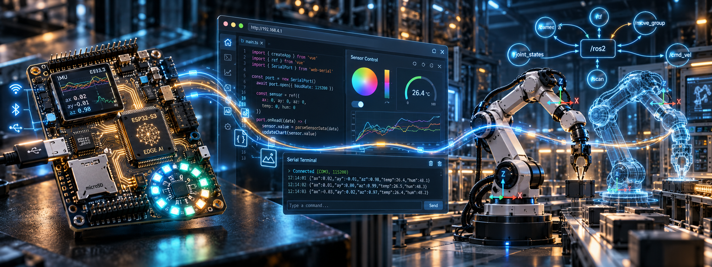

# KMUTT ND69

> [!IMPORTANT]
> ### 📢 Self-Learning & Mini-Project #1 (Week 06)
> สัปดาห์แห่งการเรียนรู้ด้วยตนเองและจัดทำมินิโปรเจกต์สรุปเนื้อหาตลอด 5 สัปดาห์ พร้อมฝึกปฏิบัติการใช้งาน Git & GitHub
> - 🟢 **ND01 (Embedded & Hardware):** [รายละเอียด Week 06](nd1/docs/week06/README.md) · [📝 ส่งงาน ND01 (Google Form)](https://forms.gle/hGqHgoEBDFinh2BfA)
> - 🔵 **ND02 (Application Developers):** [รายละเอียด Week 06](nd2/docs/week06/README.md) · [📝 ส่งงาน ND02 (Google Form)](https://forms.gle/in4mUsBT5MvBwmXt6)
> - 🟣 **ND03 (Automation & Robotics):** [รายละเอียด Week 06](nd3/docs/week06/README.md) · [📝 ส่งงาน ND03 (Google Form)](https://forms.gle/pDp1SkyJ14mVRvfK7)
>
> 📖 คู่มือศึกษาประกอบ: [GitHub Hands-On: A Practical Guide for Beginners](https://github.com/drsanti/github-hands-on)

---

> เอกสารประกอบการเรียนการสอน — จากฮาร์ดแวร์จริง สู่ซอฟต์แวร์ที่เข้าใจโลกกายภาพ

หลักสูตรนี้มุ่งเน้นให้ผู้เรียนในหลากหลายสาขาวิชาชีพ **สามารถเข้าถึงและควบคุมฮาร์ดแวร์ได้จริง** —
เนื่องจากในยุคที่ปัญญาประดิษฐ์ (AI) สามารถพัฒนาโค้ดได้แล้ว ความแตกต่างที่แท้จริงจึงอยู่ที่ความเข้าใจ
พารามิเตอร์ในโลกกายภาพ และการสร้างการตอบสนองเชิงปฏิบัติการ (Action) ต่อวัตถุจริง มิใช่เพียงแค่การประมวลผลข้อมูล

---

## Table of contents

- [Learning tracks](#learning-tracks)
- [Class schedule](#class-schedule)
- [Mini-Project #1 (Week 06)](#mini-project-1-week-06)
- [ND01 — Embedded & Hardware](#nd01--embedded--hardware)
- [ND02 — Application Developers](#nd02--application-developers)
- [ND03 — Automation & Robotics](#nd03--automation--robotics)

Each folder has a `README.md` with its own table of contents. This page links those indexes and every lesson.

---

## Learning tracks

| Track | Audience | Focus | Index |
|---|---|---|---|
| ND01 | Electronics / embedded systems | ESP32-S3 board, firmware, FreeRTOS | [nd1/README.md](nd1/README.md) |
| ND02 | Application / full-stack developers | Web Serial, Web Bluetooth, TypeScript apps | [nd2/README.md](nd2/README.md) |
| ND03 | Automation / PLC / machinery engineers | ROS-style middleware, digital twin | [nd3/README.md](nd3/README.md) |

- [Cover image](images/README.md)

---

## Class schedule

Session-by-session schedules (dates, format, times, topics and net hours) for each track. All schedules: [Schedule/README.md](Schedule/README.md)

| Track | Course | Schedule |
|---|---|---|
| ND01 | Secure Edge AI and IoT Device Developer | [Schedule/ND1.md](Schedule/ND1.md) |
| ND02 | Web and Mobile Application Developer for IoT and Edge Devices | [Schedule/ND2.md](Schedule/ND2.md) |
| ND03 | Smart Industrial Solutions Developer with Digital Twins and AI | [Schedule/ND3.md](Schedule/ND3.md) |

Each course totals **29.5 h**: Online 21 h + Onsite 8.5 h.

---

## Mini-Project #1 (Week 06)

สัปดาห์แห่งการเรียนรู้ด้วยตนเองและจัดทำมินิโปรเจกต์ชิ้นที่ 1 (Self-learning & Mini-Project #1) — ทบทวนและสรุปองค์ความรู้ตลอด 5 สัปดาห์ที่ผ่านมา พร้อมฝึกปฏิบัติการใช้งาน Git & GitHub ([คู่มือ GitHub Hands-On](https://github.com/drsanti/github-hands-on))

| Track | รายละเอียดและข้อกำหนด | แบบฟอร์มส่งงาน (Google Form) |
|---|---|---|
| **ND01** (Embedded & Hardware) | [nd1/docs/week06/README.md](nd1/docs/week06/README.md) | [แบบฟอร์มส่งงาน ND01](https://forms.gle/hGqHgoEBDFinh2BfA) |
| **ND02** (Application Developers) | [nd2/docs/week06/README.md](nd2/docs/week06/README.md) | [แบบฟอร์มส่งงาน ND02](https://forms.gle/in4mUsBT5MvBwmXt6) |
| **ND03** (Automation & Robotics) | [nd3/docs/week06/README.md](nd3/docs/week06/README.md) | [แบบฟอร์มส่งงาน ND03](https://forms.gle/pDp1SkyJ14mVRvfK7) |

---

## ND01 — Embedded & Hardware

> เสริมสร้างความเข้าใจโครงสร้างฮาร์ดแวร์ของบอร์ด ES3C28P (ESP32-S3R8) ตั้งแต่ระดับชิปเซ็ตไปจนถึงระดับเฟิร์มแวร์

- [Track](nd1/README.md)
- [Documents](nd1/docs/README.md)
- [Week 01 — Introduction](nd1/docs/week01/README.md)
- [Week 02 — ES3C28P Hardware](nd1/docs/week02/README.md)
- [Week 03 — ESP-IDF Setup and ESP32-S3 Hello World](nd1/docs/week03/README.md)
- [Week 06 — Self-learning and Mini-Project #1](nd1/docs/week06/README.md)
- [Thai lessons](nd1/docs/week02/lessons/README.md)
- [Thai illustrations](nd1/docs/week02/lessons/images/README.md)
- [English edition](nd1/docs/week02/lessons/EN/README.md)
- [English illustrations](nd1/docs/week02/lessons/EN/images/README.md)
- [Presentation](nd1/docs/week02/lessons/EN/web/README.md)

### Thai

- [สถาปัตยกรรมชิป ESP32-S3 บนบอร์ด ES3C28P](nd1/docs/week02/lessons/01-esp32s3r8-the-chip.md)
- [วิวัฒนาการของ ESP32 — จาก ESP8266 สู่ ESP32-S3](nd1/docs/week02/lessons/02-esp32-history.md)
- [โครงสร้างหน่วยความจำประเภทต่าง ๆ บน ESP32-S3 — RAM, SRAM, PSRAM, Flash, ROM และ eFuse](nd1/docs/week02/lessons/03-memory-types.md)
- [การจัดการหน่วยความจำในมุมมองของเฟิร์มแวร์ — Heap, Stack, Partition และ NVS](nd1/docs/week02/lessons/04-memory-firmware-view.md)
- [ESP-IDF — ชุดเครื่องมือพัฒนา (Toolchain) มาตรฐานของ ESP32](nd1/docs/week02/lessons/05-esp-idf-toolchain.md)
- [การสื่อสารผ่าน USB/Serial บนบอร์ด — สถาปัตยกรรมที่ปราศจากชิปแปลง USB-UART และข้อควรระวัง](nd1/docs/week02/lessons/06-usb-serial-caveat.md)
- [ระบบบริหารจัดการพลังงานและแบตเตอรี่ — วงจรชาร์จ TP4054, วงจรควบคุมแรงดัน LDO และการวัดระดับแรงดันผ่าน ADC](nd1/docs/week02/lessons/07-power-battery.md)
- [การควบคุมจอแสดงผล ILI9341V — หน้าจอ SPI ขนาด 240×320 บนบอร์ด ES3C28P](nd1/docs/week02/lessons/08-ili9341-display.md)
- [จอสัมผัสแบบเก็บประจุ FT6336G — การควบคุม Capacitive Touch ผ่านการสื่อสาร I2C](nd1/docs/week02/lessons/09-ft6336-touch.md)
- [ระบบประมวลผลเสียง — วงจรถอดและเข้ารหัสสัญญาณเสียง ES8311, วงจรขยายเสียง FM8002E และไมโครโฟน MEMS](nd1/docs/week02/lessons/10-audio-chain.md)
- [การควบคุมหลอดไฟ RGB LED WS2812 — ข้อกำหนดด้านเวลาของสายสัญญาณเดี่ยว และการประยุกต์ใช้โมดูล RMT](nd1/docs/week02/lessons/11-ws2812-rmt-led.md)
- [การใช้งานการ์ด MicroSD บน ES3C28P — การสื่อสารความเร็วสูงผ่านโปรโตคอล SDIO แบบ 4 บิต](nd1/docs/week02/lessons/12-microsd-sdio.md)
- [จุดเชื่อมต่อขยาย (Expansion Header) และผังการจัดสรรขาพอร์ต (Pinout) — การตรวจสอบสถานะและข้อจำกัดการใช้งานของแต่ละขา](nd1/docs/week02/lessons/13-expansion-pins.md)
- [ขั้นตอนการติดตั้ง ESP-IDF ร่วมกับ VS Code — พร้อมการทดสอบการทำงานบนบอร์ดจริง](nd1/docs/week02/lessons/14-esp-idf-setup.md)
- [ทบทวนหลักการภาษา Embedded C และระบบปฏิบัติการ FreeRTOS — พื้นฐานสำคัญก่อนการพัฒนาเฟิร์มแวร์จริง](nd1/docs/week02/lessons/15-embedded-c-freertos-review.md)

### English

- [Lesson 01 — The ESP32-S3R8 on the ES3C28P Board](nd1/docs/week02/lessons/EN/01-esp32s3r8-the-chip.md)
- [Lesson 02 — ESP32 Evolution and Platform Selection](nd1/docs/week02/lessons/EN/02-esp32-history.md)
- [Lesson 03 — Memory Technologies: SRAM, PSRAM, Flash, ROM, and eFuse](nd1/docs/week02/lessons/EN/03-memory-types.md)
- [Lesson 04 — Firmware Memory: Sections, Stacks, Heaps, Partitions, and NVS](nd1/docs/week02/lessons/EN/04-memory-firmware-view.md)
- [Lesson 05 — ESP-IDF and the Embedded Development Toolchain](nd1/docs/week02/lessons/EN/05-esp-idf-toolchain.md)
- [Lesson 06 — Native USB, Serial Communication, and Recovery](nd1/docs/week02/lessons/EN/06-usb-serial-caveat.md)
- [Lesson 07 — Power Supply, Battery Charging, and Voltage Measurement](nd1/docs/week02/lessons/EN/07-power-battery.md)
- [Lesson 08 — ILI9341 Display Control over SPI](nd1/docs/week02/lessons/EN/08-ili9341-display.md)
- [Lesson 09 — FT6336G Capacitive Touch and Input Events](nd1/docs/week02/lessons/EN/09-ft6336-touch.md)
- [Lesson 10 — Audio: ES8311 Codec, Amplifier, and Microphone](nd1/docs/week02/lessons/EN/10-audio-chain.md)
- [Lesson 11 — WS2812 RGB LED Control with RMT](nd1/docs/week02/lessons/EN/11-ws2812-rmt-led.md)
- [Lesson 12 — microSD Storage over the SDMMC Host](nd1/docs/week02/lessons/EN/12-microsd-sdio.md)
- [Lesson 13 — Expansion Interfaces and GPIO Resource Planning](nd1/docs/week02/lessons/EN/13-expansion-pins.md)
- [Lesson 14 — Installing ESP-IDF and Verifying the Board](nd1/docs/week02/lessons/EN/14-esp-idf-setup.md)
- [Lesson 15 — Embedded C and FreeRTOS Engineering Fundamentals](nd1/docs/week02/lessons/EN/15-embedded-c-freertos-review.md)
- [Install and Verify ESP-IDF (Windows, macOS, Linux)](nd1/docs/week03/lessons/install-esp-idf.md)
- [VS Code ESP-IDF extension setup](nd1/docs/week03/lessons/vscode-esp-idf.md)
- [ESP32-S3 Hello World project](nd1/docs/week03/lessons/esp32-s3/README.md)

---

## ND02 — Application Developers

> การเข้าถึงและสั่งการฮาร์ดแวร์ผ่านเว็บเบราว์เซอร์ — โดยไม่ต้องพัฒนาเฟิร์มแวร์ขึ้นเอง

- [Track](nd2/README.md)
- [Documents](nd2/docs/README.md)
- [Week 01 — Introduction](nd2/docs/week01/README.md)
- [Week 02 — Browser Hardware APIs](nd2/docs/week02/README.md)
- [Week 03 — Browser Apps that Reach Hardware](nd2/docs/week03/README.md)
- [Week 06 — Self-learning and Mini-Project #1](nd2/docs/week06/README.md)
- [Thai lessons](nd2/docs/week02/lessons/README.md)
- [Thai illustrations](nd2/docs/week02/lessons/images/README.md)
- [English edition](nd2/docs/week02/lessons/EN/README.md)
- [English illustrations](nd2/docs/week02/lessons/EN/images/README.md)
- [Presentation](nd2/docs/week02/lessons/EN/web/README.md)

### Thai

- [เหตุใดนักพัฒนาซอฟต์แวร์จึงจำเป็นต้องเข้าถึงฮาร์ดแวร์ — ในยุคที่การเขียนโค้ดเพียงอย่างเดียวไม่เพียงพอ](nd2/docs/week02/lessons/01-why-hardware-access.md)
- [Browser Hardware APIs — การเชื่อมต่อฮาร์ดแวร์โดยตรงผ่านเว็บแอปพลิเคชัน](nd2/docs/week02/lessons/02-browser-hardware-apis.md)
- [Web Serial — หลักการและแนวคิดของการสื่อสารแบบใช้สาย](nd2/docs/week02/lessons/03-web-serial-concept.md)
- [การประยุกต์ใช้งาน Web Serial ในทางปฏิบัติ — ตัวอย่างอุปกรณ์จริงที่มีการสื่อสารผ่านพอร์ตซีเรียล](nd2/docs/week02/lessons/04-web-serial-in-the-wild.md)
- [Web Bluetooth — หลักการและแนวคิดของการสื่อสารแบบไร้สายระยะใกล้](nd2/docs/week02/lessons/05-web-bluetooth-concept.md)
- [การเลือกช่องทางการสื่อสาร — เปรียบเทียบ Serial, BLE และ Wi-Fi ในสถานการณ์การใช้งานจริง](nd2/docs/week02/lessons/06-choosing-the-channel.md)
- [Capability สู่ Cooperation Design — การออกแบบสถาปัตยกรรมการทำงานร่วมกันระหว่างระบบ](nd2/docs/week02/lessons/07-cooperation-design.md)
- [โครงสร้างสถาปัตยกรรมของแอปพลิเคชันเฝ้าสังเกตและควบคุม (Monitor & Control) — การสื่อสารระหว่างแอปพลิเคชันกับอุปกรณ์](nd2/docs/week02/lessons/08-app-anatomy.md)
- [การขยายขีดความสามารถเมื่ออุปกรณ์เดี่ยวไม่เพียงพอ — การบูรณาการสู่ระบบบริการส่วนกลาง](nd2/docs/week02/lessons/09-beyond-one-device.md)
- [การพัฒนาแอปพลิเคชันเบื้องต้น — การควบคุมหลอดไฟ LED และการอ่านค่าระดับเสียง](nd2/docs/week02/lessons/10-first-app-led-and-audio.md)
- [การจัดเตรียมสภาพแวดล้อมและเครื่องมือพัฒนา — Node.js, Vite, TypeScript และพื้นฐานแพลตฟอร์มเว็บ](nd2/docs/week02/lessons/11-toolchain-setup.md)

### English

- [Why Software Developers Need Hardware Access](nd2/docs/week02/lessons/EN/01-why-hardware-access.md)
- [Browser Hardware APIs](nd2/docs/week02/lessons/EN/02-browser-hardware-apis.md)
- [Web Serial — The Cable, as a Concept](nd2/docs/week02/lessons/EN/03-web-serial-concept.md)
- [Web Serial in the Wild](nd2/docs/week02/lessons/EN/04-web-serial-in-the-wild.md)
- [Web Bluetooth — The Short-Range Radio, as a Concept](nd2/docs/week02/lessons/EN/05-web-bluetooth-concept.md)
- [Choosing the Channel — Serial, BLE, and Wi-Fi](nd2/docs/week02/lessons/EN/06-choosing-the-channel.md)
- [From Capabilities to Cooperation](nd2/docs/week02/lessons/EN/07-cooperation-design.md)
- [Anatomy of a Monitor and Control Application](nd2/docs/week02/lessons/EN/08-app-anatomy.md)
- [When One Device Is Not Enough](nd2/docs/week02/lessons/EN/09-beyond-one-device.md)
- [A First Application — LED Command and a Sound Level](nd2/docs/week02/lessons/EN/10-first-app-led-and-audio.md)
- [Toolchain Setup — Node.js, Vite, TypeScript, and the Web Platform](nd2/docs/week02/lessons/EN/11-toolchain-setup.md)

---

## ND03 — Automation & Robotics

> การเปลี่ยนผ่านจากระบบ PLC/DCS สู่ยุคสมัยของ ROS — มิดเดิลแวร์ (Middleware) และระบบดิจิทัลทวิน (Digital Twin)

- [Track](nd3/README.md)
- [Documents](nd3/docs/README.md)
- [Week 01 — Introduction](nd3/docs/week01/README.md)
- [Week 02 — ROS Thinking & Digital Twin](nd3/docs/week02/README.md)
- [Week 03 — Hands-on with robotos](nd3/docs/week03/README.md)
- [Week 06 — Self-learning and Mini-Project #1](nd3/docs/week06/README.md)
- [Thai lessons](nd3/docs/week02/lessons/README.md)
- [Thai illustrations](nd3/docs/week02/lessons/images/README.md)
- [English edition](nd3/docs/week02/lessons/EN/README.md)
- [English illustrations](nd3/docs/week02/lessons/EN/images/README.md)
- [Presentation](nd3/docs/week02/lessons/EN/web/README.md)

### Thai

- [เหตุผลที่ระบบอัตโนมัติต้องก้าวสู่สถาปัตยกรรม ROS และ Digital Twin](nd3/docs/week02/lessons/01-why-ros-and-digital-twin.md)
- [โครงสร้างกราฟ (The Graph) — โหนดและหัวข้อ (Node & Topic): การเปลี่ยนผ่านจาก Scan Cycle สู่ Event-Driven](nd3/docs/week02/lessons/02-the-graph.md)
- [โครงสร้างสารและสคีมา (Message & Schema) — ข้อกำหนดและมาตรฐานข้อมูลของระบบ](nd3/docs/week02/lessons/03-messages-and-schema.md)
- [การสื่อสารแบบ Service และ Action — การประมวลผลคำสั่งระยะสั้นเทียบกับงานระยะยาวที่รองรับการยกเลิก](nd3/docs/week02/lessons/04-services-and-actions.md)
- [พารามิเตอร์และวงจรการทำงาน (Parameter & Lifecycle) — การบริหารจัดการสถานะและวงจรชีวิตของโหนด](nd3/docs/week02/lessons/05-parameters-and-lifecycle.md)
- [ระบบพิกัด TF (Frames & Transforms) — การแปลงพิกัดตำแหน่งเชิงพื้นที่ของหุ่นยนต์](nd3/docs/week02/lessons/06-tf-frames.md)
- [การเฝ้าสังเกตและตรวจแก้ข้อผิดพลาด (Observe & Debug) — การติดตามการทำงานของระบบกระจายศูนย์ (Distributed Systems)](nd3/docs/week02/lessons/07-observe-and-debug.md)
- [คุณภาพการบริการ (QoS) และสภาพกำหนดได้ (Determinism) — การบริหารจัดการระบบ Pub/Sub ภายใต้ข้อจำกัดด้านเวลาจริง (Real-time Deadlines)](nd3/docs/week02/lessons/08-qos-and-determinism.md)
- [แนวคิดระบบ Digital Twin — แบบจำลองเสมือนจริงของเครื่องจักรที่มีการปฏิสัมพันธ์แบบเรียลไทม์](nd3/docs/week02/lessons/09-digital-twin.md)
- [การบูรณาการแบบจำลอง Digital Twin ร่วมกับ Middleware — กลไกการทำงานร่วมกันและการเตรียมความพร้อมสู่ภาคปฏิบัติ](nd3/docs/week02/lessons/10-twin-meets-middleware.md)
- [การนำแนวคิดเดียวกันไปประยุกต์ใช้ในสามภาษาโปรแกรม — C, Rust และ Python](nd3/docs/week02/lessons/11-three-languages.md)

### English

- [Why Automation Moves to a ROS-Style Architecture and a Digital Twin](nd3/docs/week02/lessons/EN/01-why-ros-and-digital-twin.md)
- [The Graph — Nodes and Topics](nd3/docs/week02/lessons/EN/02-the-graph.md)
- [Messages and Schema](nd3/docs/week02/lessons/EN/03-messages-and-schema.md)
- [Services and Actions](nd3/docs/week02/lessons/EN/04-services-and-actions.md)
- [Parameters and Lifecycle](nd3/docs/week02/lessons/EN/05-parameters-and-lifecycle.md)
- [TF — Frames and Transforms](nd3/docs/week02/lessons/EN/06-tf-frames.md)
- [Observing and Debugging a Distributed System](nd3/docs/week02/lessons/EN/07-observe-and-debug.md)
- [QoS and Determinism](nd3/docs/week02/lessons/EN/08-qos-and-determinism.md)
- [What a Digital Twin Is](nd3/docs/week02/lessons/EN/09-digital-twin.md)
- [The Twin on the Middleware](nd3/docs/week02/lessons/EN/10-twin-meets-middleware.md)
- [The Same Concepts in Three Languages](nd3/docs/week02/lessons/EN/11-three-languages.md)

---

  course materials · KMUTT ND69

