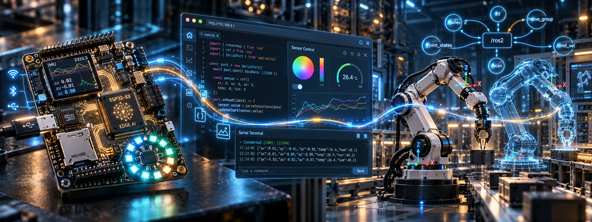

# KMUTT ND69

> เอกสารประกอบการเรียนการสอน — จาก hardware จริง สู่ software ที่เข้าใจโลกกายภาพ

คอร์สนี้สอนให้คนทำงานสายต่าง ๆ **เข้าถึงและควบคุมฮาร์ดแวร์จริง** —
เพราะในยุคที่ AI เขียน code ได้แล้ว ความแตกต่างอยู่ที่การเข้าใจ
พารามิเตอร์จริงของโลกและสร้าง action จริง ไม่ใช่แค่สร้างข้อมูล

---

## Table of contents

- [Learning tracks](#learning-tracks)
- [ND01 — Embedded & Hardware](#nd01--embedded--hardware)
- [ND02 — Application Developers](#nd02--application-developers)
- [ND03 — Automation & Robotics](#nd03--automation--robotics)

Each folder has a `README.md` with its own table of contents. This page links those indexes and every lesson.

---

## Learning tracks

| Track | Audience | Focus | Index |
|---|---|---|---|
| ND01 | Electronics / embedded systems | ESP32-S3 board, firmware, FreeRTOS | [nd1/README.md](nd1/README.md) |
| ND02 | Application / full-stack developers | Web Serial, Web Bluetooth, TypeScript apps | [nd2/README.md](nd2/README.md) |
| ND03 | Automation / PLC / machinery engineers | ROS-style middleware, digital twin | [nd3/README.md](nd3/README.md) |

- [Cover image](images/README.md)

---

## ND01 — Embedded & Hardware

> เข้าใจฮาร์ดแวร์จริงของบอร์ด ES3C28P (ESP32-S3R8) ตั้งแต่ชิปถึง firmware

- [Track](nd1/README.md)
- [Documents](nd1/docs/README.md)
- [Week 01 — Introduction](nd1/docs/week01/README.md)
- [Week 02 — ES3C28P Hardware](nd1/docs/week02/README.md)
- [Thai lessons](nd1/docs/week02/lessons/README.md)
- [Thai illustrations](nd1/docs/week02/lessons/images/README.md)
- [English edition](nd1/docs/week02/lessons/EN/README.md)
- [English illustrations](nd1/docs/week02/lessons/EN/images/README.md)
- [Presentation](nd1/docs/week02/lessons/EN/web/README.md)

### Thai

- [ชิป ESP32-S3 บน board ES3C28P](nd1/docs/week02/lessons/01-esp32s3r8-the-chip.md)
- [ประวัติ ESP32 — จาก ESP8266 ถึง ESP32-S3](nd1/docs/week02/lessons/02-esp32-history.md)
- [Memory หลายชนิดบน ESP32-S3 — RAM, SRAM, PSRAM, Flash, ROM, eFuse](nd1/docs/week02/lessons/03-memory-types.md)
- [Memory ในมุม Firmware — heap, stack, partition, NVS](nd1/docs/week02/lessons/04-memory-firmware-view.md)
- [ESP-IDF — Toolchain ตัวจริงของ ESP32](nd1/docs/week02/lessons/05-esp-idf-toolchain.md)
- [USB/Serial บน board นี้ — ไม่มีชิป USB-UART และกับดักที่ตามมา](nd1/docs/week02/lessons/06-usb-serial-caveat.md)
- [ระบบไฟและแบตเตอรี่ — TP4054, LDO, และการวัดแบตผ่าน ADC](nd1/docs/week02/lessons/07-power-battery.md)
- [จอ ILI9341V — SPI display 240×320 บน board ES3C28P](nd1/docs/week02/lessons/08-ili9341-display.md)
- [Touch screen FT6336G — capacitive touch ผ่าน I2C](nd1/docs/week02/lessons/09-ft6336-touch.md)
- [ระบบเสียง — ES8311 codec + FM8002E amp + MEMS mic](nd1/docs/week02/lessons/10-audio-chain.md)
- [RGB LED WS2812 — เส้นเดียวต้อง timing เป๊ะ และทำไมต้อง RMT](nd1/docs/week02/lessons/11-ws2812-rmt-led.md)
- [MicroSD บน ES3C28P — SDIO 4-bit เต็มสปีด](nd1/docs/week02/lessons/12-microsd-sdio.md)
- [Expansion header และแผนที่ขาทั้ง board — ขาไหนว่าง ขาไหนห้าม](nd1/docs/week02/lessons/13-expansion-pins.md)
- [ติดตั้ง ESP-IDF ผ่าน VS Code — พร้อมทดสอบบน board จริง](nd1/docs/week02/lessons/14-esp-idf-setup.md)
- [Embedded C + FreeRTOS review — ฐานที่ต้องมีก่อนเขียน firmware จริง](nd1/docs/week02/lessons/15-embedded-c-freertos-review.md)

### English

- [Lesson 01 — The ESP32-S3R8 on the ES3C28P Board](nd1/docs/week02/lessons/EN/01-esp32s3r8-the-chip.md)
- [Lesson 02 — ESP32 Evolution and Platform Selection](nd1/docs/week02/lessons/EN/02-esp32-history.md)
- [Lesson 03 — Memory Technologies: SRAM, PSRAM, Flash, ROM, and eFuse](nd1/docs/week02/lessons/EN/03-memory-types.md)
- [Lesson 04 — Firmware Memory: Sections, Stacks, Heaps, Partitions, and NVS](nd1/docs/week02/lessons/EN/04-memory-firmware-view.md)
- [Lesson 05 — ESP-IDF and the Embedded Development Toolchain](nd1/docs/week02/lessons/EN/05-esp-idf-toolchain.md)
- [Lesson 06 — Native USB, Serial Communication, and Recovery](nd1/docs/week02/lessons/EN/06-usb-serial-caveat.md)
- [Lesson 07 — Power Supply, Battery Charging, and Voltage Measurement](nd1/docs/week02/lessons/EN/07-power-battery.md)
- [Lesson 08 — ILI9341 Display Control over SPI](nd1/docs/week02/lessons/EN/08-ili9341-display.md)
- [Lesson 09 — FT6336G Capacitive Touch and Input Events](nd1/docs/week02/lessons/EN/09-ft6336-touch.md)
- [Lesson 10 — Audio: ES8311 Codec, Amplifier, and Microphone](nd1/docs/week02/lessons/EN/10-audio-chain.md)
- [Lesson 11 — WS2812 RGB LED Control with RMT](nd1/docs/week02/lessons/EN/11-ws2812-rmt-led.md)
- [Lesson 12 — microSD Storage over the SDMMC Host](nd1/docs/week02/lessons/EN/12-microsd-sdio.md)
- [Lesson 13 — Expansion Interfaces and GPIO Resource Planning](nd1/docs/week02/lessons/EN/13-expansion-pins.md)
- [Lesson 14 — Installing ESP-IDF and Verifying the Board](nd1/docs/week02/lessons/EN/14-esp-idf-setup.md)
- [Lesson 15 — Embedded C and FreeRTOS Engineering Fundamentals](nd1/docs/week02/lessons/EN/15-embedded-c-freertos-review.md)

---

## ND02 — Application Developers

> เข้าถึง hardware จาก browser — ไม่ต้องเขียน firmware เอง

- [Track](nd2/README.md)
- [Documents](nd2/docs/README.md)
- [Week 01 — Introduction](nd2/docs/week01/README.md)
- [Week 02 — Browser Hardware APIs](nd2/docs/week02/README.md)
- [Thai lessons](nd2/docs/week02/lessons/README.md)
- [Thai illustrations](nd2/docs/week02/lessons/images/README.md)
- [English edition](nd2/docs/week02/lessons/EN/README.md)
- [English illustrations](nd2/docs/week02/lessons/EN/images/README.md)
- [Presentation](nd2/docs/week02/lessons/EN/web/README.md)

### Thai

- [ทำไมเรา software developer ต้องเข้าถึง hardware — ยุคที่ coding ไม่พอ](nd2/docs/week02/lessons/01-why-hardware-access.md)
- [Browser hardware APIs — เว็บเพจที่แตะ hardware ได้](nd2/docs/week02/lessons/02-browser-hardware-apis.md)
- [Web Serial — ช่องทางแบบสายในเชิงหลักการ](nd2/docs/week02/lessons/03-web-serial-concept.md)
- [Web Serial in the wild — อุปกรณ์จริงที่คุย serial](nd2/docs/week02/lessons/04-web-serial-in-the-wild.md)
- [Web Bluetooth — ช่องทางแบบไร้สายในเชิงหลักการ](nd2/docs/week02/lessons/05-web-bluetooth-concept.md)
- [เลือกช่องทาง — Serial vs BLE vs WiFi ในสถานการณ์จริง](nd2/docs/week02/lessons/06-choosing-the-channel.md)
- [Capability → cooperation design — ออกแบบการทำงานร่วมของสองเครื่อง](nd2/docs/week02/lessons/07-cooperation-design.md)
- [Anatomy ของ monitor/control app — app ที่คุยกับ device](nd2/docs/week02/lessons/08-app-anatomy.md)
- [เมื่อ device เดียวไม่พอ — สู่บริการกลาง](nd2/docs/week02/lessons/09-beyond-one-device.md)
- [App แรก — ควบคุม LED และอ่านระดับเสียง](nd2/docs/week02/lessons/10-first-app-led-and-audio.md)
- [เตรียมเครื่องมือ — Node.js, Vite+, TypeScript และพื้นฐานเว็บ](nd2/docs/week02/lessons/11-toolchain-setup.md)

### English

- [Why Software Developers Need Hardware Access](nd2/docs/week02/lessons/EN/01-why-hardware-access.md)
- [Browser Hardware APIs](nd2/docs/week02/lessons/EN/02-browser-hardware-apis.md)
- [Web Serial — The Cable, as a Concept](nd2/docs/week02/lessons/EN/03-web-serial-concept.md)
- [Web Serial in the Wild](nd2/docs/week02/lessons/EN/04-web-serial-in-the-wild.md)
- [Web Bluetooth — The Short-Range Radio, as a Concept](nd2/docs/week02/lessons/EN/05-web-bluetooth-concept.md)
- [Choosing the Channel — Serial, BLE, and Wi-Fi](nd2/docs/week02/lessons/EN/06-choosing-the-channel.md)
- [From Capabilities to Cooperation](nd2/docs/week02/lessons/EN/07-cooperation-design.md)
- [Anatomy of a Monitor and Control Application](nd2/docs/week02/lessons/EN/08-app-anatomy.md)
- [When One Device Is Not Enough](nd2/docs/week02/lessons/EN/09-beyond-one-device.md)
- [A First Application — LED Command and a Sound Level](nd2/docs/week02/lessons/EN/10-first-app-led-and-audio.md)
- [Toolchain Setup — Node.js, Vite, TypeScript, and the Web Platform](nd2/docs/week02/lessons/EN/11-toolchain-setup.md)

---

## ND03 — Automation & Robotics

> จาก PLC/DCS สู่ ROS-era — middleware + digital twin

- [Track](nd3/README.md)
- [Documents](nd3/docs/README.md)
- [Week 01 — Introduction](nd3/docs/week01/README.md)
- [Week 02 — ROS Thinking & Digital Twin](nd3/docs/week02/README.md)
- [Thai lessons](nd3/docs/week02/lessons/README.md)
- [Thai illustrations](nd3/docs/week02/lessons/images/README.md)
- [English edition](nd3/docs/week02/lessons/EN/README.md)
- [English illustrations](nd3/docs/week02/lessons/EN/images/README.md)
- [Presentation](nd3/docs/week02/lessons/EN/web/README.md)

### Thai

- [ทำไม automation ต้องไปยุค ROS และ Digital Twin](nd3/docs/week02/lessons/01-why-ros-and-digital-twin.md)
- [The graph — node + topic: จาก scan cycle สู่ event-driven](nd3/docs/week02/lessons/02-the-graph.md)
- [Message & schema — สัญญาข้อมูลของระบบ](nd3/docs/week02/lessons/03-messages-and-schema.md)
- [Service & Action — คำสั่งสั้น vs งานยาวที่ยกเลิกได้](nd3/docs/week02/lessons/04-services-and-actions.md)
- [Parameter & lifecycle — node มีชีวิตไม่ใช่แค่ "รันตลอด"](nd3/docs/week02/lessons/05-parameters-and-lifecycle.md)
- [TF — frames & coordinate transforms: robot ต้องรู้ว่าอะไรอยู่ตรงไหน](nd3/docs/week02/lessons/06-tf-frames.md)
- [Observe & debug — ดูระบบกระจายที่ไม่มี "โปรแกรมเดียว" ให้ดู](nd3/docs/week02/lessons/07-observe-and-debug.md)
- [QoS & determinism — เมื่อ pub/sub ต้องเจอ deadline จริง](nd3/docs/week02/lessons/08-qos-and-determinism.md)
- [Digital Twin คืออะไร — ภาพจำลองที่มีชีวิตของเครื่องจริง](nd3/docs/week02/lessons/09-digital-twin.md)
- [Twin ↔ middleware — ทำให้ทั้งคู่ทำงานร่วมกัน + ปูทางสู่ hands-on](nd3/docs/week02/lessons/10-twin-meets-middleware.md)
- [Concept เดียวกัน สามภาษา — C, Rust, Python](nd3/docs/week02/lessons/11-three-languages.md)

### English

- [Why Automation Moves to a ROS-Style Architecture and a Digital Twin](nd3/docs/week02/lessons/EN/01-why-ros-and-digital-twin.md)
- [The Graph — Nodes and Topics](nd3/docs/week02/lessons/EN/02-the-graph.md)
- [Messages and Schema](nd3/docs/week02/lessons/EN/03-messages-and-schema.md)
- [Services and Actions](nd3/docs/week02/lessons/EN/04-services-and-actions.md)
- [Parameters and Lifecycle](nd3/docs/week02/lessons/EN/05-parameters-and-lifecycle.md)
- [TF — Frames and Transforms](nd3/docs/week02/lessons/EN/06-tf-frames.md)
- [Observing and Debugging a Distributed System](nd3/docs/week02/lessons/EN/07-observe-and-debug.md)
- [QoS and Determinism](nd3/docs/week02/lessons/EN/08-qos-and-determinism.md)
- [What a Digital Twin Is](nd3/docs/week02/lessons/EN/09-digital-twin.md)
- [The Twin on the Middleware](nd3/docs/week02/lessons/EN/10-twin-meets-middleware.md)
- [The Same Concepts in Three Languages](nd3/docs/week02/lessons/EN/11-three-languages.md)

---

  course materials · KMUTT ND69

