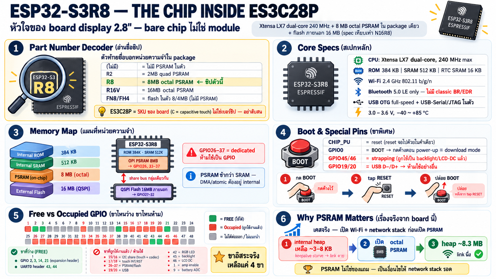

# ชิป ESP32-S3 บน board ES3C28P



## Part number ที่ใช้จริง

บน board ES3C28P ใช้ **ESP32-S3R8** — ตัว "R8" ในชื่อบอกว่ามี
8 MB octal PSRAM อยู่ใน package เดียวกับ die (ไม่ใช่ชิปแยกบน board)

| รายการ | ค่าจริงบน board นี้ |
|---|---|
| ชิป | **ESP32-S3R8** |
| PSRAM | 8 MB **octal (OPI) PSRAM ใน package เดียวกัน** |
| Flash | **16 MB QSPI flash ภายนอก** (ชิปแยกบน board) |
| เทียบเท่า module | spec เดียวกับ ESP32-S3-WROOM-1 **N16R8** แต่ board นี้ใช้ bare chip ไม่ใช่ module — วงจร RF/antenna ออกแบบเองบน PCB |

### อ่านชื่อรุ่น ESP32-S3 (สำคัญมากตอนสั่ง board / ชิปอื่น)

รูปแบบ: `ESP32-S3` + `R{x}` + `V`? — ตัวท้ายบอกหน่วยความจำใน package

| Suffix | ความหมาย |
|---|---|
| (ไม่มี) | ไม่มี PSRAM/flash ใน package |
| `R2` | 2 MB **quad** PSRAM ใน package |
| `R8` | 8 MB **octal** PSRAM ใน package ← board นี้ |
| `R8V` | 8 MB octal PSRAM, rail 1.8 V (board ทั่วไปใช้ 3.3 V — R8 ธรรมดา) |
| `R16V` | 16 MB octal PSRAM |
| `FH4` / `FN8` ฯลฯ | flash ใน package 4/8 MB (ไม่มี PSRAM) |

ชื่อ module (เช่น `N16R8`) จะแปะทั้งสองอย่าง: `N{x}` = ขนาด flash
ภายนอกที่ประกบมาใน module, `R{x}` = PSRAM — ดังนั้น N16R8 = flash 16 MB +
PSRAM 8 MB ซึ่งตรงกับสิ่งที่ผู้ผลิต board ประกบเองบน ES3C28P

## Spec หลัก

| หมวด | รายละเอียด |
|---|---|
| CPU | Xtensa LX7 dual-core, 32-bit, สูงสุด **240 MHz** |
| ROM | 384 KB |
| SRAM | **512 KB** internal SRAM |
| RTC SRAM | 16 KB (อยู่ได้ตอน deep sleep) |
| PSRAM | 8 MB octal, 80 MHz (board นี้ตั้ง `CONFIG_SPIRAM_SPEED_80M`) |
| Flash | 16 MB QSPI ภายนอก |
| WiFi | 2.4 GHz 802.11 b/g/n, 20/40 MHz |
| Bluetooth | BT 5.0 LE เท่านั้น — ไม่มี classic BR/EDR (ช่อง spec sheet board จีนหลายที่เขียน BR/EDR ผิด) |
| แรงดัน | 3.0–3.6 V |
| อุณหภูมิ | –40 ~ +85 °C |
| USB | USB OTG full-speed + **USB-Serial/JTAG** ในตัว (board นี้เอาไปใช้เป็น port เดียว: flash + monitor + protocol) |

Peripheral ที่ S3 มีในตัว (สำคัญต่อ board นี้): UART×3, SPI×2 ใช้งานทั่วไป
(+bus flash/PSRAM แยก), I2C×2, I2S×2, RMT, LEDC PWM, MCPWM, ADC×2
(ADC1 8 ch / ADC2 10 ch), touch sensor GPIO×14, SDIO host, TWAI(CAN),
LCD camera interface, USB OTG, USB-Serial/JTAG

## หน่วยความจำ — ภาพที่ต้องเข้าใจบน board นี้

```
┌───────────────────────────────────────────┐
│ ESP32-S3R8 (one package)                  │
├────────────┼─────────────┼────────────────┤
│ ROM 384 KB │ SRAM 512 KB │ RTC SRAM 16 KB │
├───────────────────────────────────────────┤
│ OPI PSRAM 8 MB                            │
│ GPIO26, GPIO33-37 + 30clk                 │
└─────────────────────┬─────────────────────┘
                      │  shared octal bus
                      ▼
           ┌─────────────────────┐
           │ QSPI flash 16 MB    │
           │ external, GPIO27-32 │
           └─────────────────────┘
```

ประเด็นสอน:

1. **Flash กับ PSRAM share bus กลุ่มเดียวกัน (GPIO27–32)** — ขากลุ่มนี้
   เป็นขาเฉพาะของ flash ภายนอกและ PSRAM ภายใน (dedicated) นี่คือเหตุที่
   GPIO26–37 ห้ามเอาไปทำอะไรเลย ไม่ใช่แค่ "แนะนำไม่ใช้"
2. **PSRAM ช้ากว่า SRAM มาก** (ผ่าน cache, ไม่ atomic) — atomic
   ops/DMA buffer ต้องอยู่ internal SRAM เท่านั้น
3. firmware serial-bridge ตั้ง `CONFIG_SPIRAM_MALLOC_ALWAYSINTERNAL=16384`
   = malloc ใต้ 16 KB บังคับลง internal SRAM เสมอ → stack/buffer เล็ก ๆ
   ไม่ไปโผล่บน PSRAM ช้า ๆ
4. กรณีจริงที่เกิดบน board นี้: ก่อนเปิด PSRAM, WiFi + lwip +
   zenoh-pico กิน internal heap เหลือ ~3–8 KB → keepalive task starve,
   link ตายตอน lease หมด พอเปิด octal PSRAM → heap เหลือ ~8.3 MB link นิ่ง
   **บทเรียน: PSRAM ไม่ใช่ของแถม มันคือเงื่อนไขให้ network stack รอด**

## Boot strapping และขาพิเศษ

| ขา | บทบาท |
|---|---|
| CHIP_PU | reset ชิป (บน board นี้ยัง reset จอไปด้วยในคำเดียว) |
| GPIO0 (BOOT) | กดค้างตอน power-up → download mode; กด BOOT ค้าง → tap RESET → ปล่อย BOOT |
| GPIO45/46 | strapping pins ของ S3 ด้วย (VDD_SPI / ROM log) — บน board นี้ถูกใช้เป็น backlight/DC อยู่แล้ว เวลา design board เองต้องระวัง pull ตอน boot |
| GPIO19/20 | USB D−/D+ — ถ้าเอาไปใช้อย่างอื่น = หมด port flash/debug ทั้ง board |

## เครือข่าย: ของที่ทำให้ board นี้ต่างจาก board display ทั่วไป

- WiFi STA ใช้งานจริงแล้วบน board นี้ (รายละเอียดบทถัด ๆ ไป) —
  antenna เป็น PCB antenna ที่ออกแบบบน board โดยตรง พร้อม matching
  circuit กลุ่มตัว C/L/R ข้างชิป
- ไม่มี Ethernet, ไม่มี BT classic
- ผลกระทบเชิงทรัพยากร: เปิด WiFi = กิน SRAM หนัก → ต้องคู่กับหัวข้อ
  PSRAM เสมอ

## ทิ้งท้าย — checklist "board นี้ให้อะไรเรา" จากมุมชิป

| อยากใช้ | ได้ไหม | เพราะ |
|---|---|---|
| UART เพิ่ม | ✔ | UART1 บน GPIO2/3 ว่างอยู่ (expansion header) |
| SPI ชุดที่สอง | ✔ | GPIO2/3/14/21 remap ได้ (แต่แย่งกับ UART1 ถ้าใช้ทั้งคู่) |
| ADC | ✔ GPIO9 ถูกใช้วัด battery แล้ว; ขา ADC อื่นที่ว่างคือ 2/3/14 (ADC1/ADC2) |
| DAC | ✔(ตัวชิปไม่มี DAC จริง — เสียงไปผ่าน ES8311 codec อยู่แล้ว) |
| I2C อีก bus | △ | I2C0 ถูก touch + codec ยึด; ทำ bus ใหม่บน 2/3 ได้ (bit-bang หรือ I2C1) |
| Touch sensor ในตัว | ✔ TOUCH pad มีในชิป (T1–T14) แต่ board ใช้ FT6336 อยู่แล้ว |
| GPIO ระดับ 5 V | ✘ | S3 เป็น 3.3 V เท่านั้น ไม่มี 5 V tolerant |

> อย่าสับสน SKU ของ board กับ part number ของชิป: **ES3C28P** = SKU
> ของ board ทั้งผืน (C = capacitive touch), **ESP32-S3R8** = part
> number ของชิปประมวลผลบน board
