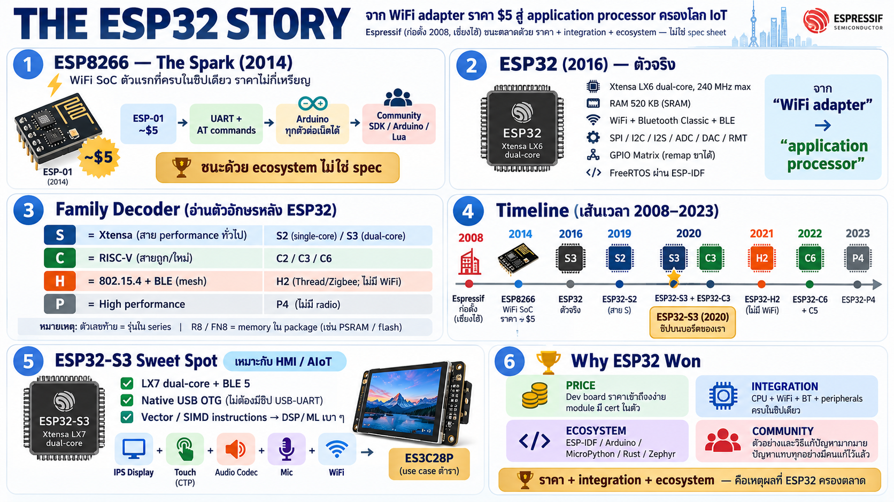

# ประวัติ ESP32 — จาก ESP8266 ถึง ESP32-S3



## จุดเริ่มต้น: Espressif

- **Espressif Systems** บริษัท fabless สัญชาติจีน ก่อตั้งปี **2008**
  ที่เซี่ยงไฮ้ โดย Teo Swee Ann (ซีอีโอที่เป็นวิศวกรสาย RF)
- ช่วงแรกทำชิป WiFi/RF ทั่วไป ยังไม่ดัง — จุดเปลี่ยนคือชิป WiFi
  ราคาถูกที่ออกมาปี 2014

## ESP8266 (2014) — ชิปที่เปลี่ยนโลก maker

- WiFi SoC ตัวแรกที่ "ครบในชิปเดียว ราคาไม่กี่เหรียญ" —
  CPU + WiFi stack + TCP/IP ในตัว
- จุดระเบิดคือ module **ESP-01** ราคา ~$5 ต่อผ่าน UART ด้วย
  AT command — ทำให้ Arduino ทุกตัวต่อเน็ตได้
- community รีเวิร์ส engineer toolchain เอง (datasheet ตอนแรกมีแต่
  ภาษาจีน) → เกิด community SDK, Arduino core, NodeMCU (Lua),
  MicroPython — ระบบนิเวศโตก่อนที่บริษัทจะตามทัน
- บทเรียนสำคัญ: **ชนะด้วย ecosystem ไม่ใช่ spec** — Espressif เลย
  เปิดเอกสารและ toolchain อย่างจริงจังตั้งแต่รุ่นถัดไป

## ESP32 (2016) — รุ่นใหญ่ตัวจริง

- ประกาศกันยายน 2016 — Xtensa **LX6 dual-core** 240 MHz,
  WiFi + **Bluetooth classic + BLE**, RAM 520 KB
- ย้ายจาก "WiFi adapter" เป็น **application processor** เต็มตัว:
  peripheral ครบ (SPI/I2C/I2S/ADC/DAC/touch sensor/RMT...), GPIO
  matrix remap ขาได้, มี FreeRTOS ใน ESP-IDF
- กลายเป็นชิป default ของงาน IoT — ราคาไม่กี่ดอลลาร์ ทำทั้ง
  sensor node, display, audio, gateway

## แตกตระกูล: ตัวอักษรหลัง ESP32 บอกสายงาน

สายตระกูลที่ย่อได้เป็นสามขั้น:

```
┌─────────┐      ┌────────────┐      ┌────────────┐
│ ESP8266 │ ───► │ ESP32      │ ───► │ ESP32-S3   │
│ Wi-Fi   │      │ Wi-Fi + BT │      │ USB, BLE 5 │
└─────────┘      └────────────┘      └────────────┘
```

หลังรุ่นแรก Espressif แยกออกเป็นหลาย family — **ตัวอักษรคือ radio
กับ architecture**:

| Series | CPU | จุดขาย |
|---|---|---|
| ESP32 (ดั้งเดิม) | Xtensa LX6 dual | WiFi + BT classic + BLE, ทั่วไป |
| **S2** (2019) | Xtensa LX7 single | ลดราคา/กำลัง — ไม่มี Bluetooth เลย, เพิ่ม native USB |
| **S3** (2020) | Xtensa LX7 dual | S2 + dual core + **BLE 5** + vector instruction (AI/DSP) — เหมาะงาน HMI/audio |
| **C2/C3** (2020–21) | **RISC-V** single | ถูกสุด — แทน ESP8266 ในตลาด sensor ถูก ๆ |
| **C6** (2022) | RISC-V | WiFi 6 + 802.15.4 (Zigbee/Thread/Matter) |
| **H2** (2021) | RISC-V | 802.15.4 + BLE — ไม่มี WiFi เลย เน้น Thread/Zigbee |
| **P4** (2023) | RISC-V dual 400 MHz | ตัวแรง — ไม่มี radio เลย ทำ HMI/camera ต้องคู่ชิป radio |
| **C5** (2023–24) | RISC-V | dual-band WiFi 6 (2.4+5 GHz) ตัวแรกของตระกูล |

สรุปเป็นกฎจำง่าย ๆ:

- **S** = Xtensa (สาย performance/ทั่วไป)
- **C** = RISC-V (สายถูก/ใหม่)
- **H** = 802.15.4 mesh (ไม่มี WiFi)
- **P** = performance (ไม่มี radio)
- ตัวเลขท้าย series = รุ่นใน series นั้น (S3 ใหม่กว่า S2, C6 ใหม่กว่า C3)

และ suffix ท้ายชื่อชิป (R8, FN8 ฯลฯ) บอกหน่วยความจำใน package —
จำจากบท ESP32-S3R8 ได้

## ESP32-S3 นั่งอยู่ตรงไหนในประวัติ

- เปิดตัวปลาย **2020** — เป็น "ESP32 รุ่น 2" ที่แท้: กลับมา
  dual-core (หลัง S2 ที่ single) + BLE 5 + native USB OTG +
  เพิ่ม vector/SIMD instruction สำหรับงาน DSP/ML เบา ๆ
- เป็นชิปที่ Espressif เล็งงาน **HMI** (จอ + touch + เสียง +
  เสียงร้อง) — เหตุผลเดียวกับที่ผู้ผลิตเลือกมาใส่ board ES3C28P
  ที่มีจอ IPS + touch + codec + mic ครบ
- native USB สำคัญมากกับ board นี้ — ไม่ต้องมีชิป USB-UART
  (ประหยัด BOM) แต่ก็คือสาเหตุของ auto-reset quirk ที่เจอกัน

## Ecosystem — เหตุผลที่ ESP32 ยังครองตลาด

- **ESP-IDF** — official framework บน FreeRTOS, เสถียรสุด
- **Arduino core** — เข้าถึงคนกลุ่ม maker/hobby เดิมจาก ESP8266
- **MicroPython / CircuitPython, Lua, Zephyr, NuttX, Rust** —
  ภาษา/RTOS เกือบทุกสายมี port
- ราคา board dev kit ถูก + module มี FCC/CE cert ในตัว → เอาไป
  ทำ product จริงได้โดยไม่ต้อง cert RF เอง
- community ใหญ่: ปัญหาแทบทุกอย่างมีคนเจอและแก้ไว้ก่อนแล้ว

## Timeline ย่อ

```
2008  Espressif ก่อตั้ง (เซี่ยงไฮ้)
2014  ESP8266 — WiFi SoC ราคาถูก
2015  ESP-01 + community SDK/Arduino → ระบาดใน maker
2016  ESP32 — LX6 dual-core, WiFi + BT classic + BLE
2019  ESP32-S2 — LX7 single-core, native USB, ไม่มี BT
2020  ESP32-S3 — LX7 dual-core, BLE5, vector inst.  ← ชิปของเรา
2020  ESP32-C3 — RISC-V รุ่นแรก (สาย C เริ่ม)
2021  ESP32-H2 — 802.15.4 (Thread/Zigbee) ไม่มี WiFi
2022  ESP32-C6 — WiFi 6 + 802.15.4
2023  ESP32-P4 — performance ไม่มี radio / ESP32-C5 WiFi6 dual-band
```

## สิ่งที่ควรจำจากบทนี้

1. ESP32 ชนะตลาดเพราะ **ราคา + integration + ecosystem** ไม่ใช่
   spec sheet
2. ชื่อ series (S/C/H/P) บอก architecture และ radio — อ่านชื่อคือ
   อ่านตำแหน่งของชิปในตลาด
3. ESP32-S3 = ทางเลือกเชิงตั้งใจสำหรับงาน HMI — board ES3C28P
   คือ use case ตำราของมัน: display + touch + audio + WiFi ในชิปเดียว
