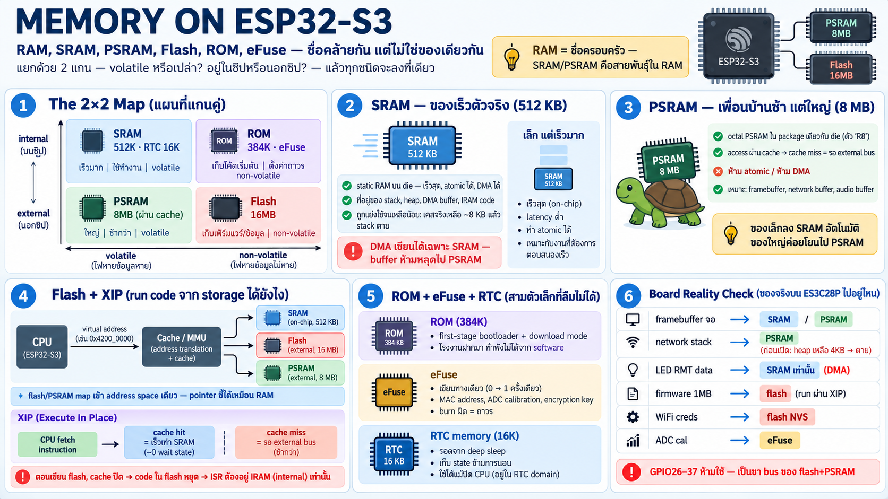

# Memory หลายชนิดบน ESP32-S3 — RAM, SRAM, PSRAM, Flash, ROM, eFuse



## ปัญหาแรก: ชื่อคล้ายกัน แต่ไม่ใช่ของเดียวกัน

คำว่า "memory" บน ESP32 มีหลายชนิดที่ฟังดูเหมือนกัน — วิธีไม่สับสน
คือแยกด้วย **2 แกน** เสมอ:

| | **volatile** (ดับไฟ = หาย) | **non-volatile** (อยู่ต่อ) |
|---|---|---|
| **internal** (ในชิป) | SRAM 512 KB — เร็วสุด<br>RTC memory 16 KB | ROM 384 KB — อ่านอย่างเดียว<br>eFuse — เขียนได้ครั้งเดียว |
| **external** (นอกชิป) | PSRAM 8 MB — ช้ากว่า ผ่าน cache | Flash 16 MB — เขียนได้จำกัดรอบ<br>code + data + filesystem |

- **RAM** = ชื่อครอบครัว หมายถึง volatile memory ทั้งหมด — SRAM กับ
  PSRAM เป็น "สายพันธุ์" ใน RAM ไม่ใช่ของคนละประเภทกับ RAM
- **Flash** = storage ฝั่ง non-volatile ที่เขียนซ้ำได้ (แต่มีวิธีเขียน
  แปลก — บท firmware ว่าต่อ)
- **ROM** = ของที่โรงงานเขียนมาให้ แก้ไม่ได้ — แต่ไม่ใช่ของไร้ประโยชน์
- **eFuse** = memory แปลกสุด: เขียนได้ "ทางเดียว" เปลี่ยน bit 0→1
  ได้ครั้งเดียวแล้วจบ

## SRAM — หน่วยความจำตัวจริงของชิป (512 KB)

- internal SRAM **512 KB** — static RAM บน die เดียวกับ CPU
- เร็วที่สุดในบ้าน: เข้าถึงได้ทุก cycle, **atomic ได้, ทำ DMA ได้**
- ถูกแบ่งใช้ 2 หน้าที่: เก็บ data (stack, heap, static buffer) และ
  เก็บ code ที่ต้องเร็ว (IRAM — ดูเรื่อง XIP ด้านล่าง)
- ข้อจำกัดสำคัญ: DMA ของ peripheral (SPI, I2S, ADC...) เขียนได้เฉพาะ
  internal SRAM — buffer ที่จะให้ DMA ต้องไม่ไปอยู่บน PSRAM
- 512 KB ฟังดูเยอะ แต่โดนแย่ง: stack ทุก task + heap + DMA buffer +
  cache-mapped code — บน board นี้เคยเหลือน้อยกว่า 8 KB จน network
  stack ตาย (อีกเรื่องที่ทำให้ PSRAM สำคัญ)

## RTC memory — เล็กแต่รอดจาก deep sleep (16 KB)

- **RTC fast memory** 8 KB + **RTC slow memory** 8 KB
- อยู่ใน power domain ของ RTC — ข้อมูลอยู่ต่อแม้ chip เข้า
  deep sleep (main power domain ดับไปแล้ว)
- ใช้เก็บ state ที่ต้องจำข้าม sleep cycle เช่น ค่า counter, flag
  "เพิ่งตื่นจาก sleep หรือ boot ใหม่"

## PSRAM — RAM เสริม 8 MB ที่ช้ากว่า (ในตัวชิป R8)

- 8 MB **octal PSRAM** อยู่ใน package เดียวกับ die (ตัว "R8")
- เข้าถึงผ่าน **cache + memory-mapped address** — CPU อ่าน/เขียน
  เหมือน memory ปกติ แต่ทุก access ที่พลาด cache ต้องเดินทางไปที่
  external bus → latency สูงกว่า SRAM มาก
- **ห้ามใช้กับ atomic operation และ DMA buffer** — สาเหตุที่ config
  `MALLOC_ALWAYSINTERNAL` บังคับ allocation เล็กลง SRAM เสมอ
- เหมาะกับของใหญ่ที่ไม่ต้องเร็ว: framebuffer, network buffer,
  audio buffer, TLS/lwIP memory
- กฎใช้งาน: "ของเล็กลง SRAM อัตโนมัติ, ของใหญ่ค่อยโยนไป PSRAM"

## Flash 16 MB — storage + บ้านของ code

- QSPI flash ภายนอก 16 MB — ไฟดับข้อมูลอยู่
- เก็บทุกอย่างที่ต้องรอด: bootloader, application binary, config,
  filesystem, OTA image
- ข้อจำกัด: เขียนต้อง **erase ก่อนเป็น sector (4 KB)** และอายุการ
  เขียนจำกัด (~100K รอบ/sector) — ห้ามเอาไปใช้แทน RAM หรือ log
  ทุก loop
- **แต่ flash ไม่ได้แค่เก็บ code — CPU run จากมันได้เลย** ผ่าน
  กลไกข้างล่างนี้

## ROM 384 KB — firmware ที่โรงงานฝากมา

- mask ROM — เขียนมาตั้งแต่ผลิต แก้ไม่ได้ตลอดชีพ
- ใส่ **first-stage bootloader** (ตัวที่ run ก่อนทุกอย่าง คอยโหลด
  bootloader จริงจาก flash), ROM routine พื้นฐาน (print, flash
  read/write, download mode)
- นี่คือเหตุที่ chip "กด BOOT แล้ว flash ได้เสมอ" — download mode
  อยู่ใน ROM แก้ไม่ได้ ทำพังไม่ได้จาก software

## eFuse — memory ทางเดียว แต่ระดับความปลอดภัย

- one-time-programmable: เปลี่ยน bit 0→1 ได้ครั้งเดียว ย้อนไม่ได้
- เก็บของที่ต้อง "แก้ไม่ได้": MAC address, chip config,
  **calibration ของ ADC** (เหตุที่อ่านแรงดัน battery ได้แม่น),
  flash encryption key, secure boot key
- ข้อผิดพลาดร้ายแรง: burn ผิด = ชิปเปลี่ยนพฤติกรรมถาวร —
  flash encryption/secure boot burn แล้วย้อนไม่ได้จริง ๆ

## XIP — กลไกที่ทำให้ "memory นอกชิป" ทำตัวเหมือนอยู่ในชิป

จุดที่คนสับสนสุด: flash กับ PSRAM อยู่ "นอก die" แต่ code ใน flash
run ได้โดยไม่ copy มา RAM — เพราะ ESP32-S3 มี **unified address
space**:

```
                   ┌─────┐
                   │ CPU │
                   └──┬──┘
                      │ address (virtual)
                      ▼
               ┌─────────────┐
               │ cache / MMU │
               └──────┬──────┘
                      │
    ┌─────────────────┴──────────────────┐
    ▼                 ▼                  ▼
┌─────────┐   ┌──────────────────┐   ┌─────────────┐
│ SRAM    │   │ Flash            │   │ PSRAM       │
│ direct  │   │ via cache, XIP   │   │ via cache   │
└─────────┘   └──────────────────┘   └─────────────┘
```

- flash และ PSRAM ถูก map เข้า address space เดียวกัน — pointer
  ชี้ไปที่ address ของ flash/PSRAM อ่านได้เหมือน RAM
- **XIP (eXecute In Place)** = CPU fetch instruction จาก flash
  ผ่าน instruction cache โดยตรง — ไม่ต้อง copy code มา SRAM ก่อน
- cache hit = เร็วเท่า SRAM; cache miss = รอ bus รอบนึง
  (flash ~หลักสิบ นาโนวินาทีขึ้นไป, PSRAM ใกล้กว่า)
- I-cache/D-cache บน S3 ขนาดหลักสิบ KB (16/32 KB และ 32/64 KB,
  configure ได้) — เล็กมากเมื่อเทียบกับ code 1 MB+ ดังนั้น hot
  loop/cache locality ยังสำคัญ

### ผลกระทบสำคัญ: ทำไมต้องมี IRAM

ระหว่างที่ chip **เขียน/erase flash** cache ถูกปิด — code ที่อยู่
ใน flash หยุด run ทั้งระบบ:

- interrupt handler ที่อาจเกิดตอน flash กำลังเขียน **ต้องอยู่ใน
  internal SRAM** → มาร์กด้วย `IRAM_ATTR`
- ใส่ผิดที่ = ระบบพังตอน flash busy — bug ที่เจอได้ยากถ้าไม่รู้
  กลไกนี้
- data ที่ ISR แตะต้องอยู่ internal เหมือนกัน (`DRAM_ATTR`)

นี่คือตัวอย่างตำราของ "hardware detail กลายเป็น rule ในฝั่ง
software" — เข้าใจ cache แล้วเข้าใจทำไม attribute พวกนี้มีอยู่

## เชื่อมกลับ board ES3C28P

| ทรัพยากร | อยู่ memory ไหน | เพราะ |
|---|---|---|
| framebuffer จอ 320×240 RGB565 (~150 KB) | SRAM หรือ PSRAM | ใหญ่ — บน board นี้วาง static ใน SRAM แต่ถ้าจอใหญ่กว่านี้ต้อง PSRAM |
| network stack (WiFi+lwip+zenoh) | PSRAM เป็นหลัก | เคสจริง: ไม่เปิด PSRAM เหลือ heap ~4 KB → ตาย |
| LED timing data (RMT) | SRAM เท่านั้น | RMT ทำ DMA — ต้อง internal |
| firmware binary ~1 MB | flash | run ผ่าน XIP ไม่ได้ copy |
| WiFi credential | flash (NVS) | ต้องรอดจาก reboot |
| ADC calibration | eFuse | โรงงาน burn มาให้ |
| GPIO26–37 | ห้ามใช้ | เป็นขา bus ของ flash+PSRAM — memory ทั้งหมดของ board |
