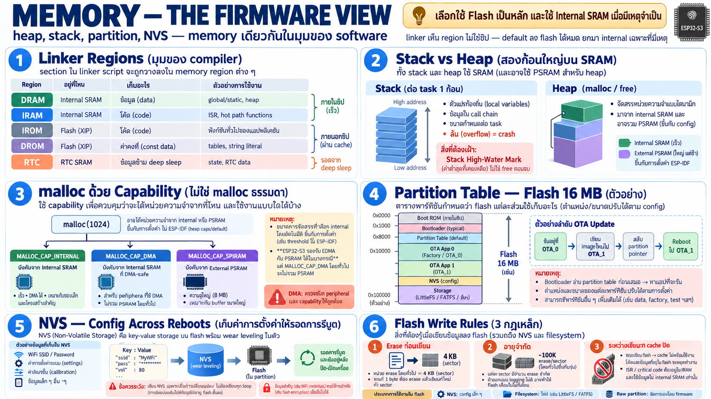

# Memory ในมุม Firmware — heap, stack, partition, NVS



บทก่อนพูดถึง memory แต่ละชนิดในเชิง hardware — บทนี้ดูจากฝั่ง
software ว่า memory พวกนั้นถูกจัดการและใช้งานยังไงจริง

## Linker view: memory ที่ code เห็น

Compiler/linker ไม่เห็น "SRAM/PSRAM" ตรง ๆ — เห็นเป็น **region**
ที่กำหนดชะตาของ code/data:

| Region | ความหมาย | ใส่อะไร |
|---|---|---|
| `DRAM` | data ใน internal SRAM | static/global variable, heap |
| `IRAM` | code ใน internal SRAM | interrupt handler, hot path (`IRAM_ATTR`) |
| `IROM` | code ที่ run จาก flash (XIP) | function ทั่วไปเกือบทั้งหมด |
| `DROM` | read-only data ที่อ่านจาก flash | const, lookup table, string literal |
| `RTC` | RTC memory | data ข้าม deep sleep |

บทเรียนจากบทก่อนตกผลึกตรงนี้: **default ทุกอย่างลง flash (IROM/DROM)
ได้เลย** — ยกมา internal เฉพาะเมื่อมีเหตุ (ISR, flash-write window,
DMA buffer)

## Stack vs Heap — สองสิ่งที่กิน SRAM

- **stack**: ต่อ task หนึ่งก้อน — local variable, call chain,
  context; ล้น = crash ทันที (stack canary จับได้ถ้าเปิด)
- **heap**: malloc/free — บน ESP-IDF heap อาจกระจายหลาย region:
  internal SRAM + PSRAM ใน pool เดียวกัน

### malloc บน ESP32 ไม่เหมือน malloc ทั่วไป

`malloc()` แบ่งตาม **capability** — allocator เลือก memory ให้ตาม
ความต้องการ:

```
malloc(1024)                    → อาจได้ PSRAM (ของใหญ่, ไม่บังคับ)
heap_caps_malloc(n, MALLOC_CAP_INTERNAL)  → บังคับ internal
heap_caps_malloc(n, MALLOC_CAP_DMA)       → บังคับ internal + DMA-safe
heap_caps_malloc(n, MALLOC_CAP_SPIRAM)    → บังคับ PSRAM
```

- `CONFIG_SPIRAM_MALLOC_ALWAYSINTERNAL=16384` = allocation ≤ 16 KB
  บังคับลง internal เสมอ — stack, struct เล็ก, ของที่ต้อง atomic
  ไม่หลุดไป PSRAM โดยไม่ตั้งใจ
- กฎเหล็ก: **buffer ที่จะส่งให้ DMA ต้อง malloc ด้วย CAP_DMA**
  ไม่ใช่ malloc ธรรมดา — ถ้ามันดันไปลง PSRAM, DMA จะเงียบหรือพัง

## Partition table — แผนที่ของ flash 16 MB

flash 16 MB ถูกแบ่งเป็นช่วง ๆ ตามลำดับบนชิป:

```
┌────────────┐  ┌─────────────┐  ┌─────┐  ┌─────┐  ┌─────────┐
│ bootloader │  │ part. table │  │ app │  │ NVS │  │ storage │
└────────────┘  └─────────────┘  └─────┘  └─────┘  └─────────┘
```

ลำดับตอนเปิดเครื่อง:

```
┌─────┐           ┌────────────┐           ┌─────┐
│ ROM │           │ bootloader │           │ app │
└──┬──┘           └──────┬─────┘           └──┬──┘
   │                     │                    │
   │ load ──────────────►│                    │
   │                     │ start ────────────►│
```

Flash ไม่ใช่ไฟล์เดียวยาว ๆ — ถูกผ่าเป็น partition โดย
**partition table** (binary เล็ก ๆ ที่ bootloader อ่านก่อน):

```
offset 0x0000   bootloader.bin      ← stage 2 boot
offset 0x8000   partition-table.bin ← แผนที่ใบนี้เอง
0x10000+        app partition       ← firmware หลัก (อาจมี OTA slot)
...             nvs                 ← key-value storage
...             storage (littlefs/fatfs/spiffs)
```

- bootloader อ่าน table → หา app partition → โหลด/run
- **OTA** ทำได้เพราะมี app partition สองช่อง (ota_0/ota_1): เขียน
  image ใหม่ลงอีกช่อง สลับ pointer แล้ว reboot — flash 16 MB เลย
  มีที่ให้ OTA สบาย
- ขนาด app partition กำหนดเพดาน firmware — board นี้เลือก
  single-app-large เพราะ binary โตเกิน 1 MB (WiFi + display + audio)

## NVS — key-value storage ที่ทุกคนใช้โดยไม่รู้ตัว

- **NVS (Non-Volatile Storage)** = partition พิเศษที่เก็บคู่
  key → value ลง flash พร้อม wear leveling ในตัว
- ของที่ลง NVS จริงบน board นี้: **WiFi SSID/password** — ตั้งค่า
  ผ่าน serial command แล้ว persist ข้าม reboot โดยไม่ต้องแก้ code
- จุดที่ต้องระวัง: NVS เป็น flash — เขียนทุก loop = กินอายุ flash
  + ทำให้ flash busy (ช่วงที่ IRAM เรื่องก่อนหน้ามีผล)

## Flash write rules — ทำไม storage บน MCU ยุ่งยาก

1. **erase ก่อนเขียนเสมอ** — หน่วย erase = sector 4 KB แต่เขียน
   ได้ทีละน้อยกว่านั้น: แก้ byte เดียว = erase ทั้ง sector → เขียน
   ใหม่ทั้งก้อน (flash layer จัดการให้ แต่ latency มีจริง)
2. **อายุเขียนจำกัด** ~100K erase/sector — ออกแบบ data logging
   ผิด = flash ตายในไม่กี่เดือน
3. ระหว่าง erase/write → cache ปิด → ทุกอย่างใน flash หยุด
   (เหตุผลเดียวกับที่ ISR ต้องอยู่ IRAM)
4. เลือกใช้ให้ถูก: NVS = ค่า config เล็ก ๆ / filesystem = ไฟล์ /
   raw partition = ของใหญ่ที่จัดการเอง

## Debug memory — เครื่องมือที่ควรรู้จัก

- `heap_caps_get_free_size()` / `get_minimum_free_size()` —
  free heap ตอนนี้ และ **high-water mark** (ต่ำสุดที่เคยเหลือ —
  จับ memory leak/peak ได้แม่นกว่า free ตอนจบ)
- stack high-water ของแต่ละ task (uxTaskGetStackHighWaterMark)
- เฝ้าดูตัวเลขจริงบน board นี้: internal heap ต่ำสุดเคยเหลือ ~3–8 KB
  ตอน WiFi+zenoh ทำงานก่อนเปิด PSRAM — ตัวเลข high-water เล่าปัญหา
  ได้ก่อน crash เสมอ

## สรุปสองบท memory

| คำถาม | คำตอบสั้น |
|---|---|
| ของเล็ก/เร็ว/DMA/atomic | internal SRAM (512 KB) |
| ของใหญ่ ไม่เร่ง (buffer, frame) | PSRAM (8 MB, ผ่าน cache) |
| code | flash — run ผ่าน XIP, ISR ยกเว้นลง IRAM |
| config ข้าม reboot | NVS partition ใน flash |
| state ข้าม deep sleep | RTC memory 16 KB |
| ของที่แก้ไม่ได้ | ROM (boot) และ eFuse (MAC, key, calibration) |
