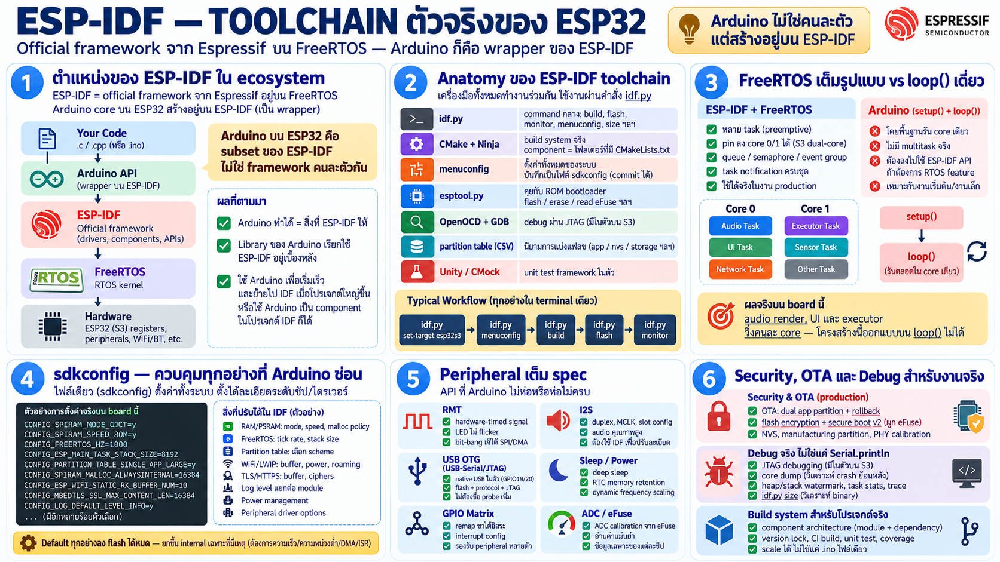

# ESP-IDF — Toolchain ตัวจริงของ ESP32



## ตำแหน่งของ ESP-IDF ใน ecosystem

**ESP-IDF (Espressif IoT Development Framework)** = official
framework จาก Espressif เอง อยู่บน **FreeRTOS kernel**

ข้อเท็จจริงที่เปลี่ยนมุมมองทั้งบท: **Arduino core ของ ESP32 ถูก build
อยู่บน ESP-IDF** — Arduino เป็น wrapper ที่ห่อ IDF ไว้อีกชั้น ทุกอย่าง
ที่ Arduino บน ESP32 ทำได้ คือ subset ของสิ่งที่ IDF ให้ — ไม่ใช่
framework คนละตัวกัน

```
โค้ดของคุณ
   │
Arduino API ──► (ยังเรียกลงข้างล่างเสมอ)
   │
ESP-IDF ──────► official API + FreeRTOS + driver ครบ
   │
hardware ─────► register, peripheral, radio
```

## Anatomy ของ toolchain

| เครื่องมือ | หน้าที่ |
|---|---|
| `idf.py` | command กลาง: build, flash, monitor, menuconfig, size |
| CMake + Ninja | build system จริง — component = folder ที่มี CMakeLists |
| `menuconfig` → `sdkconfig` | config ทั้งหมดของระบบ ไฟล์เดียว commit ได้ |
| `esptool.py` | คุยกับ ROM bootloader — flash/erase/read eFuse |
| OpenOCD + GDB | debug จริงผ่าน JTAG |
| partition table (CSV) | นิยามการผ่า flash เอง |
| Unity/CMock | unit test framework ในตัว |

Workflow จริง: `idf.py set-target esp32s3` → `idf.py menuconfig` →
`idf.py build flash monitor` — ทุกอย่างใน terminal เดียว script ได้
เข้า CI ได้

## จุดแข็งเหนือ Arduino — ทีละข้อ

### 1. FreeRTOS เต็มรูปแบบ vs `loop()` เดี่ยว

- IDF: task หลายตัว preemptive, pin ลง core 0/1 ได้ (S3 dual-core),
  queue / semaphore / event group / task notification ครบชุด —
  RTOS ของจริงที่ใช้ในงาน production
- Arduino: model คือ `setup()` + `loop()` รัน core เดียว;
  จะทำ multitask ต้องลงไปใช้ API ของ IDF อยู่ดี
- ผลจริงบน board นี้: audio render task, UI task, executor task
  วิ่งคนละ core — โครงสร้างนี้ออกแบบบน `loop()` ไม่ได้

### 2. `sdkconfig` — ควบคุมทุกอย่างที่ Arduino ซ่อน

ตัวอย่างที่ firmware บน board นี้ตั้งจริง:

- `CONFIG_SPIRAM_MODE_OCT` + `SPEED_80M` — เปิด octal PSRAM
  (Arduino: มีแค่ menu "PSRAM enabled" ปรับ mode/speed ไม่ได้)
- `CONFIG_FREERTOS_HZ=1000` — tick 1 ms สำหรับ executor
- `CONFIG_ESP_MAIN_TASK_STACK_SIZE=8192` — stack ต่อ task
- `CONFIG_PARTITION_TABLE_SINGLE_APP_LARGE` — เลือก partition scheme
  เพราะ binary โตเกิน 1 MB
- `CONFIG_SPIRAM_MALLOC_ALWAYSINTERNAL` — นโยบาย malloc
- WiFi/LWIP buffer, TLS, log level ต่อ module — หลายร้อยตัวเลือก

ใน Arduino เลือกได้แค่ "board + preset" ใน IDE — config ระดับนี้
ต้องแก้ core เอง

### 3. Peripheral เต็ม spec

API ที่ Arduino ไม่ห่อหรือห่อไม่ครบ:

- **RMT** — hardware-timed signal (เหตุที่ LED บน board นี้ไม่
  flicker — bit-bang เจ๊งใต้ SPI/DMA traffic)
- **I2S** ละเอียด: duplex, MCLK, slot config — เสียงจริงจังต้อง IDF
- **USB-Serial/JTAG + OTG** — board นี้ใช้ native USB ทั้ง flash,
  protocol และ JTAG debug ผ่านสายเดียว
- **sleep/power management** — deep sleep, RTC memory retention,
  dynamic frequency scaling
- GPIO matrix, interrupt config, ADC calibration จาก eFuse

### 4. Security & OTA — ของที่ production ต้องมี

- **OTA**: dual app partition + rollback — เขียน image ใหม่อีกช่อง
  สลับ pointer reboot; เขียนล้มกลับตัวเก่าได้
- **flash encryption + secure boot v2** (ผูก eFuse — burn แล้ว
  ถาวร) — firmware ไม่ถูกอ่าน/ปลอม
- NVS, manufacturing partition, PHY calibration partition —
  โครงสร้าง flash สำหรับงานจริง
- Arduino: OTA มี แต่เป็น sketch-level (basic OTA), security chain
  แบบนี้ไม่มีให้

### 5. Debug จริง ไม่ใช่ `Serial.println` อย่างเดียว

- **JTAG debugging**: breakpoint, step, inspect — บน S3 ใช้
  built-in USB-JTAG ได้เลย (GPIO19/20) ไม่ต้องซื้อ probe
- **core dump**: crash แล้ว dump state ลง flash/uart เอาไปวิเคราะห์
  ย้อนหลัง — เปลี่ยน random crash เป็น debuggable
- heap/stack watermark, task stats, trace — เห็นระบบทั้งตัวไม่ใช่
  print ทีละจุด
- `idf.py size` — วิเคราะห์ binary ว่า component ไหนกิน flash/RAM

### 6. Build system สำหรับโปรเจกต์จริง

- component architecture: แต่ละส่วนเป็น module มี dependency ชัด —
  scale ได้ไม่ใช่ sketch ไฟล์เดียว
- version lock, CI build, unit test, coverage — engineering loop
  ครบ
- Arduino: `.ino` + library folder — ดีตอนเริ่ม เจ็บตอนโต

## แล้ว Arduino ดีตรงไหน — พูดตรง ๆ

- เริ่มได้ใน 5 นาที: `setup()`/`loop()` เข้าใจง่ายมาก
- library ecosystem ใหญ่ — sensor/จอแปลก ๆ มี library ก่อนเสมอ
- เหมาะกับ prototype เร็ว งานเล็ก คนเพิ่งเริ่ม
- **ตัวเลือกลูกผสม: Arduino ใช้เป็น component ของ IDF ได้** —
  เอา library Arduino มาใส่ในโปรเจกต์ IDF ได้ ไม่ต้องเลือกขั้วเดียว

## กฎเลือกใช้

| งาน | เลือก |
|---|---|
| อ่าน sensor ส่งขึ้นเน็ต เสร็จในเย็นนี้ | Arduino |
| prototype UI/display เร็ว ๆ | Arduino |
| multitask จริงจัง, audio, dual-core | IDF |
| ต้อง tuning memory/power/security | IDF |
| product ที่จะ ship | IDF (+ อาจดึง Arduino lib เข้ามา) |
| ต้อง debug crash ที่หาไม่เจอ | IDF (core dump/JTAG) |

สำหรับ board นี้คำตอบคือ IDF ชัด ๆ — เพราะทุกฟีเจอร์ที่ทำให้มันน่า
สนใจ (PSRAM, audio codec, RMT, touch, WiFi stack) อยู่ชั้นที่
Arduino เข้าไม่ถึงหรือเข้าได้ครึ่งเดียว
