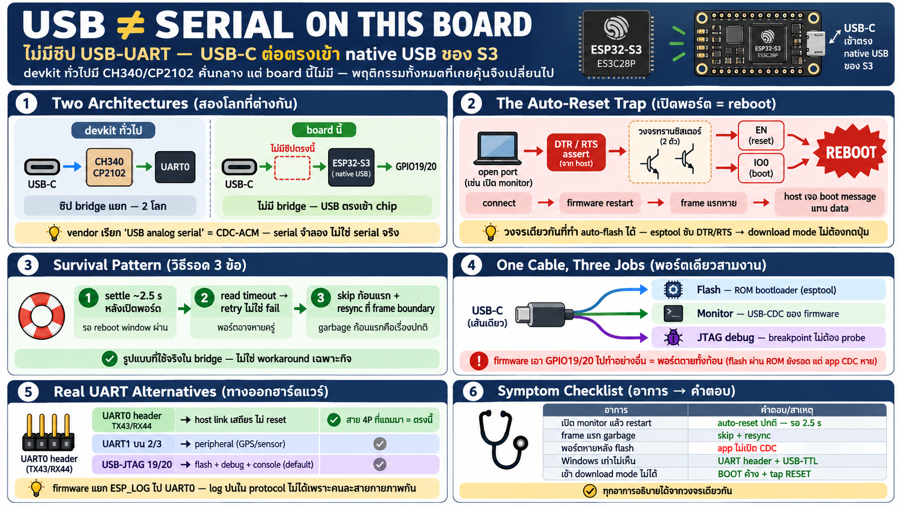

# USB/Serial บน board นี้ — ไม่มีชิป USB-UART และกับดักที่ตามมา



## จุดต่างสถาปัตยกรรม: USB ตรงเข้าชิป

devkit ทั่วไป (ตระกูล DevKitC, NodeMCU) มีสองโลกแยกกัน:

```
┌───────┐      ┌──────────────────────────────┐      ┌────────────────────┐
│ USB-C │ ───► │ CH340 / CP2102               │ ───► │ UART0 of the ESP32 │
└───────┘      │ USB-UART bridge              │      └────────────────────┘
               │ separate chip, USB to serial │
               └──────────────────────────────┘
```

board ES3C28P **ไม่มีชิป bridge** — USB-C ต่อตรงเข้า native USB ของ
ESP32-S3 บน GPIO19/20:

```
┌───────┐      ┌─────────────────────┐      ┌───────────────────────┐
│ USB-C │ ───► │ ESP32-S3 native USB │ ───► │ GPIO19 (D-) / 20 (D+) │
└───────┘      │ USB-Serial / JTAG   │      └───────────────────────┘
               └─────────────────────┘
```

ผู้ผลิตเรียกมันว่า "USB analog serial" — ผลข้างเคียงคือพฤติกรรมทั้ง
หมดที่เคยคุ้นกับ CH340 เปลี่ยนไป และนี่คือสาเหตุของกับดักทุกข้อใน
บทนี้

## Host เห็นอะไร

- เสียบสายแล้ว host เห็น `/dev/cu.usbmodem*` — เป็น **USB CDC-ACM
  device** (serial จำลองผ่าน USB protocol) ไม่ใช่ serial port จริง
- ตัว USB stack มี 2 ชีวิต: **ROM bootloader** (โรงงาน — ใช้ตอน
  flash/download mode) กับ **firmware ที่ flash ลงไป** (ถ้า app ไม่
  init USB-CDC, port จะหายหรือเปลี่ยนหน้าตาหลัง boot)
- symptom ที่เจอ: flash firmware ใหม่แล้ว port "หายไปพักนึงแล้วกลับ
  มาเป็นชื่อเดิม" หรือไม่กลับมาเลย — ขึ้นกับ firmware เปิด CDC ไว้ไหม
- **Windows <10 ไม่มี USB-CDC driver ในตัว** → ทางหนีเดียวคือ UART
  header + USB-TTL adapter ภายนอก

## กับดักใหญ่: เปิด port = chip reset

นี่คือสิ่งที่ทำให้ทุกคนงงครั้งแรก: **ทุกครั้งที่โปรแกรมเปิด serial
port, board จะ reboot**

### วงจรจริง (สั้น ๆ แต่เป็นสาเหตุของทุก symptom)

สาย serial มีสายควบคุม 2 เส้นคือ **DTR** และ **RTS** — บน board มี
auto-reset circuit (transistor pair) แปลงสองเส้นนี้ไปที่ขา
**EN (reset)** และ **IO0 (BOOT)**:

```
┌─────┐        ┌─────┐
│ DTR │        │ RTS │
└──┬──┘        └──┬──┘
   │              │
   └──────┬───────┘
          ▼
      ┌───────┐
      │ logic │
      └───┬───┘
          │
         ┌┴───────────────────────┐
         ▼                        ▼
┌─────────────────┐      ┌────────────────┐
│ EN              │      │ IO0            │
│ CHIP_PU / reset │      │ BOOT strapping │
└─────────────────┘      └────────────────┘
```

- host software เปิด port → OS/driver assert DTR/RTS → transistor
  pair ดึง EN ลง → **chip reset**
- ตอน flash: esptool ขับ DTR/RTS เป็น pattern เฉพาะ → IO0 ลง + EN
  pulse → เข้า **download mode** อัตโนมัติ (ไม่ต้องกดปุ่ม)
- วงจรเดียวกันนี้เองที่ทำให้ auto-flash ทำงานได้ — และที่ทำให้
  serial monitor ทุกตัว reset board โดยไม่ตั้งใจ

### symptom ที่ตามมา

- เปิด monitor/bridge → firmware restart → **frame แรก ๆ หาย**,
  log ขาดช่วง, host อ่านเจอ boot message แทน data
- host ที่ออกแบบ "connect แล้วคุยทันที" จะอ่านเจอ garbage ก้อนแรก
  (boot log ของ ROM)

### วิธีรอด (รูปแบบที่ใช้จริง)

1. **settle delay ~2.5 s หลังเปิด port** — รอ reboot window ผ่านไป
   ก่อนคุย (bridge ตัวจริงใช้ `--settle-ms` ทำสิ่งนี้)
2. **read timeout ต้อง retry ไม่ใช่ fail** — ช่วง reboot port อาจ
   หายไปครู่หนึ่ง
3. **ออกแบบ protocol ให้ทน garbage ก้อนแรก** — เฟรมแรกที่อ่านได้
   อาจไม่ใช่ data จริง ต้องมี resync point (COBS frame boundary)

## Port เดียว สามงาน — สะดวกและเปราะพร้อมกัน

สาย USB เส้นเดียวบน GPIO19/20 ทำ 3 หน้าที่:

| งาน | ชั้นที่ทำ |
|---|---|
| Flash firmware | ROM bootloader (esptool คุยตรง) |
| Console/monitor | USB-CDC ของ firmware (ถ้า app เปิดไว้) |
| **JTAG debug** | USB-JTAG peripheral — breakpoint/step ได้ ไม่ต้องซื้อ probe |

ข้อดีชัด: debug จริงผ่านสายเดิม (ตามที่เห็นในบท ESP-IDF)
ข้อควรรู้: **ถ้า firmware เอา GPIO19/20 ไปใช้อย่างอื่น — USB-CDC
ของ app ตายทั้งก้อน** (flash ผ่าน ROM ยังรอด แต่หน้าต่าง monitor/
protocol หาย)

## ทางเลือก: hardware UART — เมื่อไหร่ควรใช้

board นี้ยังมี UART จริงให้เล่น:

| ช่อง | ขา | ใช้ทำอะไร |
|---|---|---|
| **UART0** (4-pin header) | TX 43 / RX 44 | host link ที่เสถียร — ไม่มี auto-reset, สาย 4P ที่แถมมาคือตรงนี้ |
| **UART1** (expansion) | TX 2 / RX 3 | peripheral — GPS, sensor module ฯลฯ |
| **USB-JTAG** | 19/20 | flash + debug + console (default) |

เหตุผลเชิงออกแบบที่น่าจำ: firmware บน board นี้จงใจเอา **ESP_LOG ไว้
บน UART0** แยกออกจาก protocol frame บน USB — log ไม่มีทางปนใน
protocol เพราะคนละสายกายภาพกันเลย เทคนิค "แยก channel ด้วยสาย"
ปลอดภัยกว่า "แยกด้วย prefix"

## Checklist — ปัญหาที่จะเจอแน่และคำตอบ

| อาการ | สาเหตุ | ทำอะไร |
|---|---|---|
| เปิด monitor แล้ว board restart | auto-reset ผ่าน DTR/RTS | ปกติ — รอ ~2.5 s |
| frame แรกเป็น garbage/boot text | reboot window | skip ก้อนแรก, resync ที่ frame boundary |
| port หายหลัง flash firmware ใหม่ | app ไม่เปิด USB-CDC | ตรวจว่า firmware init CDC ไว้ |
| Windows เก่าไม่เห็น port | ไม่มี CDC driver | USB-TTL + UART0 header |
| อยากได้ serial "นิ่ง" ไม่ reboot | ต้องเลี่ยง USB-JTAG | UART0 header (43/44) |
| เข้า download mode ไม่ได้ | — | hold BOOT → tap RESET → ปล่อย BOOT (manual path เสมอ) |
