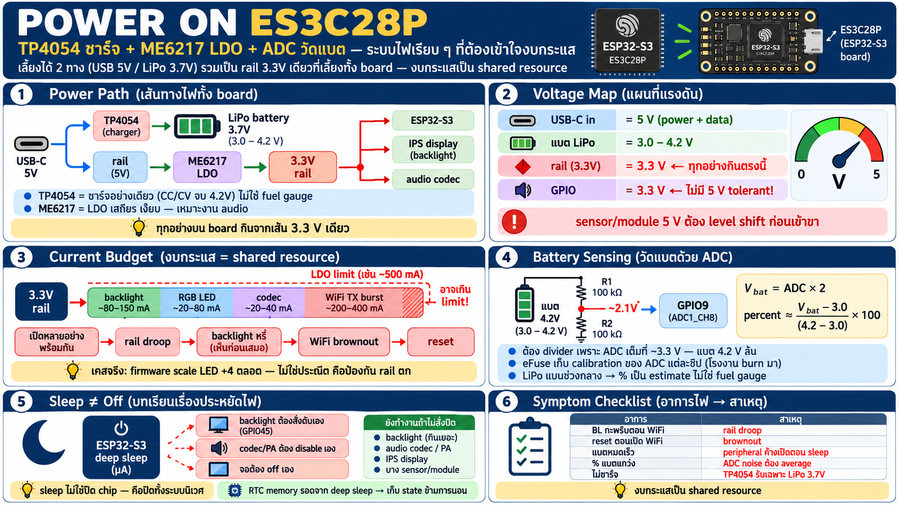

# ระบบไฟและแบตเตอรี่ — TP4054, LDO, และการวัดแบตผ่าน ADC



## ภาพรวม power path

board นี้เลี้ยงได้ 2 ทาง — USB-C (5 V) หรือแบต LiPo 3.7 V ต่อเข้า
battery header:

```
                    ┌───────────┐
                    │ USB-C 5 V │
                    └─────┬─────┘
                          │
      ┌───────────────────┴─────────────┐
      ▼                                 ▼
┌───────────┐                       ┌──────┐
│ TP4054    │                       │ rail │
│ charge IC │                       └───┬──┘
└─────┬─────┘                           │
      ▼                                 │
┌────────────┐                          │
│ LiPo 3.7 V │                          │
│ 3.0-4.2 V  │                          │
└──────┬─────┘                          │
       │                                │
       └───────────────┬────────────────┘
                       ▼
            ┌─────────────────────┐
            │ ME6217 LDO          │
            │ stable step-down    │
            └──────────┬──────────┘
                       ▼
                   ┌───────┐
                   │ 3.3 V │
                   └───┬───┘
                       ▼
            ┌─────────────────────┐
            │ ESP32-S3            │
            │ and the whole board │
            └─────────────────────┘
```

- **TP4054** = charge management IC ตัวเล็ก — single-cell LiPo,
 constant-current/constant-voltage จบที่ 4.2 V — charge ให้เฉพาะ
  แบต 3.7 V เท่านั้น (ห้ามเอา cell อื่นมาต่อ)
- **ME6217** = LDO regulator — แปลง 5 V (USB) หรือ ~3.0–4.2 V
  (แบต) ให้เป็น rail 3.3 V ที่นิ่งพอให้ ESP32 + peripheral ทำงาน
- ไม่มีชิป power path ซับซ้อน — เป็นโครงเรียบ ๆ แบบ low-cost:
 USB charge +เลี้ยงไปพร้อมกัน, แบตเลี้ยงเมื่อถอดสาย

## กฎแรงดันที่ต้องจำ

| จุด | แรงดัน | หมายเหตุ |
|---|---|---|
| USB-C input | 5 V | เป็นได้ทั้ง power + data |
| แบต LiPo | 3.0–4.2 V | TP4054 charge จบที่ 4.2 V |
| rail หลัก | **3.3 V** | ทุกอย่างบน board กินจากเส้นนี้ |
| GPIO ทุกขา | 3.3 V | **ไม่มี 5 V tolerant** — sensor/module 5 V ต้อง level shift |

## ขีดจำกัดกระแส — ของจริงที่กัดบน board นี้

LDO มีเพดานกระแส และ WiFi TX burst ของ ESP32 กินช่วงสั้น ๆ
หลายร้อย mA — เมื่อ rail droop อาการจะออกที่อุปกรณ์กินไฟหนักก่อน:

- **backlight กะพริบ/หรี่** — BL ถูกขับผ่าน FET จาก rail ตรง ๆ
  supply droop เห็นที่หน้าจอก่อนเสมอ (vendor FAQ ยืนยันจุดนี้)
- **WiFi ตัด/ไม่ connect** — peak เกิน rail ไหว chip brownout
- **RGB LED สว่างเต็มที่ + backlight พร้อมกัน** = รวมกระแสเกินงบ —
  เหตุที่ firmware บน board นี้ scale ค่า LED ÷4 ตลอด (ดูประณีต
  แต่จริง ๆ คือป้องกัน rail ตก)

บทเรียนเชิงออกแบบ: งบกระแสบน board เล็ก ๆ คือ **shared resource**
— เปิดอุปกรณ์หลายตัวพร้อมกันต้องคิดรวม ไม่ใช่คิดทีละตัว

## การวัดแบต — อ่านแรงดันด้วย ADC

- battery sense อยู่บน **GPIO9 = ADC1_CH8** ผ่าน **voltage divider
  ~1/2** (แบต 4.2 V → ~2.1 V ที่ขา ADC — อยู่ใน range ของ ADC 3.3 V)
- ทำไมต้อง divider: ADC อ่านได้สูงสุด ~3.3 V (จริง ๆ ต่ำกว่านั้น
  ตาม attenuation) — แบตเต็ม 4.2 V ต้องหารลงก่อนเสมอ
- อ่านค่า: `ADC raw → แรงดันที่ขา → ×2 กลับเป็นแรงดันแบต →
  แปลงเป็น % จากช่วง 3.0–4.2 V`
- **calibration มาจาก eFuse** — โรงงาน burn ค่า reference ของ ADC
  ไว้ให้แต่ละชิป (เชื่อมกับบท memory: eFuse ไม่ได้มีแค่ MAC/key)
- ข้อควรรู้: ADC ของ ESP32 ไม่ linear ตลอดช่วง — ค่าปลายช่วง
  (ใกล้ 0 หรือใกล้เต็ม) คลาดเคลื่อนกว่า → divider 1/2 ทำให้ช่วงที่
  ใช้จริง (3.0–4.2 V → 1.5–2.1 V) ตกในโซน linear ที่ดีของ ADC

### สูตรโดยประมาณ

```
V_bat  = ADC_reading × 2          (ชด divider 1/2)
percent ≈ (V_bat - 3.0) / (4.2 - 3.0) × 100   (clamp 0–100)
```

แบต LiPo ไม่ได้ discharge เป็นเส้นตรง — ช่วงกลางแบน (3.7–3.9 V
นานสุด) เพราะงั้น % จากแรงดันเป็นแค่ estimate อย่าคาดหวังความ
แม่นระดับ fuel gauge IC

## เจาะชิปทีละตัว

### TP4054 — charge อย่างเดียวไม่จัดการอย่างอื่น

- charge IC ขนาด SOT-23 — ทำ CC/CV charge สำหรับ single cell
- จบ charge ที่ 4.2 V แล้วตัด (ไม่มีจอภาพ ไม่มี timer ซับซ้อน)
- **ไม่ใช่ fuel gauge** — ไม่บอก % แบต (เหตุที่ต้องวัดเองผ่าน ADC)
- **ไม่ใช่ protection IC ระดับสูง** — อย่าคาดหวัง over-discharge 
  cutoff ชาญฉลาด; ถ้าแบตร่วงต่ำมาก ๆ ให้ใช้แบตที่มี protection
  board ในตัว

### ME6217 — LDO ตัวเลี้ยงทั้ง board

- linear regulator: เรียบ ไม่มี switching noise — เหมาะกับงาน
  analog/audio (codec บน board นี้แพ้ noise ง่าย)
- ข้อเสีย: สิ้นเปลืองเป็นร้อนเมื่อ input สูง (5 V → 3.3 V ทิ้ง
  ~34% เป็นความร้อน) — USB จึงอุ่นกว่าเลี้ยงแบต
- เพดานกระแสจำกัด — เหตุผลเดียวกับเรื่องงบกระแสด้านบน

## เชื่อมกับ sleep modes (บท memory กลับมาใช้)

- deep sleep ปิด main power domain → กระแสเหลือระดับ µA — แต่
  **อุปกรณ์บน board ไม่ได้หลับตาม**: backlight, codec, จอ ต้อง
  สั่งปิดเอง (GPIO45 ดับ, PA disable) ไม่งั้นนอนกินไฟต่อ
- RTC memory รอดจาก deep sleep → เก็บ state เช่น "ครั้งที่ตื่น"
  หรือค่า sensor ล่าสุด
- กฎทองของ board ที่มี peripheral แน่น: **sleep ไม่ใช่ปิด chip —
  คือปิดทั้งระบบนิเวศ** อย่าลืมตัดไฟเลี้ยงอุปกรณ์ข้างนอกก่อนนอน

## Checklist — อาการไฟที่เจอบ่อย

| อาการ | สาเหตุน่าสงสัย |
|---|---|
| backlight กะพริบ/หรี่ตอน WiFi ทำงาน | rail droop — งบกระแสเกิน |
| board reset ตอนเปิด WiFi | brownout — peak เกิน LDO/แบตจ่ายไหว |
| แบตหมดเร็วผิดปกติ | peripheral ค้างเปิดตอน sleep (BL, codec, จอ) |
| อ่าน % แบตแกว่ง/ไม่นิ่ง | ADC noise + divider — ต้อง average หลายครั้ง |
| เสียบแบตแล้วไม่ charge | ตรวจชนิด cell — TP4054 รับเฉพาะ LiPo 3.7 V |
| ต่อ sensor 5 V เข้า GPIO แล้วขาเจ็บ | GPIO ไม่ 5 V tolerant — ต้อง level shift |
