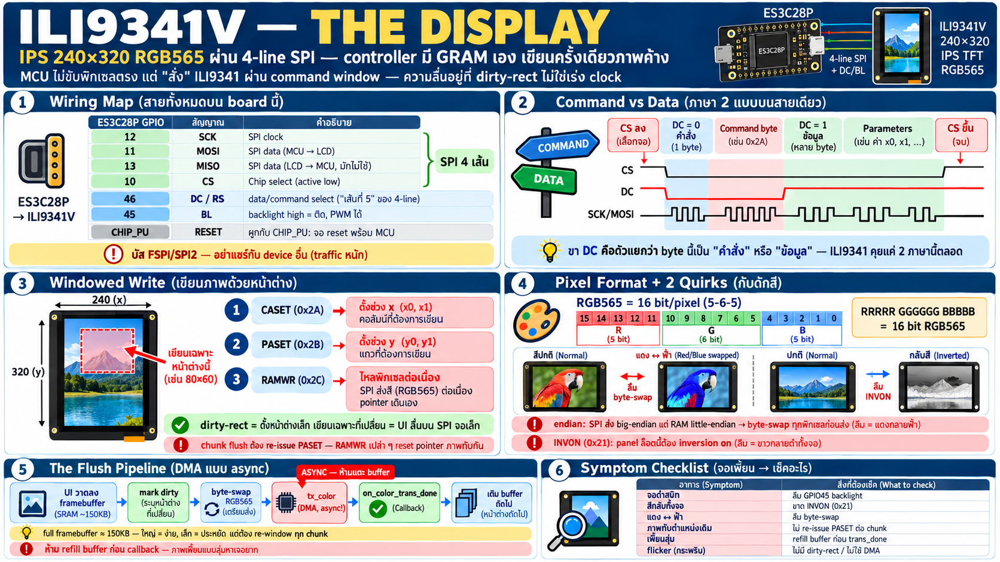

# จอ ILI9341V — SPI display 240×320 บน board ES3C28P



## ILI9341 คืออะไร

- **display controller IC** ในตัวจอ TFT 2.8" — MCU ไม่ได้ขับพิกเซล
  ตรง ๆ แต่ "สั่ง" ILI9341 ให้จัดการ
- panel: **IPS, 240×320 pixel**, สี **RGB565** (16 bit/pixel —
  ทางเลือก RGB666 แต่ firmware ทั่วไปใช้ 565)
- ภายในมี GRAM (graphic RAM) ของตัวเอง — เขียนพิกเซลลง GRAM ผ่าน
  SPI แล้ว controller สแกนออกจอเองตลอดเวลา = **ไม่ต้อง refresh
  ฝั่ง MCU** เขียนครั้งเดียวภาพค้าง

## Wiring บน board นี้ — SPI 4 เส้น + DC

| สัญญาณ | GPIO | หน้าที่ |
|---|---|---|
| SCK | 12 | clock |
| MOSI | 11 | data ออก (MCU→จอ) |
| MISO | 13 | data เข้า (อ่าน register — แทบไม่ได้ใช้) |
| CS | 10 | chip select, low active |
| **DC/RS** | 46 | data/command select — นี่คือ "4-line SPI" |
| Backlight | 45 | high = ติด, PWM ได้ (FET-driven) |
| Reset | CHIP_PU | **ผูกกับ reset ของ chip** — จอ reset พร้อม MCU เสมอ |

Bus นี้คือ FSPI/SPI2 ของ S3 — ถ้าอยากเพิ่ม SPI device ข้างนอกต้อง
ใช้ขาอิสระ (2/3/14/21) ทำ bus ใหม่ ห้ามมา share เส้นจอเพราะ traffic
หนักตลอดเวลา

## Protocol: command vs data ผ่านขา DC

ILI9341 คุย 2 ภาษาบนสายเดียว — แยกกันด้วย DC:

- **DC = 0** → byte ที่ส่งคือ **command** (register address)
- **DC = 1** → byte ที่ส่งคือ **parameter/data**

ลำดับคุยทั่วไป: CS ลง → command (DC=0) → parameters (DC=1) → CS ขึ้น
— transaction ขนาดเล็กนี้แหละที่ควบคุมทั้งจอ ตั้งแต่ init ยันเขียน
พิกเซล

## Windowed write — CASET/PASET/RAMWR

จอเป็นอุปกรณ์ SPI อีกตัวหนึ่งของชิป:

```
┌─────────────┐            ┌───────────┐
│ ESP32-S3    │ ── SPI ──► │ ILI9341   │
│ FSPI / SPI2 │            │ 240 x 320 │
└─────────────┘            └───────────┘
```

การเขียนภาพหนึ่งครั้งคือสามคำสั่งตามลำดับ:

```
┌──────────┐                         ┌─────────┐
│ ESP32-S3 │                         │ ILI9341 │
└─────┬────┘                         └────┬────┘
      │                                   │
      │ CASET 0x2A, columns ─────────────►│
      │ PASET 0x2B, rows ────────────────►│
      │ RAMWR 0x2C, pixels ──────────────►│
```

วิธีเขียนภาพของ ILI9341 ไม่ใช่ "ส่งพิกเซลที่ (x,y)" — คือ **ตั้ง
หน้าต่างแล้วไหลข้อมูลต่อเนื่อง**:

```
CASET (0x2A): x_start, x_end    ← ตั้งช่วง column
PASET (0x2B): y_start, y_end    ← ตั้งช่วงแถว
RAMWR (0x2C): pixel0, pixel1, … ← ไหลข้อมูลลงหน้าต่าง
```

- write pointer เดินเองภายในหน้าต่าง — ส่งต่อเนื่องได้ยาว ๆ เร็ว
  มาก (ไม่ต้องส่ง address ทุกพิกเซล)
- **partial update**: ตั้งหน้าต่างเล็ก ๆ แล้วเขียนเฉพาะส่วนที่เปลี่ยน
  = dirty-rectangle flush — หัวใจของ UI ที่ลื่นบน SPI จอเล็ก
- **กับดักจริงบน board นี้**: ถ้า flush แบบแบ่ง chunk ต้อง re-issue
  `PASET` ทุก chunk — ส่ง `RAMWR` เปล่า ๆ แล้ว write pointer
  จะ reset กลับจุดเริ่มของหน้าต่าง ภาพเขียนทับกันเอง

## RGB565 และ endian quirk

- พิกเซลละ 2 byte: `RRRRR GGGGGG BBBBB` — เขียว 5 bit, แดง 5 bit,
  ฟ้า 5 bit
- **SPI ส่ง big-endian แต่หน่วยความจำเป็น little-endian** →
  framebuffer ใน RAM ต้อง byte-swap ทุกพิกเซลก่อนส่ง ไม่งั้นสี
  เพี้ยนทั้งจอ (แดงกลายฟ้า ฯลฯ)
- swap ทำตอนเติม TX buffer — อย่าสลับใน framebuffer ต้นทางเพราะ
  UI/drawing code ต้องการค่าปกติ

## INVON — quirk ที่ทุกคนเจอ

- panel บน board นี้ต้อง **`INVON (0x21)` — display inversion on**
  ไม่งั้นสีทั้งจอกลับ (ขาวเป็นดำ)
- init sequence ของ driver ต้องมีคำสั่งนี้ — ถ้าภาพออกมาสีกลับ
  แปลว่าลืม INVON ไม่ใช่จอพัง
- (เป็นความผันแปรของ panel แต่ละตัว — ILI9341 บางล็อตไม่ต้อง
  บางล็อตต้อง; ล็อตของ board นี้ต้อง)

## Pipeline การวาดจริง — framebuffer → dirty rect → DMA

pattern ที่ firmware ใช้จริง:

```
UI code วาดลง framebuffer (SRAM, RGB565)
   → mark dirty region (ส่วนที่เปลี่ยนจริง)
   → byte-swap ลง TX buffer
   → esp_lcd tx_color (DMA, async!)
   → on_color_trans_done → เติม buffer ถัดไป
```

จุดที่ต้องระวัง:

- **`tx_color` เป็น async** — SPI/DMA ทำงานเบื้องหลัง ห้ามแก้
  buffer จนกว่า callback `on_color_trans_done` จะยิง — refill
  ก่อนเวลา = ภาพเพี้ยนแบบสุ่มหาเจอยาก
- framebuffer เต็มจอ 240×320×2 ≈ **150 KB** — ทางเลือก:
  full buffer ใน SRAM (เร็ว ง่าย แต่กิน RAM) / buffer เล็กแบ่ง
  chunk (ประหยัด แต่ต้อง re-issue window ตามข้างบน)
- SPI clock ยิงได้หลักสิบ MHz — จอขนาดนี้ full flush ใช้เวลาไม่นาน
  แต่ UI ลื่นอยู่ที่ dirty-rect เป็นหลัก ไม่ใช่เร่ง clock

## Backlight — GPIO45

- high = ติด / low = ดับ — FET-driven จาก rail ตรง (เชื่อมกับบท
  power: droop เห็นที่แสงจอก่อนเสมอ)
- **PWM ได้ผ่าน LEDC** → ปรับความสว่างเป็นขั้น — แต่ระวัง PWM
  frequency ต่ำจะเห็น flicker; บท power ก็เตือนว่า BL คือตัวกิน
  กระแสอันดับต้น — dim ลงช่วยงบไฟด้วย
- symptom คลาสสิก: flash เสร็จจอดำสนิท → ลืม drive GPIO45 ขึ้น
  (ตรวจจุดนี้ก่อนสงสัยจอพัง)

## เชื่อมเรื่องที่เคยเจอ: ทำไม bit-bang LED เจ๊งข้างจอนี้

- WS2812 บน GPIO42 เคยถูกขับด้วย bit-bang — timing โดน SPI/DMA
  ของจอแย่ง CPU/bus ทุก flush → LED flicker เห็นชัด
- แก้ด้วยย้ายไป **RMT** (hardware-timed, CPU-free) — บทเรียน:
  งาน timing-critical ห้ามพึ่ง CPU บนระบบที่มี DMA traffic หนัก
- กฎกว้าง ๆ: **ถ้ามี DMA อยู่ ทุกอย่างที่ต้อง timing ต้องเป็น
  hardware peripheral** — ไม่ใช่ code

## Checklist — จอมีปัญหา ตรวจตามนี้

| อาการ | สาเหตุน่าสงสัย |
|---|---|
| จอดำสนิท | ลืม drive GPIO45 (backlight) / init sequence ไม่ถึง |
| สีกลับทั้งจอ | ขาด `INVON (0x21)` ใน init |
| สีเพี้ยน แดง↔ฟ้า | ลืม byte-swap RGB565 (endian) |
| ภาพซ้อน/เขียนทับตำแหน่งเดิม | chunk flush ไม่ re-issue PASET — RAMWR reset pointer |
| ภาพเพี้ยนแบบสุ่ม | refill TX buffer ก่อน `on_color_trans_done` |
| flicker ตอนวาด | SPI speed ต่ำ / ไม่ใช้ DMA / full flush ทั้งจอทุก frame |
| ทำงานได้แต่ช้า | ไม่มี dirty-rect — ส่งทั้งจอทุกครั้ง |
