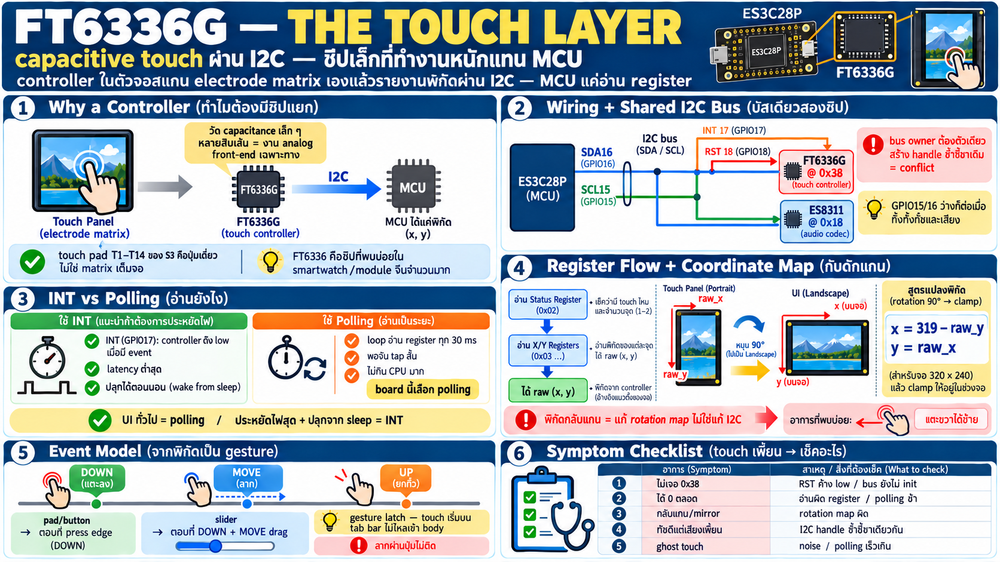

# Touch screen FT6336G — capacitive touch ผ่าน I2C



## FT6336G คืออะไร

- **capacitive touch controller** ในตัวหน้าจอสัมผัส — งานหนักทั้งหมด
  (สแกน matrix ของ touch panel, filter noise, หาจุดสัมผัส, ตีความ
  เป็น gesture) อยู่ในชิปตัวนี้
- MCU ไม่ได้อ่านสัญญาณ analog เองเลย — ได้แค่ **อ่าน register ผ่าน
  I2C** แล้วรับพิกัดพร้อมใช้
- เป็น controller ตัวเดียวกับที่พบใน smartwatch/module จอเล็กจีน
  จำนวนมาก — spec กว้างขวาง driver มีให้ทุก ecosystem

### ทำไมต้องมี controller แยก

capacitive sensing คือการวัด capacitance เล็ก ๆ ที่เปลี่ยนตอนนิ้ว
แตะ — ต้อง drive/sense electrode matrix หลายสิบเส้นด้วย analog
front-end เฉพาะทาง + firmware ในชิปคอยคำนวณ centroid เป็น (x,y)
ESP32-S3 มี touch sensor pad ในตัว (T1–T14) แต่นั่นคือปุ่มจม/
pad เดี่ยว — ไม่ใช่ matrix เต็มจอ 320×240 นี่คือเหตุที่ touch
screen ทุกตัวต้องมี controller เฉพาะ

## Wiring บน board นี้

| สัญญาณ | GPIO | หน้าที่ |
|---|---|---|
| SDA | 16 | I2C data |
| SCL | 15 | I2C clock |
| INT | 17 | interrupt — **ลง low เมื่อมี touch event** |
| RST | 18 | reset touch controller, low active |
| I2C address | `0x38` | 7-bit address ของ FT6336G |

## I2C bus sharing — bus เดียวสองชิป

SDA16/SCL15 ไม่ได้ให้ touch คนเดียว — **share กับ ES8311 audio codec
(address `0x18`)** บน bus เดียวกัน:

```
I2C bus (SDA16/SCL15)
   ├─► FT6336G  touch   @ 0x38
   └─► ES8311   codec   @ 0x18
```

ผลที่ต้องเข้าใจ:

- แยกกันด้วย **address** — transaction ระบุว่าคุยกับใคร พูดพร้อม
  กันไม่ได้ (I2C เป็น shared bus แบบ half-duplex โดยกำเนิด)
- firmware ต้องมี **owner เดียวของ bus** (bus handle เดียวที่ทั้ง
  touch driver และ codec driver ใช้ร่วม) — สร้าง bus สองตัวชี้ขา
  เดียวกัน = conflict
- ข้อเสียที่แพ้จริง: **GPIO15/16 ใช้เป็น GPIO ธรรมดาได้ก็ต่อเมื่อ
  ทิ้งทั้ง touch และเสียงพร้อมกัน** — นี่คือต้นทุนของการ share

## Interrupt vs polling

- **INT pin (GPIO17)**: controller ดึง low เมื่อมี event รอ —
  ใช้เป็น edge trigger ปลุกให้มาอ่าน ได้ latency ต่ำสุด
- **polling**: ไม่อ่าน INT เลย ตั้ง loop อ่าน register ทุก N ms —
  UI บน board นี้เลือก polling **30 ms** พอจับ tap สั้นได้ทันและ
  ไม่กิน CPU
- เลือกแบบไหนขึ้นกับงาน: UI ทั่วไป polling พอ; งานที่ต้องตอบสนอง
  ทันทีหรือประหยัดไฟสุด (นอนรอ touch ปลุก) → INT

## อ่านจุดสัมผัส — register flow

Pattern มาตรฐานของ touch controller ตระกูลนี้:

```
อ่าน status register → ได้จำนวน touch point (0 = ไม่มี)
   → ถ้า >0: อ่าน register คู่ X/Y ของแต่ละจุด
   → ได้ raw coordinate ในระบบพิกัดของ touch panel
```

- FT6336G รองรับหลายจุด (multi-touch) แต่ board + UI นี้ใช้จุดเดียว
- register map แบ่งเป็น: status (จำนวนจุด), ข้อมูลต่อจุด
  (X high/low, Y high/low, weight, touch id) — 12 bit per axis

## Coordinate mapping — กับดักที่เจอจริงทุก board

raw coordinate ของ touch panel อยู่ในแกน **portrait ของ panel**
แต่ UI ใช้ **landscape** — ต้องหมุนแผนที่ก่อนใช้:

```
จอ landscape: x = 319 - raw_y,  y = raw_x   (rotation 90°)
แล้ว clamp ให้อยู่ในขอบจอ
```

- ลืมแปลง = touch ตรงแนวตั้งแต่กลับแนวนอน / mirrored — symptom
  คลาสสิก "แตะขวาได้ซ้าย" หรือ "แตะล่างได้ขวา"
- กฎจำ: **ถ้าพิกัดดูเหมือนกลับแกน อย่าแก้ I2C — แก้ rotation map**
- เพดานค่า raw ไม่เท่าจอเสมอ → clamp เสมอหลังแปลง

## Event model — จากพิกัดเป็น gesture

driver ให้แค่ "ตอนนี้มีนิ้วที่ (x,y) หรือไม่มี" — UI ต้องตีเป็น
event เอง:

- **DOWN** = จุดขึ้นครั้งแรก (ก่อนหน้าไม่มีจุด)
- **MOVE** = จุดยังอยู่และขยับ
- **UP** = จุดหายไป
- pattern ที่ใช้จริงบน board: pad/button ตอบที่ **press edge**
  (DOWN), slider ตอบที่ DOWN|MOVE drag
- **gesture latch**: touch ที่เริ่มบน chrome (tab bar) ถูกล็อกไม่
  ให้ไหลเข้า body control — แตะ tab แล้วลากผ่านปุ่มจะไม่กดปุ่ม
  ติด — รายละเอียดเล็กที่ทำให้ UI "รู้สึกถูกต้อง"

## Checklist — touch มีปัญหา

| อาการ | สาเหตุน่าสงสัย |
|---|---|
| อ่าน I2C ไม่เจอ 0x38 | RST (GPIO18) ยังค้าง low / bus owner ไม่ได้ init |
| ได้ค่า 0 ตลอดทั้งที่แตะอยู่ | อ่านผิด register / polling ช้าเกิน event หลุด |
| พิกัดกลับแกน/mirror | rotation map ผิด — แก้ transform ไม่ใช่ I2C |
| touch ดีแต่เสียงเพี้ยน/ค้าง | I2C conflict — bus ถูกสร้าง 2 handle ชี้ขาเดียวกัน |
| ghost touch / จุดเพี้ยน | noise บน panel / polling เร็วเกินจนอ่านค่าระหว่าง update |
| ขยับช้า/ค้างตอนเสียงเล่น | transaction บน shared bus ชนกัน — ดู arbitration/timeout |
