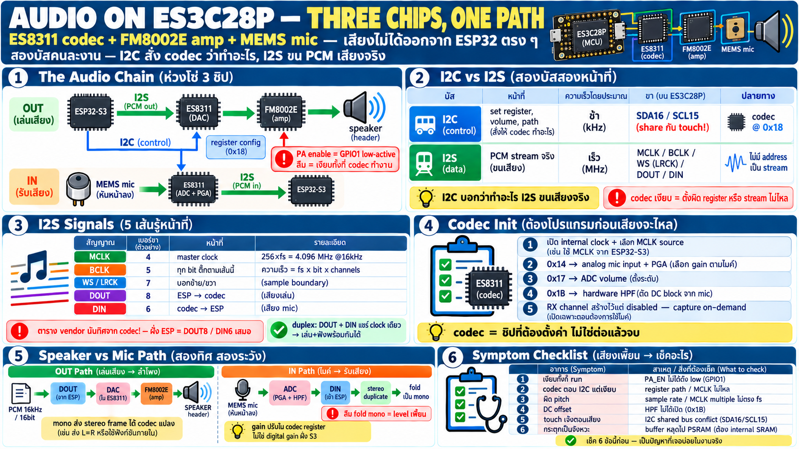

# ระบบเสียง — ES8311 codec + FM8002E amp + MEMS mic



## สามชิปในเส้นทางเสียงเดียว

เสียงบน board นี้ไม่ได้ออกจาก ESP32 ตรง ๆ — มีห่วงโซ่ 3 ชิป:

```
speaker out
┌──────────┐          ┌────────┐      ┌─────────┐      ┌─────────┐
│ ESP32-S3 │ ─ I2S ─► │ ES8311 │ ───► │ FM8002E │ ───► │ speaker │
└──────────┘          │ DAC    │      │ amp     │      └─────────┘
                      └────────┘      └─────────┘

speaker in
┌──────────┐      ┌───────────┐          ┌──────────┐
│ MEMS mic │ ───► │ ES8311    │ ─ I2S ─► │ ESP32-S3 │
└──────────┘      │ ADC + PGA │          └──────────┘
                  └───────────┘

control
┌──────────┐          ┌───────────┐
│ ESP32-S3 │ ─ I2C ─► │ ES8311    │
└──────────┘          │ registers │
                      └───────────┘
```

- **ES8311** = audio codec — รวม DAC (เล่นเสียง) + ADC (รับ mic)
  + PGA (pre-amp) ในตัวเดียว คุย config ผ่าน I2C, ส่งข้อมูลเสียง
  ผ่าน I2S
- **FM8002E** = class-D speaker amplifier — codec ออก analog
  อ่อน ๆ ต้อง amp ขับลำโพง (header สำหรับลำโพงภายนอก)
- **LMA2718B381** = MEMS microphone หันหน้าลง (ลงบน board) —
  เสียงเข้า ADC ของ codec
- **PA enable = GPIO1, low-active** — ดึงลงเพื่อเปิด amp; ลืมเปิด =
  codec ทำงานปกติแต่ลำโพงเงียบ (symptom คลาสสิก "เสียงไม่ออก")

## สอง bus สองหน้าที่ — I2C vs I2S

จุดที่คนใหม่สับสนคือเห็น I2C กับ I2S คล้ายกัน — จริง ๆ คนละงาน
สิ้นเชิง:

| | I2C | I2S |
|---|---|---|
| งาน | **control** — set register, volume, เปิด/ปิด ADC/DAC | **data** — PCM audio stream จริง |
| ความเร็ว | ต่ำ (kHz) | สูง (MHz — sample × bit × channel) |
| ขา | SDA16 / SCL15 (share กับ touch!) | MCLK4, BCLK5, WS7, DOUT8, DIN6 |
| address | codec @ `0x18` | ไม่มี address — เป็น stream |

กฎจำ: **I2C บอก codec ว่าทำอะไร, I2S ขนเสียงจริง** — codec ที่
"มีอยู่แต่เงียบ" ส่วนมากคือ I2S ไหลแล้วแต่ register ตั้งผิด
(หรือ I2C ตั้งถูกแล้วแต่ I2S ยังไม่ไหล)

## I2S signal ทีละเส้น

| สัญญาณ | GPIO | หน้าที่ |
|---|---|---|
| MCLK | 4 | master clock — 256× sample rate = **4.096 MHz @ 16 kHz** — reference ให้ codec ทั้งตัว |
| BCLK | 5 | bit clock — ทุก bit ของ data ติ๊กตามเส้นนี้ |
| WS/LRCK | 7 | word select — บอกซ้าย/ขวา (sample boundary) |
| **DOUT** | 8 | data ออกจาก ESP → codec (เสียงที่จะเล่น) |
| **DIN** | 6 | data เข้า ESP ← codec ADC (เสียงจาก mic) |

### กับดักทิศทางขา (ของจริงบน board นี้)

เอกสารผู้ขายเขียนขา 6/8 กลับกัน — เพราะเขานับทิศ **จากมุมมอง codec**
ไม่ใช่จาก ESP: ขา 6 คือ "output" ฝั่ง codec (= เส้น DIN ของ ESP)
ฝั่ง firmware ใช้ `DOUT8 / DIN6` เสมอ ถ้าอ่านตาราง vendor แล้วงง
ให้ยึดฝั่ง ESP เป็นหลัก

### Duplex บน clock เดียวกัน

DOUT กับ DIN share BCLK/WS/MCLK เดียวกัน — เล่นเสียงและรับ mic พร้อม
กันได้ (full duplex) ที่ sample rate เดียว 16 kHz/16-bit — codec
ทำ ADC และ DAC พร้อมกันบน time slot เดียวของ frame

## Codec init — ทำไมต้องเขียน register

ES8311 ตื่นมาในสภาพที่ยังไม่พร้อม — ต้องโปรแกรมผ่าน I2C ก่อนเสียง
จะไหล ตัวอย่างขั้นตอนจริงบน board นี้:

- เปิด clock ภายใน + เลือก MCLK เป็น source
- **ขาเข้า mic**: เลือก analog mic input + เปิด PGA (pre-amp) —
  `0x14`
- **ADC volume**: ตั้งระดับเสียงเข้า — `0x17`
- **HPF (high-pass) ในตัว**: ตัด DC block ออกจากสัญญาณ mic —
  `0x1B`
- แล้วค่อยเปิด path — RX channel ถูกสร้างไว้แต่ disable จนกว่า
  จะเรียก enable จริง (capture on-demand — ไม่เปิด mic ค้าง)

บทเรียน: **codec = ชิปที่ต้อง "ตั้งค่า" ไม่ใช่ "ต่อแล้วจบ"** —
init sequence คือส่วนหนึ่งของวงจรเสียงเท่า ๆ กับสาย

## ขั้นตอนเสียงออก (speaker path)

```
sample → [DSP chain ใน firmware] → PCM buffer →
I2S DOUT(8) → ES8311 DAC → analog อ่อน →
FM8002E (ต้อง PA_EN GPIO1 low) → SPEAKER header
```

- PCM ที่ส่ง = 16 kHz/16-bit stereo frame (codec duplicate mono)
- amp enable ต้อง **low** — ผิด logic คือเงียบ ไม่ใช่เสียงเบา

## ขั้นตอนเสียงเข้า (mic path)

```
MEMS mic → ES8311 ADC (PGA + HPF) → I2S DIN(6) →
ESP32 อ่านเป็น stereo frame → mono → DSP/level
```

- mic เป็น analog MEMS → เข้า codec เลย ไม่ผ่าน ADC ของ S3
- gain ปรับได้ผ่าน register codec (ADC scale) — ไม่ใช่ digital gain
  ฝั่ง S3
- mono source มาเป็น stereo duplicate — อย่าลืม fold ลง mono ก่อน
  คำนวณ level ไม่งั้นค่าเพี้ยน

## เชื่อมบทอื่น ๆ ที่ชนกันตรงนี้

- **I2C share กับ touch** — bus owner ต้องตัวเดียว (บท touch):
  codec init + touch poll อยู่เส้นเดียวกัน transaction ห้ามชน
- **DMA/PSRAM** — audio buffer ต้อง internal SRAM (DMA!) ไม่ใช่
  PSRAM (บท memory)
- **real-time** — render เสียงต้องเป็น dedicated task ไม่ใช่ใน
  executor/ISR (บท toolchain: นี่คือเหตุที่ต้อง pin task ลง core)
- **power** — LDO เลือกมาเพราะเงียบเหมาะงาน analog/audio
  (บท power); PA + BL พร้อมกันกินกระแสเพิ่ม

## Checklist — เสียงมีปัญหา

| อาการ | สาเหตุน่าสงสัย |
|---|---|
| ลำโพงเงียบทั้งที่ code run | PA_EN (GPIO1) ยังไม่ถูกดึง low — low-active |
| codec ตอบ I2C แต่ไม่มีเสียง | register path ตั้งผิด / MCLK ไม่ไหล |
| เสียงบิด/ผิด pitch | sample rate หรือ MCLK multiple ไม่ตรง fs |
| mic อ่านได้แต่ค่าแปลก | ลืม fold stereo→mono / gain register |
| เสียงมี DC offset ตลอด | HPF (0x1B) ไม่ได้เปิด — DC-block |
| touch เจ๊งตอนเสียงเล่น | I2C shared bus conflict — ดู transaction overlap |
| กระตุกเป็นจังหวะ | audio buffer ไม่ใช่ internal SRAM (หลุดไป PSRAM) |
