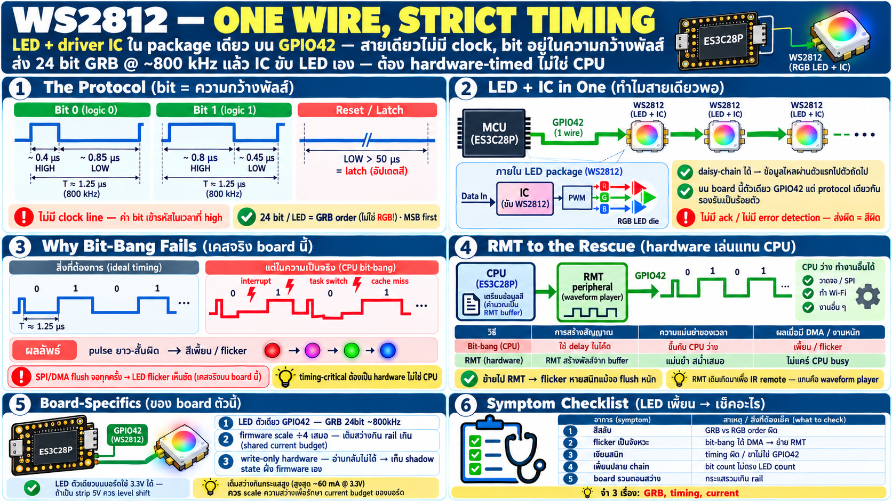

# RGB LED WS2812 — เส้นเดียวต้อง timing เป๊ะ และทำไมต้อง RMT



## WS2812 คืออะไร

- LED RGB ที่มี **driver IC ฝังในตัว package เดียว** — ไม่ใช่ LED
  ธรรมดาที่ต่อขา R/G/B แยก
- คุยด้วย **สายเดียว (single-wire)** ที่ ~800 kHz — ไม่มี clock
  แยก ไม่มี SPI/I2C
- ขึ้นชื่อเรื่อง **daisy-chain**: LED หลายตัวต่อหางกัน ข้อมูลไหล
  ผ่านตัวแรกไปตัวถัดไป — บน board นี้มีแค่ตัวเดียวบน **GPIO42**
  แต่ protocol เดียวกันนี้รองรับเป็นร้อยตัว
- IC ข้างในมี PWM ของตัวเอง — รับค่า 24 bit แล้วขับ LED ต่อเอง
  MCU ส่งครั้งเดียวสีค้าง

## Protocol: bit อยู่ใน "ความกว้าง pulse" ไม่ใช่ระดับไฟ

นี่คือจุดที่ทำให้ WS2812 ต่างจาก bus ปกติ — ไม่มี clock line,
ค่า bit เข้ารหัสในความกว้างของ pulse high:

```
bit 0: high ~0.4 µs → low ~0.85 µs
bit 1: high ~0.8 µs → low ~0.45 µs
reset: low >50 µs  = จบ frame, latch ค่าใหม่
```

- ส่ง 24 bit ต่อ LED: **GRB order** (เขียว-แดง-ฟ้า ไม่ใช่ RGB!)
  8 bit ต่อ channel, MSB ก่อน
- timing tolerance ±150 ns โดยประมาณ — ผิดนิดเดียวสีเพี้ยนหรือ
  LED เงียบ
- ไม่มี error detection ไม่มี ack — ส่งผิดคือสีผิด ไม่มีทางรู้จาก
  ฝั่ง LED

## ทำไม bit-bang เจ๊ง — เคสจริงบน board นี้

การขับด้วย code (`GPIO high; delay; GPIO low; delay`) ฟังดูได้
แต่พังบนระบบจริง:

- CPU โดนแย่งโดย **interrupt**, task switch, **cache miss**
  (code บางส่วนอยู่ flash — บท memory จำได้) → delay ที่เขียนไว้
  ไม่ตรง
- บน board นี้ **SPI/DMA flush จอทุกครั้งทำให้ LED flicker เห็น
  ชัด** — timing หลุดทุกครั้งที่จอวาด
- ยิ่ง LED หลายตัวยิ่งแย่: frame ยาวขึ้น = หน้าต่างที่ต้องนิ่ง
  ยาวขึ้น

กฎทั่วไปที่คุ้มค่าจำ: **เมื่อระบบมี DMA/interrupt หนัก ทุกงาน
timing-critical ต้องเล่นโดย hardware ไม่ใช่ CPU**

## RMT — peripheral ที่เกิดมาเพื่อเรื่องแบบนี้

- **RMT (Remote Control peripheral)** ของ ESP32 ออกแบบมาสำหรับ
  สัญญาณ IR remote แต่แกนมันคือ **waveform generator ที่เล่น
  จาก memory** — ใส่ pattern (high นานเท่าไร low นานเท่าไร) แล้ว
  hardware เล่นออกขาเอง ตรงตาม clock ไม่ต้อง CPU คุม
- mapping ลง WS2812: แต่ละ bit เป็นรายการ duration → RMT ไล่เล่น
  24 bit ต่อเนื่อง + ปิดท้าย reset — CPU เติม buffer แล้วปล่อย
- ผลบน board นี้: ย้าย LED จาก bit-bang ไป RMT แล้ว **flicker
  หายสนิท** แม้ตอนจอ flush หนัก — เพราะ RMT ไม่สน CPU busy

เปรียบเทียบสั้น ๆ:

| | bit-bang | RMT |
|---|---|---|
| timing | ขึ้นกับ CPU ว่าง | hardware-timed เป๊ะ |
| ใต้ DMA/interrupt | เพี้ยน | ไม่สน |
| CPU cost | กินเต็มตอนส่ง | เติม buffer แล้ว free |
| code | ดูง่าย | API ซับซ้อนกว่าหน่อย |

## เรื่องของ board ตัวนี้

- LED ตัวเดียวบน **GPIO42** — GRB 24 bit, ~800 kHz
- firmware **scale ค่า ÷4** ก่อนส่ง — LED ตัวเดียวเต็มสว่างกิน
  กระแสเยอะพอจะกระทบ rail (บท power: งบกระแสคือ shared resource);
  ความสว่างเต็มยังแจ่มเกินจนบอดตาอยู่ดี
- LED เป็น **write-only hardware** — ไม่มีทางอ่านกลับว่าตอนนี้สี
  อะไร; "สถานะ" ต้องเก็บเองฝั่ง firmware (**shadow state**) —
  pattern สำคัญของ hardware ที่ไม่มี feedback

## Checklist — LED มีปัญหา

| อาการ | สาเหตุน่าสงสัย |
|---|---|
| สีสลับ (แดงเป็นเขียว) | byte order ผิด — GRB ไม่ใช่ RGB |
| flicker เป็นจังหวะตอนใช้อย่างอื่น | bit-bang + DMA/interrupt แย่ง — ย้ายไป RMT |
| เงียบสนิท | timing ผิด (clock source/scale) หรือขาไม่ใช่ 42 |
| สีเพี้ยนปลาย chain (ถ้าหลายตัว) | ส่งจำนวน bit ไม่ตรงจำนวน LED |
| LED 5V strip ไม่ตอบสนอง | data 3.3 V อาจไม่ถึง threshold — ต้อง level shift (บน board นี้ LED ตัวเดียวเลี้ยง 3.3 V ได้) |
| สว่างแล้ว board รวน | กระแสรวมเกิน rail — ตรวจ scaling/จำนวน LED |
