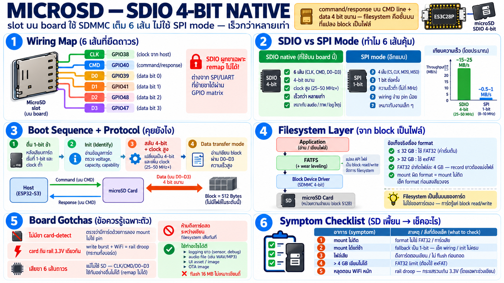

# MicroSD บน ES3C28P — SDIO 4-bit เต็มสปีด

## SD card บน board นี้ต่อยังไง

Slot microSD บน board ใช้ **SDIO native 4-bit** ไม่ใช่ SPI mode:

| สัญญาณ | GPIO | หน้าที่ |
|---|---|---|
| CLK | 38 | clock จาก host |
| CMD | 40 | command/response line |
| D0 | 39 | data bit 0 |
| D1 | 41 | data bit 1 |
| D2 | 48 | data bit 2 |
| D3 | 47 | data bit 3 |

ขาพวกนี้ถูกยึดทั้งหมด — **remap ไม่ได้** (SDIO ผูกกับขาเฉพาะ ไม่เหมือน
SPI/UART ที่ผ่าน GPIO matrix ได้) — ถ้าจะใช้ SD ต้องยอมเสียขากลุ่มนี้

## SDMMC vs SPI mode — สองวิธีคุยกับ card

SD card ทุกใบรองรับ 2 โหมด:

| | SDIO native (board นี้) | SPI mode |
|---|---|---|
| ขา | 6 เส้น (CLK+CMD+D0–D3) | 4 เส้น SPI ปกติ |
| ความเร็ว | สูง — 4 bit ขนาน + clock สูง (หลักสิบ MHz) | ต่ำกว่ามาก — 1 bit เดียว |
| driver | SDMMC host peripheral ในตัว | SPI ปกติ ง่ายกว่า |
| เหมาะกับ | data logging, audio file, ภาพ | wiring ง่าย, pin น้อย |

จุดสำคัญ: board นี้ลงทุนเสียสาย 6 เส้นเพื่อเอา **SDIO เต็ม** — card
ที่คุยแบบนี้เร็วกว่า SPI หลายเท่า สำคัญตอนอ่าน/เขียนไฟล์ใหญ่
(เสียง, log, ภาพ)

## Protocol คร่าว ๆ — คุยผ่าน CMD line

- host ส่ง **command** ผ่าน CMD → card ตอบ **response** → แล้ว
  data ไหลบน D0–D3
- boot sequence: card เริ่มที่ 1-bit mode ช้า ๆ → host init
  (identify, check voltage, อ่าน capacity) → สลับเป็น 4-bit +
  clock สูง → เข้า data transfer mode
- ใต้ฝา: command ระดับ "อ่าน block 512 byte ตรงนี้" — ไม่มี
  โครงสร้างไฟล์เลย นั่นคืองานของ filesystem ชั้นบน

## Filesystem — จาก block เป็นไฟล์

- card เกือบทุกใบมาพร้อม **FAT32** (ถ้า ≤32 GB) หรือ **exFAT**
  (>32 GB) — firmware ฝั่ง ESP นิยม mount ผ่าน **FATFS** กับ
  wear leveling layer
- FAT32 จำกัดไฟล์ละ **4 GB** — สำคัญตอน record ไฟล์ยาว (audio,
  log ต่อเนื่อง)
- mount ผิด format = mount ไม่ติด — ตรวจ format card ก่อนสงสัยวงจร

## ข้อควรรู้เฉพาะ board นี้

- **ไม่มีขา card-detect** แยก — ตรวจว่ามี card ด้วยการลอง mount/
  อ่าน ไม่ใช่ interrupt จาก pin (อย่าหาขา CD ใน schematic ไม่มี)
- card กินจาก rail 3.3 V เดียวกับทุกอย่าง — **write burst ของ SD
  กระโดดกระแสพอสมควร** รวมกับ WiFi/backlight ช่วงเดียวกัน = เคส
  droop อีกหน้า (บท power)
- ขากลุ่มนี้คือของหาย: ถ้าโปรเจกต์ "ไม่ใช้ SD" ก็ยังเสียขา 6 ขา
  เพราะผูกกับ slot แล้ว — เลี่ยงไม่ได้
- hot-plug: ระบบไม่ได้ออกแบบให้ดึง card สด — ดึงระหว่างเขียน =
  filesystem เสียได้ทันที (unmount/idle ก่อนเสมอ)

## ใช้ทำอะไรบน board นี้

- data logging sensor ระยะยาว (flash 16MB ไม่เหมาะเขียนถี่ —
  บท memory)
- เล่นไฟล์เสียงใหญ่ที่เก็บใน flash ไม่ไหว
- เก็บ config ใหญ่ / asset ของ UI (font, icon)
- OTA image ชั่วคราว

## Checklist — SD มีปัญหา

| อาการ | สาเหตุน่าสงสัย |
|---|---|
| mount ไม่ติดเลย | format ไม่ใช่ FAT32 / card ติดไม่สนิท |
| mount ได้แต่ช้ามาก | fallback ไป 1-bit mode — ตรวจ wiring/ขา |
| เขียนแล้วไฟล์เสีย | ดึง card ตอนเขียน / ไม่ flush ก่อน eject |
| ไฟล์ >4GB เขียนไม่ได้ | FAT32 limit — แบ่งไฟล์หรือใช้ exFAT |
| mount ใต้งาน WiFi หนักแล้วหลุด | rail droop — กระแสรวมเกิน |
| อ่านข้ามกันมั่ว | format ผิด filesystem เทียบที่เขียนไว้ |
