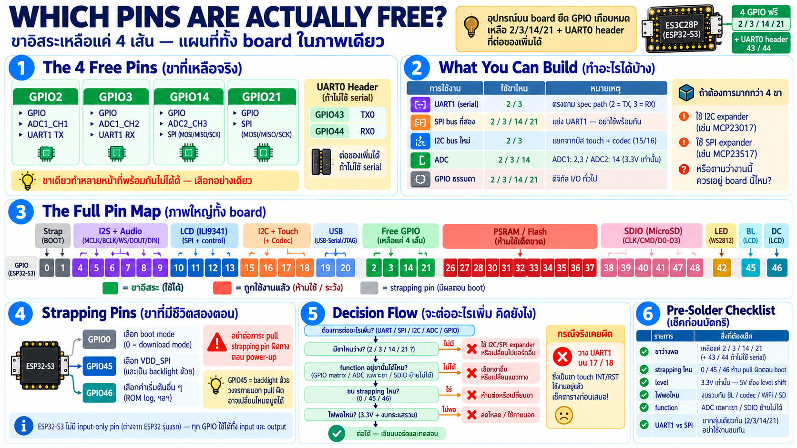

# Expansion header และแผนที่ขาทั้ง board — ขาไหนว่าง ขาไหนห้าม



## ขาอิสระที่เหลือจริง: 4 ขา

หลังอุปกรณ์บน board ยึดขาเกือบหมด ที่ expansion header เหลือ
ว่างสำหรับผู้ใช้แค่:

| GPIO | ใช้เป็นอะไรได้ |
|---|---|
| **2** | GPIO, ADC1_CH1, UART1 TX (ที่ firmware ใช้อยู่) |
| **3** | GPIO, ADC1_CH2, UART1 RX |
| **14** | GPIO, ADC2_CH3, SPI |
| **21** | GPIO, SPI |

บวกกับ **UART0 header 4-pin** (TX43/RX44) ที่แยกออกมาเป็นขั้ว
ต่างหาก — ใช้ได้เป็น serial จริงหรือ GPIO เพิ่มถ้าไม่ใช้ serial

## ทำอะไรได้บ้างกับ 4 ขานี้

| อยากได้ | ใช้ขา | หมายเหตุ |
|---|---|---|
| UART1 | 2/3 | เส้นทาง spec-compliant ของ serial bridge — หรือ sensor/module อื่น |
| SPI bus ที่สอง | 2/3/14/21 | ขาครบพอดี — แต่แย่งกับ UART1 (อย่าใช้คู่กัน) |
| I2C bus ใหม่ | 2/3 | I2C1 หรือ bit-bang — แยกจาก bus touch+codec |
| ADC | 2/3/14 | input อะนาล็อก (อยู่ range 3.3 V เท่านั้น) |
| GPIO ธรรมดา | ทั้งหมด | input/output ทั่วไป |

เลือกได้อย่างเดียวต่อจุด — ขาเดียวกันทำหลายหน้าที่พร้อมกันไม่ได้

## แผนที่ขาทั้ง board — cheatsheet เดียวจบ

ขาบนบอร์ดนี้แยกเป็นกลุ่มที่ถูกจอง กับกลุ่มที่ยังว่าง:

```
┌───────────────┐   ┌─────────────┐   ┌───────────────┐
│ flash + PSRAM │   │ USB D- / D+ │   │ LCD SPI       │
│ GPIO26-37     │   │ GPIO19-20   │   │ GPIO10-13, 46 │
└───────────────┘   └─────────────┘   └───────────────┘

┌───────────────────┐   ┌─────────┐   ┌──────────────────┐
│ free header       │   │ RGB LED │   │ microSD          │
│ GPIO 2, 3, 14, 21 │   │ GPIO42  │   │ GPIO38-41, 47-48 │
└───────────────────┘   └─────────┘   └──────────────────┘
```

| ขา | สถานะ | เหตุผล |
|---|---|---|
| 0 | BOOT button | strapping — กดตอน power-up = download mode |
| 1 | amp enable (low-active) | FM8002E |
| **2, 3, 14, 21** | **FREE** | expansion header |
| 4, 5, 6, 7, 8 | I2S (MCLK/BCLK/DIN/WS/DOUT) | audio codec |
| 9 | battery ADC | divider 1/2 |
| 10–13 | LCD SPI (CS/MOSI/SCK/MISO) | ILI9341 |
| 15, 16 | I2C share | touch + codec — ว่างก็ต่อเมื่อทิ้งทั้งคู่ |
| 17, 18 | touch INT/RST | ไม่ว่าง (อย่าเผลอใช้เป็น UART1 — เคสจริงเคยผิด) |
| 19, 20 | USB D−/D+ | port เดียวทั้ง board — ห้ามแตะ |
| **26–37** | **ห้ามเด็ดขาด** | OPI PSRAM + QSPI flash bus |
| 38–41, 47, 48 | SDIO | microSD slot |
| 42 | RGB LED | RMT |
| 43, 44 | UART0 header | ว่างถ้าไม่ใช้ serial |
| 45 | LCD backlight | strapping pin ด้วย — ระวัง pull ตอน boot |
| 46 | LCD DC | strapping pin ด้วย |

### Strapping pins — ขาที่ "มีชีวิตสองตอน"

GPIO 0/45/46 เป็น strapping pin — chip อ่านค่าระดับตอน boot เพื่อ
เลือกโหมด (download mode, VDD_SPI voltage, ROM log):

- GPIO45 บน board นี้เป็น backlight — ถ้า circuit ภายนอก pull ผิด
  ตอน boot อาจเปลี่ยนโหมด boot
- กฎ: อย่าต่อภาระที่ pull strapping pin ไปผิดทางตอน power-up
- เหตุผลที่ต้องทำ auto-reset circuit ดูแลสองเส้นนี้ (บท USB) ก็เพราะ
  มันเป็น strapping

### S3 ไม่มี input-only pin

ต่างจาก ESP32 รุ่นแรก (GPIO34–39 ใส่ได้แต่ input) — **S3 ทุกขา
เป็น bidirectional** ออกแบบง่ายกว่า แต่หมายความว่าขา "ฟรี" ที่จริง
บน board นี้แค่ 4 เส้นเท่านั้น — ไม่มีของแถม

## วิธีคิดเวลาจะต่ออะไรเพิ่ม

```
ต้องการ ___? 
→ ตรวจ cheatsheet ว่าขาไหนว่าง
→ ตรวจว่า function ที่ต้องการอยู่บนขานั้นได้ไหม (GPIO matrix)
→ ตรวจว่าชน strapping pin ไหม (0/45/46)
→ ตรวจไฟ: level 3.3 V เท่านั้น + งบกระแส rail
```

- ตัวอย่างผิดจริงที่เคยเกิด: ร่าง port ใช้ GPIO17/18 เป็น UART1 —
  จริง ๆ เป็นขา INT/RST ของ touch — ตรวจตารางก่อนเสมอ อย่าเดา
- ถ้าต้องการขามากกว่า 4: ทางเลือกคือ I2C expander บนขา 2/3 หรือ
  SPI GPIO expander — แต่ตอนนั้นต้องถามก่อนว่างานนั้นควรอยู่บน
  board นี้จริงไหม

## Checklist — ก่อนบัดกรี/ต่ออะไรเข้า board นี้

| ต้องการ | ตรวจ |
|---|---|
| ขาว่างพอไหม | เหลือแค่ 2/3/14/21 (+43/44 ถ้าไม่ใช้ UART0) |
| ชน strapping pin ไหม | 0/45/46 ต้องไม่ถูก pull ผิดตอน boot |
| level ตรงไหม | ทุกขา 3.3 V — 5 V device ต้อง level shift |
| ไฟพอไหม | งบกระแสรวมกับ BL/codec/WiFi/SD |
| function อยู่ขานั้นได้ไหม | ADC มีเฉพาะขาที่กำหนด / SDIO-SD ไม่ย้ายได้ |
| UART1 vs SPI อย่าชน | ใช้ขากลุ่มเดียวกัน |
