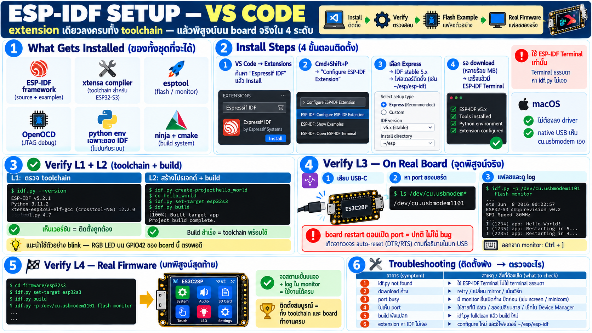

# ติดตั้ง ESP-IDF ผ่าน VS Code — พร้อมทดสอบบน board จริง



## จะได้อะไรจากการติดตั้งครั้งนี้

ESP-IDF extension ของ Espressif ติดตั้ง toolchain ทั้งชุดให้ครบใน
ครั้งเดียว — เข้าใจก่อนว่าแต่ละชิ้นคืออะไร:

| ชิ้นส่วน | คืออะไร |
|---|---|
| ESP-IDF | framework + driver + FreeRTOS ทั้งหมด |
| xtensa-esp32s3 toolchain | compiler สำหรับ LX7 |
| esptool | ตัวคุยกับ ROM bootloader (flash) |
| OpenOCD-ESP32 | JTAG debug |
| python env | virtualenv เฉพาะของ IDF (ไม่ปนระบบ) |
| ninja + cmake | build backend |

ติดตั้งเสร็จจะมีทุกอย่างที่ต้องใช้ในบทถัด ๆ ไป ไม่ต้องโหลดเพิ่ม

## ขั้นตอนติดตั้ง

1. **ติดตั้ง VS Code** (ถ้ายังไม่มี)
2. Extensions → ค้นหา **"Espressif IDF"** → Install
3. เปิด command palette (`Cmd+Shift+P`) →
   **"ESP-IDF: Configure ESP-IDF Extension"**
4. เลือก **Express** mode:
   - IDF version: เลือก **stable ล่าสุด** (5.x) — อย่าเลือก master
   - folder ติดตั้ง: default `~/esp` ปล่อยไว้
   - เปิด download tools + python env ให้
5. รอ download นานหน่อย (หลายร้อย MB — toolchain + IDF repo)
6. จบแล้ว extension จะสร้าง **ESP-IDF Terminal** ให้ —
   terminal ที่มี env ครบ (PATH, IDF_PATH, python env) ใช้
   terminal ธรรมดาแล้ว `idf.py` ไม่เจอเป็นเรื่องปกติ

### macOS เฉพาะ

- ไม่ต้องลง driver — S3 ใช้ native USB เห็น `/dev/cu.usbmodem*`
  เอง (บท USB caveat)
- ถ้าเคยติดตั้ง ESP-IDF แบบ manual มาก่อน อย่าให้ config ชนกัน —
  extension จัดการ env เองใน folder ของมัน

## Verify ระดับ 1 — toolchain ตอบกลับ

เปิด ESP-IDF Terminal (palette → "ESP-IDF: Open ESP-IDF Terminal")
แล้ว:

```
idf.py --version      → เห็น version IDF
xtensa-esp32s3-elf-gcc --version  → compiler พร้อม
```

ผ่าน = toolchain ติดตั้งสมบูรณ์

## Verify ระดับ 2 — build ตัวอย่าง

ทดสอบของจริงด้วยตัวอย่างในตัว IDF:

```
palette → "ESP-IDF: New Project" → เลือก template
   hello_world หรือ blink (blink ของ S3 ใช้ LED driver — เหมาะ
   กับ board นี้เพราะมี RGB LED ตัวเดียวที่ GPIO42)
```

หลังสร้าง project:

```
idf.py set-target esp32s3    ← บอกว่าชิปเป้าหมายคือ S3
idf.py build                 ← compile ทั้งหมด
```

สำเร็จ = เห็น `Project build complete` + binary พร้อม flash

## Verify ระดับ 3 — ลง board จริง

เสียบ board ES3C28P เข้า USB-C:

```
idf.py -p /dev/cu.usbmodemXXXX flash monitor
```

หา port ก่อน: `ls /dev/cu.usbmodem*` — board นี้ขึ้นเป็น
usbmodem (ไม่ใช่ usbserial) เพราะไม่มีชิป bridge

สิ่งที่จะเห็น (และเหตุผล — เชื่อมบท USB caveat):

- flash ผ่าน ROM bootloader โดย esptool — auto-reset circuit ทำให้
  เข้า download mode เอง ไม่ต้องกดปุ่ม
- `monitor` เปิด → **เห็น boot log แล้ว board restart ตามปกติ**
  (เปิด port = reset — อย่าตกใจ นี่คือกับดักที่เรียนมา)
- hello_world จะพิมพ์ chip info + hello แล้วนับ reboot countdown
- ออกจาก monitor: `Ctrl+]`

ถ้าเลือกตัวอย่าง blink → LED บน GPIO42 กะพริบ (ตัวอย่าง IDF ใช้
led_strip/RMT driver — เหมือนที่ firmware จริงทำในบท LED)

## Verify ระดับ 4 — flash firmware จริงของ board

ขั้นสุดท้ายลองกับ project จริง (ตัว serial-bridge firmware):

```
cd firmware/esp32s3
idf.py set-target esp32s3 build flash -p /dev/cu.usbmodemXXXX
idf.py monitor
```

เจอจอสถานะขึ้นที่หน้าจอ + log ใน monitor = ติดตั้งสมบูรณ์ + board
ทำงานครบทุกอย่าง

## Troubleshooting ติดตั้ง

| อาการ | แก้ |
|---|---|
| `idf.py: command not found` | ใช้ terminal ธรรมดา — เปิด ESP-IDF Terminal แทน |
| download ช้า/ค้าง | mirror ของ Espressif หล่นบ่อย — retry หรือเปลี่ยน mirror ใน setup |
| python version ไม่ตรง | extension ต้องการ python3 ล่าสุด — ลงผ่าน brew/official installer |
| flash แล้ว "port busy" | monitor อื่นเปิด port ค้าง — ปิดก่อน |
| ไม่เห็น port เลย | ตรวจสายขา data (สาย charge อย่างเดียวไม่มี) + firmware ไม่จำเป็นสำหรับ ROM port |
| build พังแปลก ๆ หลัง clone | `idf.py fullclean` แล้ว build ใหม่ |
| extension หา IDF ไม่เจอ | configure ใหม่ชี้ `~/esp/esp-idf` ที่ setup ทิ้งไว้ |

## Done criteria — ผ่านครบแปลว่าพร้อม

- [ ] `idf.py --version` ตอบใน ESP-IDF Terminal
- [ ] `idf.py build` ผ่านบน hello_world
- [ ] flash ลง board จริง + monitor เห็น output
- [ ] เข้าใจว่าทำไม board restart ตอนเปิด port (ไม่ใช่ bug)
- [ ] firmware จริง build+flash ได้
