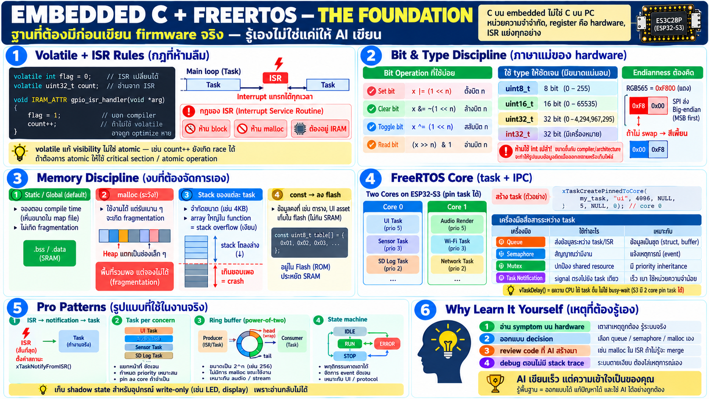

# Embedded C + FreeRTOS review — ฐานที่ต้องมีก่อนเขียน firmware จริง



บทนี้รวมความรู้ C สำหรับ embedded ที่ต่างจาก C บน PC อย่างมีนัยสำคัญ
บวกแนวคิด FreeRTOS ที่ใช้จริงใน firmware ระดับ production — เป้าคือ
เขียนโค้ดด้วยตัวเองได้ ไม่ใช่แค่ copy-paste

## ส่วนที่ 1: C บน embedded ต่างจาก C บน PC ยังไง

สมมติฐานที่ใช้ได้บน PC แต่ใช้ไม่ได้ที่นี่:

- **ไม่มี heap ไม่จำกัด** — SRAM 512 KB เท่านั้น malloc พลาด = ระบบตาย
  ไม่ใช่แค่ crash โปรแกรม
- **ไม่มี OS คุ้มหัว** — bug ฝั่ง memory เดียวฆ่าได้ทั้งระบบ
- **register คือหน่วยความจำ** — ขา hardware อ่านเขียนผ่าน address
  ปกติ — เข้าใจ pointer คือเข้าใจ hardware
- **หลาย flow ทำงานพร้อมกัน** — ISR กับ main loop แย่งตัวแปรเดียว
  กันได้ แค่นั้นเองที่ race condition เกิดจริง

## ส่วนที่ 2: `volatile` — keyword ที่สำคัญที่สุดบน embedded

```c
volatile int flag;   /* บอก compiler ว่าค่านี้เปลี่ยนได้เอง
                        (ISR / hardware / อีก core เปลี่ยน) */
```

- ไม่ใส่ = compiler อาจ "จำ" ค่าไว้ใน register → while loop รอ flag
  ไม่มีวันเห็นการเปลี่ยน — **bug คลาสสิกที่ debug ไม่เจอใน optimized
  build** (debug build มักรอด เพราะ optimize ต่ำ)
- ต้องใช้เมื่อ: ตัวแปรที่ ISR แก้ / register hardware / shared ระหว่าง
  core หรือ task
- `volatile` **ไม่ใช่ atomic** — แก้ปัญหา visibility อย่างเดียว
  increment ยังเป็น read-modify-write ที่ race ได้อยู่

## ส่วนที่ 3: Bit manipulation — ภาษาแม่ของ hardware

ทุก register hardware คือ bit field — ต้องคล่อง 4 operation:

```c
REG |=  (1 << 3);   /* set bit 3 */
REG &= ~(1 << 3);   /* clear bit 3 */
REG ^=  (1 << 3);   /* toggle bit 3 */
(REG >> 3) & 1      /* read bit 3 */
```

- ทำไมต้อง mask-read-modify-write: register เดียวมีหลาย field —
  เขียนทับทั้ง register = พัง field ข้างเคียง
- เคสจริงบน board นี้: codec register (0x14 mic path ฯลฯ), eFuse,
  strapping — ทั้งหมดคือ bit-level

## ส่วนที่ 4: ขนาด type ต้องชัดเจน

```c
uint8_t  frame_len;      /* ไม่ใช่ int — int ขนาดขึ้นกับ platform */
uint16_t crc;
int32_t  sample;
```

- `int` บน ESP32 = 32 bit แต่อย่าไปพึ่ง — wire protocol/binary
  format ต้อง `stdint.h` เสมอ
- `size_t` สำหรับ index/length, `int32_t` สำหรับค่าลบได้
- **endianness** ต้องคิดเมื่อทำ wire format: struct packed บน
  little-endian chip ≠ byte ที่ออกสาย — protocol ต้องกำหนด byte
  order ชัด ๆ (เชื่อมบทจอ: RGB565 byte-swap คือปัญหาเดียวกัน)

## ส่วนที่ 5: Memory discipline — ของที่ PC ไม่ต้องคิด

- **static allocation เป็นค่า default** — buffer ขนาดคงที่ประกาศเป็น
  global/static ทำให้เห็น RAM usage ตอน compile เลย ไม่ใช่ตอน run
- malloc บน embedded: ทำได้แต่**ระวัง fragmentation** — ระบบรันนาน
  heap แตกเป็นช่องเล็ก ๆ จนใหญ่พอแต่ให้ไม่ได้ — pro มักกฎ "alloc
  ครั้งเดียวตอน init แล้วห้ามแตะ" หรือใช้ fixed pool (เหมือนที่
  zpeer ใช้ 8 pubs/8 subs pool ไม่มี heap ฝั่ง caller)
- **stack ต่อ task มีจำกัด** — array ใหญ่ใน function = stack
  overflow เงียบ ๆ → hard crash ไม่มี message ที่บอกตรง ๆ
- `const` ที่จริง const ลง **flash แทน RAM** — เขียน `static const`
  ให้ lookup table ประหยัด SRAM

## ส่วนที่ 6: ISR rules — สิ่งที่ทำใน interrupt ไม่ได้

ISR (interrupt handler) คือ context พิเศษ — กฎเหล็ก:

- **ห้าม block** — ไม่มี sleep, ไม่มี wait queue, ไม่มี printf หนัก
- **ห้าม malloc/free**
- code ใน ISR ต้องอยู่ **IRAM** (cache อาจปิดตอน flash op — บท
  memory) → `IRAM_ATTR`
- งานหนักใน ISR = pattern ผิด — **แค่ note event แล้วส่งต่อให้
  task** (deferred work) นี่คือหัวใจของ firmware ดี

## ส่วนที่ 7: Data structure ที่ต้องเป็น — ring buffer + state machine

**ring buffer (circular buffer)**: stream ไม่รู้จบ เช่น byte จาก
serial — producer เขียนวน consumer อ่านตาม head/tail index:
- ใช้ทุกที่ใน board นี้: UART RX, audio frame, COBS decode
- กฎเดียว: capacity ต้อง power-of-two → wrap ด้วย `& (size-1)`
  เร็วและไม่มี edge case

**state machine**: firmware เป็น event loop ไม่ใช่ sequential
script — เขียนเป็น state + transition ชัด ๆ:
- UI screens, protocol handshake, gesture latch (บท touch),
  OTA flow — ทุกอย่างคือ state machine ที่ดี = behavior ที่คาด
  เดาได้ทุก event

## ส่วนที่ 8: FreeRTOS — แกนเดียวที่ใช้จริงทุกวัน

FreeRTOS ให้ **task** — thread เล็กที่มี stack ของตัวเอง:

```c
xTaskCreatePinnedToCore(audio_task, "audio",
                        4096,   /* stack bytes — ต้องวัดจริง */
                        arg, 5, /* priority ยิ่งสูงยิ่งรันก่อน */
                        &handle, 1); /* core: 0=PRO 1=APP */
```

- **preemptive + priority** — task priority สูงสุดที่พร้อมรันจะได้
  CPU เสมอ ระบบ real-time เกิดจากการให้ priority ถูก
- S3 มี 2 core — `PinnedToCore` ควบคุมว่า task ไหนอยู่ core ไหน —
  audio/UI อยู่คนละ core กับ network ได้จริง (เหตุที่ toolchain
  บทก่อนบอกว่า pin task ลง core เป็นเรื่องจริง)

### เครื่องมือ IPC — เลือกให้ถูก

สอง task ไม่แชร์ตัวแปรตรง ๆ พวกมันส่งของผ่านคิว:

```
┌────────┐             ┌───────┐                ┌────────┐
│ task A │ ── send ──► │ queue │ ── receive ──► │ task B │
└────────┘             └───────┘                └────────┘
```

ลำดับของหนึ่งชิ้นข้อมูล:

```
┌────────┐                  ┌───────┐                  ┌────────┐
│ task A │                  │ queue │                  │ task B │
└────┬───┘                  └───┬───┘                  └────┬───┘
     │                          │                           │
     │ send item ──────────────►│                           │
     │                          │ deliver item ────────────►│
```

| เครื่องมือ | ใช้เมื่อ |
|---|---|
| **Queue** | ส่ง data ระหว่าง task / ISR→task — ring buffer ที่ thread-safe ในตัว |
| **Semaphore (binary)** | ปล่อยสิทธิ์/signal — ISR บอก task "มีงาน" |
| **Mutex** | ป้องกัน shared resource — แตะ I2C bus share, shared state (มี priority inheritance ในตัว) |
| **Task notification** | เบากว่า semaphore — signal ตรงถึง task เดียว ไม่มี object แยก |
| **Event group** | หลาย task รอหลาย flag รวมกัน |

- **vTaskDelay()** = ยอม CPU ไม่ใช่ busy-wait — loop `while(1)
  vTaskDelay(10)` กิน CPU เกือบศูนย์ ต่างจาก delay loop เปล่า
- **priority inversion** — task ต่ำถือ mutex ที่ task สูงรอ →
  mutex มี inheritance แก้โดยยก priority ชั่วคราว — รู้จักเพราะ
  symptom "ระบบค้างทั้งที่เหมือนไม่มีอะไรผิด"

## ส่วนที่ 9: Pattern ที่ firmware จริงบน board นี้ใช้

จากโค้ดจริง — รูปแบบที่ผู้เรียนจะเห็นและควรเขียนเป็น:

- **ISR → queue/notification → worker task**: interrupt แค่ note
  event งานจริงทำใน task (audio render task, UI poll task)
- **task per concern**: render audio อยู่ task ของมัน — ไม่ใช่ใน
  executor/ISR (เพราะ blocking ได้แต่ต้องเวลาจริง)
- **fixed pool แทน malloc**: zpeer ใช้ pool 8/8 — caller ไม่มี
  heap ไม่มี fragmentation
- **shadow state** สำหรับ write-only hardware (LED)
- **DMA buffer ใน SRAM เท่านั้น** — PSRAM ไม่เข้า DMA (บท memory)

## ส่วนที่ 10: ทำไมต้องรู้ทั้งหมดนี้เอง — แม้มี AI ช่วยเขียน

AI ช่วยเขียน code ได้เร็ว แต่สิ่งที่ทดแทนไม่ได้:

- **อ่าน symptom บน hardware** — flicker/เงียบ/crash ต้องผูกกับ
  สาเหตุจริง (ISR race? buffer DMA ผิด memory? stack ล้น?) —
  ต้องรู้ว่าระบบทำงานยังไงถึงเดาถูก
- **ออกแบบที่ถูกตั้งแต่แรก** — เลือก queue vs semaphore, static
  vs malloc, priority เท่าไร — คือ decision ไม่ใช่ typing
- **review code ที่ generate มา** — AI เขียน malloc ใน ISR มาให้
  ถ้าไม่รู้กฎก็ merge เข้าไปแล้วระบบพังตอน production
- **debug ที่ไม่มี stack trace** — embedded ตายเงียบบ่อย สาเหตุ
  หาได้เฉพาะคนที่เข้าใจลำดับเหตุการณ์

## Checklist — รู้พอไหม

| สถานการณ์ | ต้องตอบได้ว่า |
|---|---|
| เขียนตัวแปรที่ ISR แก้ | ใส่ `volatile` + เข้าใจว่าไม่ใช่ atomic |
| ต้องการ delay 10ms | `vTaskDelay()` ไม่ใช่ loop เปล่า |
| ISR ต้องประมวลผลหนัก | ผิด pattern — signal ออกไปให้ task |
| buffer ใหญ่ใน function | อันตราย — ย้าย static หรือ heap |
| 2 task แตะ I2C เดียวกัน | mutex — ไม่ใช่แค่หวังว่าไม่ชน |
| อยากส่ง byte stream | ring buffer — head/tail + wrap |
| task ทำไมไม่รัน | เช็ค priority + มี vTaskDelay ให้ scheduler หายใจไหม |
| malloc ตอน runtime เยอะ | คิด fixed pool/static แทน |
| LED ขับด้วย delay ใน code | ผิด — RMT/hardware timing |
