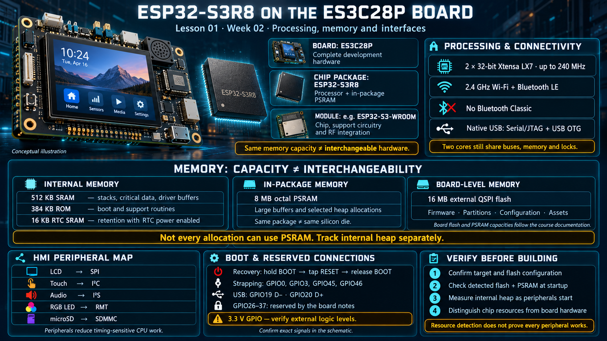

# Lesson 01 — The ESP32-S3R8 on the ES3C28P Board

> English edition · Week 02 · ES3C28P / ESP32-S3

[Lesson index](README.md) · [Original lesson](../01-esp32s3r8-the-chip.md)

## Learning objectives

Explain the distinction between a board, a chip, and a module; identify the processing and memory resources available to firmware; and connect those resources to display, audio, and networking requirements.

## Board identity and processor selection

**ES3C28P** identifies the complete development board. **ESP32-S3R8** identifies its processor package. The original course notes describe a bare-chip implementation with an external 16 MB QSPI flash device and 8 MB octal PSRAM integrated into the processor package. This distinction matters: a memory die in the same package is not necessarily on the same silicon die as the CPU.

A module such as an ESP32-S3-WROOM device additionally integrates support circuitry and an RF implementation. A module configuration described as N16R8 has the same nominal flash and PSRAM capacities as this board, but that does not make the board electrically or mechanically interchangeable with the module.

| Resource                                           | Role in this course                                                        |
| -------------------------------------------------- | -------------------------------------------------------------------------- |
| Two 32-bit Xtensa LX7 CPU cores, up to 240 MHz     | Concurrent application and system processing                               |
| 512 KB internal SRAM                               | Internal code, task stacks, critical data, and suitable peripheral buffers |
| 384 KB ROM                                         | Factory boot and support routines                                          |
| 16 KB RTC SRAM                                     | State retention when the appropriate RTC power domain remains enabled      |
| 8 MB octal PSRAM, as documented for this board     | Large application buffers and selected heap allocations                    |
| 16 MB external flash, as documented for this board | Firmware, configuration, partitions, and assets                            |
| 2.4 GHz Wi-Fi and Bluetooth LE                     | Wireless connectivity; Bluetooth Classic is unavailable                    |
| Native USB interfaces                              | USB Serial/JTAG and USB OTG functions                                      |

The processor specifications and package variants are defined in the [ESP32-S3 datasheet](https://documentation.espressif.com/esp32-s3_datasheet_en.pdf). Package suffixes specify memory options; consult the ordering table rather than treating the suffix as a universal naming formula.

## Why this processor suits an HMI board

A human-machine interface combines input, output, and communication. On this board, the LCD uses SPI, the touch controller uses I2C, audio samples use I2S, the RGB LED uses RMT, and the microSD socket uses the SDMMC host. These peripherals reduce the amount of timing-sensitive work performed directly by the CPU.

Two cores provide scheduling flexibility, but parallel execution does not remove contention. Tasks still compete for memory bandwidth, shared buses, locks, and power. Audio can miss a deadline even when average CPU utilization appears low.

## Memory capacity is not a single resource

A useful allocation plan separates internal memory from external memory. Large display or application buffers can consume PSRAM, preserving internal SRAM for stacks, driver requirements, and work that must remain accessible during cache-disabled intervals.

The original notes report that a Wi-Fi/lwIP/zenoh-pico configuration had only approximately 3–8 KB of internal heap remaining before PSRAM was enabled. They also report improved link stability afterward. These are historical observations for that firmware configuration, not guaranteed measurements for every application. Reproduce the workload and record internal heap separately from total heap before drawing conclusions about the failure mechanism.

Do not equate “8 MB available” with “every allocation can use 8 MB.” Driver restrictions and memory capabilities remain relevant throughout the course.

## Boot, reset, and reserved connections

GPIO0 participates in boot-mode selection. The documented manual recovery sequence is to hold BOOT, press and release RESET, and then release BOOT. GPIO3, GPIO45, and GPIO46 also have strapping functions. An external circuit can affect startup if it drives a strap to an unintended level during reset.

GPIO19 and GPIO20 carry USB D− and D+. The board notes reserve GPIO26–37 for the flash/PSRAM subsystem. Treat this range as unavailable for expansion; use the package documentation and board schematic for exact individual signal assignments.

The GPIO operating domain is 3.3 V. A peripheral powered from 5 V does not automatically provide safe 3.3 V logic signals.

## Practical verification

1. Record the processor target and configured flash capacity from the build configuration.
2. Capture startup messages identifying detected flash and PSRAM.
3. Measure free internal heap before and after initializing the display, audio, and Wi-Fi.
4. Explain which observed resources belong to the chip and which belong to the board.

Successful verification demonstrates a consistent configuration and observable resource availability. It does not yet demonstrate that every peripheral is working.

## Existing course illustration

> This is the illustration supplied with the original lesson. Its embedded labels have not been translated or technically revised; the English text above governs this edition.
