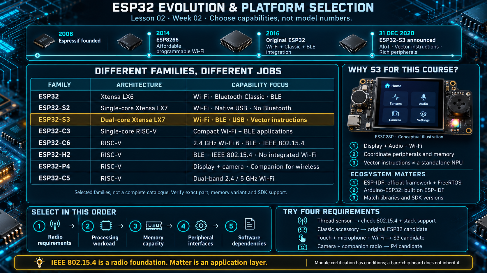

# Lesson 02 — ESP32 Evolution and Platform Selection

> English edition · Week 02 · ES3C28P / ESP32-S3

[Lesson index](README.md) · [Original lesson](../02-esp32-history.md)

## Learning objectives

Describe the transition from Wi-Fi connectivity devices to integrated application processors, compare representative ESP32 families, and select a device by required capabilities rather than its model number.

## From connectivity to integrated applications

Espressif was established in 2008. The ESP8266, introduced in 2014, became widely adopted because inexpensive modules combined a programmable processor with Wi-Fi connectivity. Early applications often used UART AT commands to connect a separate microcontroller to a network. Community firmware, Arduino support, and higher-level language runtimes subsequently made the device useful as the application processor itself.

The original ESP32 followed in 2016, combining Wi-Fi, Bluetooth Classic, Bluetooth LE, and a broad peripheral set. Its importance for embedded education was integration: communication, sensing, timing, and application execution could be taught on one accessible platform.

These developments illustrate why toolchains, examples, libraries, and documentation matter alongside CPU frequency. An appropriate processor must be supported by an engineering workflow that the team can maintain.

## Families represent different capability choices

The family, reduced to the three steps this board inherits:

```
┌─────────┐      ┌────────────┐      ┌────────────┐
│ ESP8266 │ ───► │ ESP32      │ ───► │ ESP32-S3   │
│ Wi-Fi   │      │ Wi-Fi + BT │      │ USB, BLE 5 │
└─────────┘      └────────────┘      └────────────┘
```

| Family         | Representative architecture               | Selection considerations                                                        |
| -------------- | ----------------------------------------- | ------------------------------------------------------------------------------- |
| Original ESP32 | Xtensa LX6; common variants are dual-core | Wi-Fi, Bluetooth Classic, and Bluetooth LE                                      |
| ESP32-S2       | Single-core Xtensa LX7                    | Wi-Fi and native USB; no Bluetooth                                              |
| ESP32-S3       | Dual-core Xtensa LX7                      | Wi-Fi, Bluetooth LE, USB, and vector instructions                               |
| ESP32-C3       | Single-core RISC-V                        | Compact Wi-Fi and Bluetooth LE applications                                     |
| ESP32-C6       | RISC-V                                    | Wi-Fi 6 in 2.4 GHz, Bluetooth LE, and IEEE 802.15.4                             |
| ESP32-H2       | RISC-V                                    | Bluetooth LE and IEEE 802.15.4; no integrated Wi-Fi                             |
| ESP32-P4       | RISC-V application-processing family      | Display and camera workloads; wireless connectivity requires a companion device |
| ESP32-C5       | RISC-V                                    | Dual-band 2.4/5 GHz Wi-Fi capability                                            |

This is a selected comparison, not a complete product catalogue. Family letters are useful orientation aids, but they are not contractual definitions of price, performance, or future architecture. Verify the exact part, memory variant, radio features, and supported software release.

IEEE 802.15.4 is a radio/MAC foundation used by technologies such as Thread and Zigbee. Matter is an application-layer ecosystem and should not be described as an additional radio. A radio feature alone does not establish support for an entire product protocol.

## Position of the ESP32-S3

Espressif announced the ESP32-S3 on **31 December 2020**, describing it as a platform for AIoT applications. Its dual-core processing, vector instructions, and peripheral integration make it relevant to display, audio, and embedded inference workloads. Vector instructions accelerate suitable software kernels; they are not a separate general-purpose neural processing unit. See the [original announcement](https://www.espressif.com/en/node/4978).

The ES3C28P combines these capabilities with a touch display, codec, microphone, RGB LED, and storage socket. Consequently, this course emphasizes coordination among peripherals rather than isolated GPIO demonstrations.

## Frameworks and ecosystem

ESP-IDF provides the official framework, drivers, configuration system, and FreeRTOS integration. Arduino-ESP32 builds on ESP-IDF and provides familiar application APIs and libraries. Other environments offer different language and operating-system tradeoffs.

Framework selection should follow requirements. A short sensor prototype may benefit from a high-level library. A system combining audio deadlines, DMA buffers, USB protocols, and detailed memory configuration benefits from direct access to ESP-IDF facilities. Arduino libraries can also be integrated into an ESP-IDF project when their compatibility and dependencies are controlled.

Pre-certified modules can simplify RF engineering, but their certification conditions still apply to the final product. A bare-chip board cannot inherit a module's approval merely because its processor and memory capacities are similar.

## Selection exercise

For each proposed product, identify the required radio, processing load, memory capacity, peripheral interfaces, and software dependencies:

1. A battery-powered Thread sensor.
2. A device that must connect to a Bluetooth Classic accessory.
3. A touch display with microphone capture and Wi-Fi.
4. A camera interface with external wireless connectivity.

Justify each choice using a capability table. A newer or higher-numbered family is not automatically a compatible replacement.

## Existing course illustration



> This is the illustration supplied with the original lesson. Its embedded labels have not been translated or technically revised; the English text above governs this edition.
