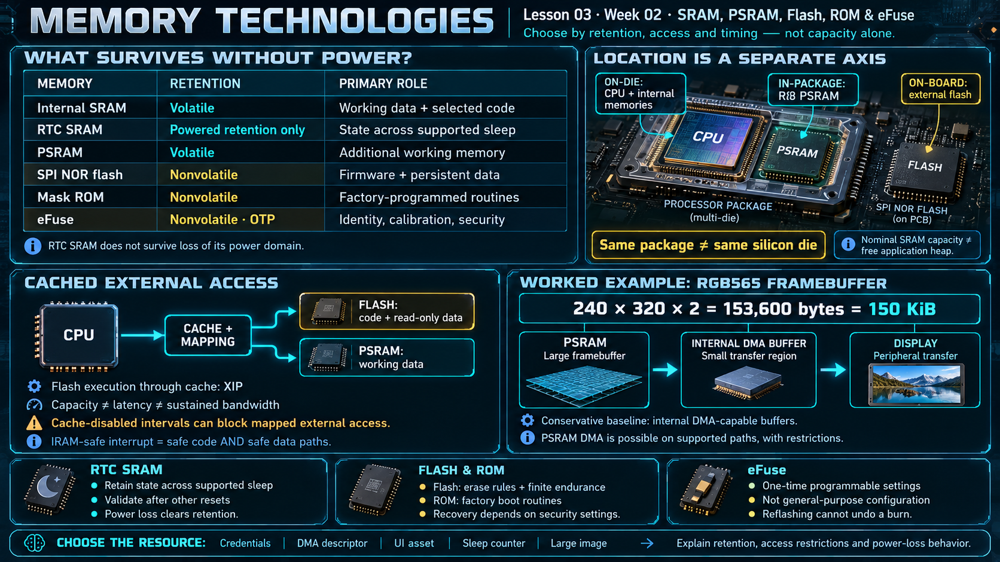

# Lesson 03 — Memory Technologies: SRAM, PSRAM, Flash, ROM, and eFuse

> English edition · Week 02 · ES3C28P / ESP32-S3

[Lesson index](README.md) · [Original lesson](../03-memory-types.md)

## Learning objectives

Classify memory by retention and physical location, explain cached external-memory access, and choose a memory resource according to access, timing, and persistence requirements.

## A consistent classification

An address leaves the CPU and lands in one of three memories:

```
                   ┌─────┐
                   │ CPU │
                   └──┬──┘
                      │ address (virtual)
                      ▼
               ┌─────────────┐
               │ cache / MMU │
               └──────┬──────┘
                      │
    ┌─────────────────┴──────────────────┐
    ▼                 ▼                  ▼
┌─────────┐   ┌──────────────────┐   ┌─────────────┐
│ SRAM    │   │ Flash            │   │ PSRAM       │
│ direct  │   │ via cache, XIP   │   │ via cache   │
└─────────┘   └──────────────────┘   └─────────────┘
```

| Technology    | Retains data without power?             | Primary purpose                                   |
| ------------- | --------------------------------------- | ------------------------------------------------- |
| Internal SRAM | No                                      | Working data and selected executable code         |
| RTC SRAM      | No; retention requires its power domain | State across supported sleep transitions          |
| PSRAM         | No                                      | Additional working memory                         |
| SPI NOR flash | Yes                                     | Firmware and persistent application data          |
| Mask ROM      | Yes                                     | Factory-programmed routines                       |
| eFuse         | Yes; one-time programmable              | Identity, calibration, and security configuration |

RAM means random-access memory. SRAM and PSRAM are relevant RAM technologies here; volatility describes their retention behavior rather than the literal expansion of the acronym. The distinction between **on-die**, **in-package**, and **on-board** is also important: the board's R8 PSRAM is in the processor package but external to the CPU die.

## Internal SRAM and RTC SRAM

Internal SRAM supports data and instruction regions. Its total nominal capacity is not the free application heap: the runtime, static data, driver state, task stacks, and internal code consume portions of it.

RTC memory provides a small retention resource. An `RTC_DATA_ATTR` variable can preserve state across an appropriate deep-sleep cycle, but a loss of power is different from sleep. Always define how retained data is initialized and validated after other reset causes.

```c
#include <stdint.h>
#include "esp_attr.h"

RTC_DATA_ATTR static uint32_t wake_count;
```

This declaration illustrates placement; the application must decide when to increment or reset the counter.

## PSRAM and cache behavior

PSRAM expands working capacity through a serial memory interface. CPU accesses normally pass through cache and address mapping. Sequential or frequently reused data can behave differently from scattered accesses over large buffers. Capacity, latency, and sustained bandwidth must therefore be evaluated separately.

The ESP32-S3 has hardware support for some external-memory DMA transfers, with restrictions on descriptors, bandwidth, alignment, and driver support. An absolute statement that PSRAM can never participate in DMA is incorrect. For the course examples, internal DMA-capable buffers are the conservative baseline; use a driver-supported external-memory path only after checking its requirements. See [external RAM support](https://docs.espressif.com/projects/esp-idf/en/v5.3/esp32s3/api-guides/external-ram.html).

## Flash, ROM, and eFuse

Flash stores the application and persistent data. SPI NOR flash generally requires erasing a region before restoring programmed bits to their erased state. Erase granularity and endurance depend on the actual flash device. An assumed endurance figure must not substitute for its datasheet.

ROM contains factory routines and the initial boot path. A corrupted application normally remains recoverable through an allowed download interface. Security configuration can restrict or disable recovery interfaces, so recovery is not unconditional.

eFuse stores one-time settings such as identity, calibration, and security configuration. It is not general-purpose configuration storage. A permanent security operation should follow the documented provisioning process; changing the application binary does not undo an eFuse change.

## Execute in place and cache-disabled intervals

Most application code executes from mapped flash through the instruction cache, commonly called execute in place (XIP). Read-only data can also reside in mapped flash. This saves internal SRAM, but cached access introduces dependencies.

In configurations where flash operations disable the relevant cache, flash-resident code and cached external data are temporarily inaccessible. An interrupt intended to remain active in that interval must have an entirely safe call path and data path. Adding `IRAM_ATTR` to its entry function alone is insufficient if it calls a flash-resident function or reads a flash-resident constant. Other interrupts can be deferred by the framework rather than requiring every ISR to be IRAM-safe.

Consult the [memory placement guide](https://docs.espressif.com/projects/esp-idf/en/v5.0.6/esp32s3/api-guides/memory-types.html) when deciding where code and data belong.

## Worked allocation example

A 240 × 320 RGB565 framebuffer requires:

```text
240 × 320 × 2 = 153,600 bytes = 150 KiB
```

A large framebuffer can reside in PSRAM while small DMA transfer buffers reside internally. The transfer layer copies or converts only the region being transmitted. This separates image capacity from peripheral transfer requirements.

## Review exercise

Choose suitable storage for Wi-Fi credentials, an audio DMA descriptor, a UI asset, a retained sleep counter, and a large image buffer. For each choice, explain retention, access restrictions, and the behavior if power is removed.

## Existing course illustration



> This is the illustration supplied with the original lesson. Its embedded labels have not been translated or technically revised; the English text above governs this edition.
