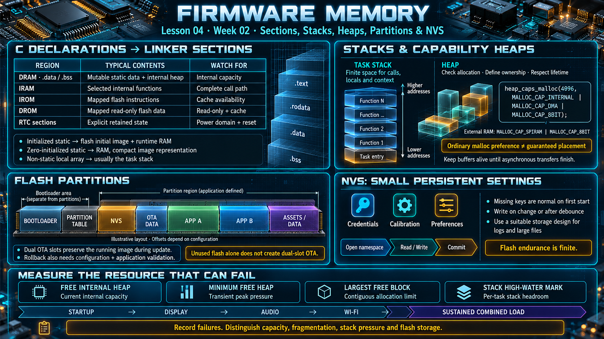

# Lesson 04 — Firmware Memory: Sections, Stacks, Heaps, Partitions, and NVS

> English edition · Week 02 · ES3C28P / ESP32-S3

[Lesson index](README.md) · [Original lesson](../04-memory-firmware-view.md)

## Learning objectives

Relate C objects to linker sections, allocate memory by capability, interpret a flash partition layout, and measure memory pressure under realistic workloads.

## From C declarations to memory placement

| Region or section                  | Typical contents                              | Engineering concern                     |
| ---------------------------------- | --------------------------------------------- | --------------------------------------- |
| DRAM, including `.data` and `.bss` | Mutable static data and internal heap regions | Internal capacity                       |
| IRAM                               | Functions selected for internal execution     | Placement of the complete call path     |
| IROM                               | Mapped flash instructions                     | Cache availability                      |
| DROM                               | Mapped read-only flash data                   | Read-only access and cache availability |
| RTC sections                       | Explicitly retained state                     | Power-domain and reset behavior         |

Initialized mutable static data usually consumes flash for its initial image and RAM at runtime. Zero-initialized static data occupies RAM without requiring an equally large array of zero bytes in the application image. A function-local array generally consumes its task's stack unless declared with static storage duration.

## Task stacks and dynamic allocation

Each task has a finite stack for calls, local objects, and saved context. Large local arrays can exhaust it. Heap allocations have separate failure and lifetime rules: check the returned pointer, define ownership, and ensure that a buffer outlives every asynchronous operation using it.

A capability allocator expresses requirements directly:

```c
#include <stdlib.h>
#include "esp_heap_caps.h"

void *buffer = heap_caps_malloc(4096,
    MALLOC_CAP_INTERNAL | MALLOC_CAP_DMA | MALLOC_CAP_8BIT);
if (buffer == NULL) {
    /* Return an error or disable the optional operation. */
} else {
    /* Use the buffer; wait for all transfers before releasing it. */
    free(buffer);
}
```

`MALLOC_CAP_SPIRAM | MALLOC_CAP_8BIT` expresses a different requirement: byte-addressable external RAM. Neither placement removes the need to satisfy driver-specific alignment and size rules.

The name `CONFIG_SPIRAM_MALLOC_ALWAYSINTERNAL` can be misleading. Its threshold establishes an internal-versus-external **preference** for ordinary allocation, with fallback when necessary. It does not guarantee internal placement. Use explicit capabilities for a mandatory requirement. See [ESP-IDF external-memory allocation](https://docs.espressif.com/projects/esp-idf/en/v4.4.5/esp32s3/esp-idf-en-v4.4.5-esp32s3.pdf).

## Flash partitions

A partition table divides flash into application and data regions. The bootloader and partition-table binary are separate from the application partitions. In a conventional ESP32-S3 layout, the second-stage bootloader starts at `0x0000`, the partition table commonly starts at `0x8000`, and an application commonly starts at `0x10000`. These are configuration-dependent conventions, not addresses to hard-code into arbitrary projects.

| Partition                  | Purpose                                         |
| -------------------------- | ----------------------------------------------- |
| Factory or OTA application | Executable firmware image                       |
| OTA data                   | Selection and state used by an OTA boot flow    |
| NVS                        | Persistent key-value storage                    |
| Filesystem or raw data     | Assets, records, or application-managed storage |

Two OTA application slots allow a new image to be written while preserving the running image. Rollback additionally requires the relevant configuration and application validation flow. A large single-application partition does not provide dual-slot OTA merely because unused flash remains elsewhere. See [partition tables](https://docs.espressif.com/projects/esp-idf/en/v5.3/esp32s3/api-guides/partition-tables.html).

## NVS and persistence policy

NVS is appropriate for relatively small settings such as network credentials, calibration overrides, and user preferences. Applications open a namespace, read or write typed values, and commit changes. Handle missing keys as an expected first-start condition.

Avoid committing unchanged settings on every loop iteration. Prefer writing after an explicit user action or after a suitable debounce interval. NVS manages its storage layout, but it does not make physical flash endurance unlimited. For logs or large files, select a storage design according to throughput, recovery, and retention needs. See [NVS documentation](https://docs.espressif.com/projects/esp-idf/en/v5.3/esp32s3/api-reference/storage/nvs_flash.html).

## Measure the resource that can fail

Track free internal heap, minimum free internal heap, largest free block, and each task's stack high-water mark. The largest free block can explain an allocation failure even when total free memory appears sufficient. A minimum-free measurement captures a transient peak that a final snapshot misses.

## Practical exercise

Capture these measurements after startup, display initialization, audio initialization, Wi-Fi connection, and a sustained combined workload. Record allocation failures explicitly. Explain whether a shortage is caused by internal capacity, fragmentation, task stack sizing, or total application storage.

## Existing course illustration



> This is the illustration supplied with the original lesson. Its embedded labels have not been translated or technically revised; the English text above governs this edition.
