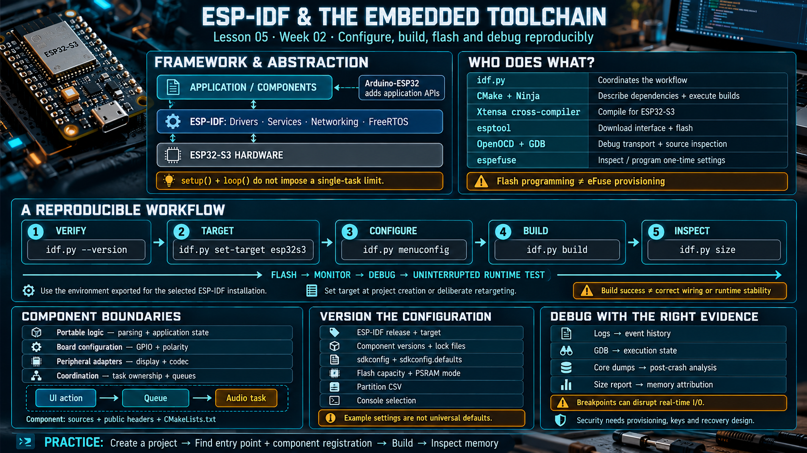

# Lesson 05 — ESP-IDF and the Embedded Development Toolchain

> English edition · Week 02 · ES3C28P / ESP32-S3

[Lesson index](README.md) · [Original lesson](../05-esp-idf-toolchain.md)

## Learning objectives

Identify the responsibilities of the framework and build tools, understand component boundaries, and establish a reproducible build, flash, and debug workflow.

## Framework and abstraction layers

ESP-IDF is Espressif's official development framework. It combines drivers, system services, networking libraries, configuration facilities, and FreeRTOS integration. Arduino-ESP32 builds on ESP-IDF and provides an additional application API. Arduino applications can use tasks and many underlying IDF services; `setup()` and `loop()` do not impose a fundamental single-task limitation.

For this course, direct ESP-IDF development makes hardware configuration, buffer placement, component dependencies, and scheduling decisions visible. This is particularly useful when integrating the board's display, codec, USB connection, and networking stack.

## Tool responsibilities

| Tool or artifact      | Responsibility                                                          |
| --------------------- | ----------------------------------------------------------------------- |
| `idf.py`              | Coordinates configuration, build, flash, monitor, and analysis commands |
| CMake                 | Describes the build and component dependencies                          |
| Ninja                 | Executes generated build steps                                          |
| Xtensa cross-compiler | Produces code for the ESP32-S3 target                                   |
| `sdkconfig`           | Stores the selected project configuration                               |
| `sdkconfig.defaults`  | Supplies intended defaults for reproducible configuration               |
| esptool               | Communicates with the download interface and flash                      |
| espefuse              | Inspects or programs eFuse settings through supported operations        |
| OpenOCD and GDB       | Provide debug transport and source-level inspection                     |
| Partition CSV         | Defines application and data partition boundaries                       |

Keep flash operations and eFuse provisioning conceptually separate: they have different permanence and review requirements.

## Build workflow

Run commands in an environment exported for the selected ESP-IDF installation:

```sh
idf.py --version
idf.py set-target esp32s3
idf.py menuconfig
idf.py build
idf.py size
```

Set the target when creating or deliberately retargeting a project. Repeating target selection unnecessarily can regenerate configuration and invalidate existing build artifacts. Use the project's documented configuration procedure for subsequent builds.

A successful build establishes that sources, dependencies, and configuration are consistent enough to produce an image. Flashing establishes communication and programming. Neither result proves correct display wiring, audio output, battery measurement, or runtime stability.

## Components and responsibility boundaries

An ESP-IDF component normally contains source files, public headers, and a `CMakeLists.txt` declaration. Dependencies should reflect actual API use. A maintainable board application separates:

- Portable logic, such as protocol parsing and application state.
- Board configuration, including GPIO assignments and signal polarity.
- Peripheral adapters, such as display and codec operations.
- Scheduling and coordination, including task ownership and queues.

For example, a UI action can request an audio operation through a queue. The UI need not manipulate I2S DMA buffers or codec registers directly. That boundary allows UI behavior to be tested without reproducing the audio hardware.

## Configuration and version control

Record the ESP-IDF release, target, component versions, flash capacity, PSRAM mode, partition layout, and console selection. Preserve dependency lock files when the project uses managed components. Avoid selecting a release solely because it is the newest: the course project must support its APIs and dependencies.

The original notes mention octal PSRAM at 80 MHz, a 1 kHz RTOS tick, and an enlarged main-task stack. These are examples of project configuration, not mandatory settings for every ESP32-S3 application. Increasing tick frequency also increases scheduling overhead; it does not guarantee 1 ms application deadlines.

## Debugging and product features

Use logs for event history, GDB for execution state, core dumps for post-crash analysis, and size reports for memory attribution. A breakpoint can disrupt time-sensitive I/O, so a successful interactive debug session should be followed by an uninterrupted runtime test.

ESP-IDF supports OTA and security workflows, and higher-level frameworks can expose parts of them. Effective protection depends on configuration, provisioning, key management, and recovery design. Enabling a feature name alone does not establish a secure product.

See the [ESP-IDF build system guide](https://docs.espressif.com/projects/esp-idf/en/v5.3/esp32s3/api-guides/build-system.html) for component and configuration details.

## Practical exercise

Create a small project, identify its entry point and component registration, build it, and inspect its memory report. Explain which files define application behavior, board configuration, dependencies, and generated output.

## Existing course illustration



> This is the illustration supplied with the original lesson. Its embedded labels have not been translated or technically revised; the English text above governs this edition.
