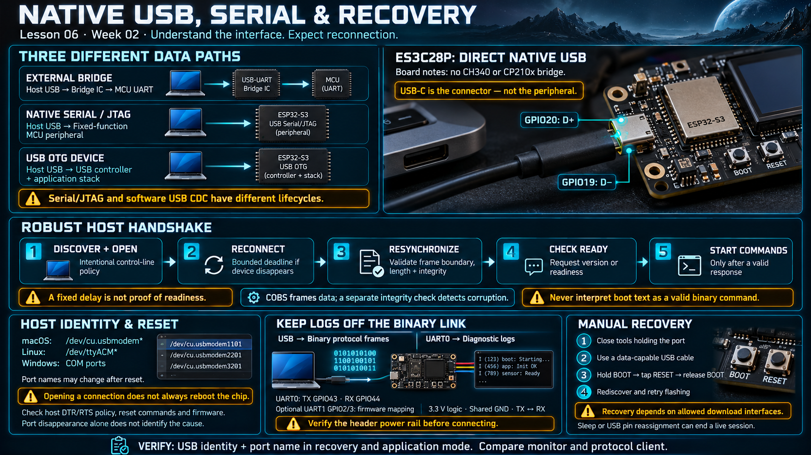

# Lesson 06 — Native USB, Serial Communication, and Recovery

> English edition · Week 02 · ES3C28P / ESP32-S3

[Lesson index](README.md) · [Original lesson](../06-usb-serial-caveat.md)

## Learning objectives

Distinguish native USB from an external USB-to-UART bridge, explain USB Serial/JTAG and USB OTG, and design a host connection that tolerates reset and reconnection.

## The board's USB connection

The original board notes describe a USB-C connector wired directly to ESP32-S3 GPIO19 (D−) and GPIO20 (D+), without a CH340 or CP210x bridge. USB-C describes the connector; it does not specify which internal peripheral implements the data interface.

| Architecture               | Data path                                               |
| -------------------------- | ------------------------------------------------------- |
| External bridge            | Host USB → bridge IC → MCU UART                         |
| Native USB Serial/JTAG     | Host USB → fixed-function MCU peripheral                |
| USB OTG device application | Host USB → MCU USB controller and application USB stack |

The ESP32-S3 USB Serial/JTAG controller is implemented in hardware and provides serial and JTAG functions. An application using USB OTG with a software CDC class has a different initialization and lifecycle. These interfaces must not be treated as interchangeable. See the [USB Serial/JTAG console guide](https://docs.espressif.com/projects/esp-idf/en/v5.3/esp32s3/api-guides/usb-serial-jtag-console.html).

## What the host observes

Typical host names include `/dev/cu.usbmodem*` on macOS, `/dev/ttyACM*` on Linux, and `COM` ports on Windows. The exact name can change after reset or re-enumeration. Identify the device by its USB identity and observed connection behavior rather than assuming a permanent path.

Drivers and permissions depend on the host OS and whether serial access, JTAG access, or both are needed. A device visible in a USB listing can still be unavailable to a user process because of permissions or another application holding the port.

## Reset behavior: distinguish the mechanisms

An external bridge board may route DTR and RTS through a transistor circuit to EN and GPIO0. This explanation cannot simply be copied onto a board without that bridge. The native Serial/JTAG controller has its own automatic download/reset behavior, and host tools can request control-line sequences through it.

The original notes report restarts when opening a host connection. Treat this as an observation of that tool and firmware combination. Opening every serial connection does **not** universally require an ESP32-S3 reboot. Investigate the host's DTR/RTS policy, reset commands, USB peripheral selection, and firmware configuration.

## A robust host handshake

A fixed delay can accommodate an observed startup time, but it is not proof of readiness. A stronger connection procedure is:

1. Discover and open the device with an intentional control-line policy.
2. Tolerate disappearance and reconnect within a bounded deadline.
3. Find a valid frame boundary and validate frame length and integrity.
4. Send a version or readiness request.
5. Begin application commands only after a valid response.

If COBS framing is used, its delimiter provides a resynchronization point. COBS itself does not detect corruption; include the protocol's specified integrity check. Boot text must not be accepted as a valid binary command.

## Separate diagnostics from protocol traffic

The board notes describe UART0 TX on GPIO43 and RX on GPIO44, with an optional UART1 mapping on GPIO2/3. UART assignments beyond fixed board wiring are firmware choices made through routing configuration.

Sending diagnostic logs to UART0 while reserving USB for binary frames simplifies protocol integrity. A UART adapter must use 3.3 V logic, share ground with the board, and connect TX to the peer's RX. Check whether the header's power pin is 3.3 V or another rail before connecting it.

## Recovery procedure

Close applications that own the port. Use a known data-capable cable. Hold BOOT, press and release RESET, then release BOOT and retry discovery and flashing. This assumes download interfaces have not been permanently restricted by security configuration.

Reassigning USB pins or entering sleep can make the running application inaccessible. Manual download mode can often recover a development board, but it does not preserve a live session.

## Troubleshooting exercise

Record the USB identity and port name before flash, during recovery mode, and after application startup. Compare a serial monitor with the protocol client. Determine whether a restart follows an explicit host action, a firmware crash, a watchdog, or a power fault; do not infer the cause from port disappearance alone.

## Existing course illustration

> This is the illustration supplied with the original lesson. Its embedded labels have not been translated or technically revised; the English text above governs this edition.
