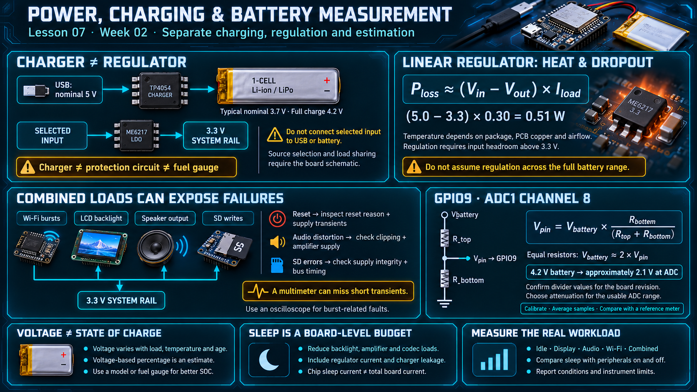

# Lesson 07 — Power Supply, Battery Charging, and Voltage Measurement

> English edition · Week 02 · ES3C28P / ESP32-S3

[Lesson index](README.md) · [Original lesson](../07-power-battery.md)

## Learning objectives

Explain the roles of the charger and regulator, estimate electrical and thermal load, and distinguish battery voltage measurement from state-of-charge estimation.

## Charger and regulator responsibilities

The course notes identify a TP4054 single-cell charger and an ME6217 linear regulator. USB provides nominal 5 V input, while a conventional rechargeable single-cell lithium-ion/polymer battery has a nominal voltage near 3.7 V and a full-charge voltage of 4.2 V.

The charger controls the battery charging process. The regulator supplies a nominal 3.3 V system rail. These are separate responsibilities. The exact source-selection, reverse-current protection, and load-sharing behavior must be read from the board schematic; a simplified power diagram does not establish the presence of a managed power path.

Use the battery chemistry, connector polarity, and charging voltage specified for the board. A charge-management IC is not automatically a battery protection circuit or a fuel gauge. A simultaneous system load can also affect charge termination when the design lacks a separate managed load path.

## Linear-regulator limits

A linear regulator approximately dissipates:

```text
P_loss = (V_input − V_output) × I_load
```

At 5.0 V input, 3.3 V output, and 0.30 A load, the estimated dissipation is 0.51 W. Package temperature, PCB copper, airflow, and regulator limits determine whether this is sustainable.

A 3.3 V LDO cannot maintain 3.3 V output when its input falls below the required output plus dropout voltage. Consequently, a discharging battery can cause the system rail to decline before the cell reaches its minimum allowed voltage. Do not assume full regulation over the entire 3.0–4.2 V battery range.

## Shared current demand

Wi-Fi transmissions, LCD backlight, speaker output, and SD writes can produce overlapping demand. A board that works with each function individually can reset when they run together.

| Symptom                            | Investigation                                      |
| ---------------------------------- | -------------------------------------------------- |
| Backlight brightness changes       | Measure rail voltage and backlight control signals |
| Reset during Wi-Fi activity        | Inspect reset reason and capture supply transients |
| Audio distortion at high volume    | Check clipping, amplifier supply, and total load   |
| SD errors during combined activity | Check supply integrity as well as bus timing       |

The original firmware reportedly reduced LED intensity by a factor of four. This is a brightness policy and reduces LED load, but it does not establish the board's measured power margin. A multimeter can miss short transients; an oscilloscope is more informative for burst-related faults.

## Battery sensing through GPIO9

The notes assign battery sensing to GPIO9, ADC1 channel 8, through an approximately 1:2 divider. Confirm resistor values and tolerances for the board revision.

```text
V_pin = V_battery × R_bottom / (R_top + R_bottom)
V_battery = V_pin × (R_top + R_bottom) / R_bottom
```

Equal resistor values produce a nominal factor of two. A 4.2 V battery then produces approximately 2.1 V at the ADC pin. Select attenuation according to the documented usable ADC range; the GPIO supply voltage is not a guarantee of an accurate 0–3.3 V ADC measurement range.

Use the supported calibration driver, which can use factory calibration information when available. Average repeated samples and compare the reconstructed voltage against a reference meter at several battery voltages. Calibration does not remove divider tolerance, interference, or loading effects. See the [ADC calibration guide](https://docs.espressif.com/projects/esp-idf/en/v5.3/esp32s3/api-reference/peripherals/adc_calibration.html).

## Voltage is not battery percentage

A linear mapping from 3.0 to 4.2 V can illustrate normalization, but lithium-cell discharge voltage is nonlinear and depends on load, temperature, age, and recent charging. Present voltage-derived percentage as an estimate. Accurate state-of-charge measurement may require a characterized model or a dedicated fuel gauge.

## Sleep is a system-level operation

Before sleeping, reduce or disable backlight, amplifier, codec, and other loads as supported by their circuits. RTC retention and chip sleep current do not determine total board current. Regulator quiescent current, charger leakage, and external peripherals remain part of the budget.

## Practical exercise

Measure idle, display-only, audio, Wi-Fi, and combined current. Repeat the sleep measurement with peripherals enabled and disabled. Report measurement conditions and instrument limitations alongside the results.

## Existing course illustration



> This is the illustration supplied with the original lesson. Its embedded labels have not been translated or technically revised; the English text above governs this edition.
