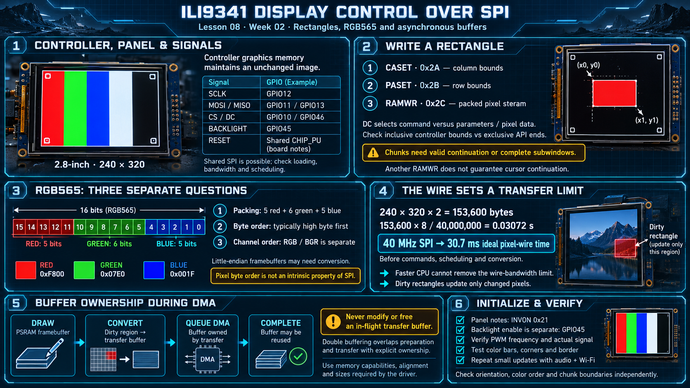

# Lesson 08 — ILI9341 Display Control over SPI

> English edition · Week 02 · ES3C28P / ESP32-S3

[Lesson index](README.md) · [Original lesson](../08-ili9341-display.md)

## Learning objectives

Explain command/data signaling, calculate framebuffer and transfer requirements, and manage asynchronous display buffers without corrupting pixels.

## Controller, panel, and framebuffer

The board notes identify a 2.8-inch 240 × 320 display using an ILI9341-family controller. The controller stores received pixels in its graphics memory and scans the panel independently. The MCU updates image content; it does not need to continuously resend an unchanged frame to maintain it.

| Signal            | GPIO in the course notes                    |
| ----------------- | ------------------------------------------- |
| SPI clock         | 12                                          |
| MOSI              | 11                                          |
| MISO              | 13                                          |
| Chip select       | 10                                          |
| Data/command      | 46                                          |
| Backlight control | 45                                          |
| Display reset     | Shared with CHIP_PU, according to the notes |

Board wiring is fixed by PCB traces. A shared SPI bus is technically possible with compatible devices and separate chip selects, but accessibility, bandwidth, electrical loading, and scheduling must be considered. Heavy LCD traffic is a design constraint, not a universal prohibition on bus sharing.

## Commands and rectangular writes

The panel is another SPI device on the chip:

```
┌─────────────┐            ┌───────────┐
│ ESP32-S3    │ ── SPI ──► │ ILI9341   │
│ FSPI / SPI2 │            │ 240 x 320 │
└─────────────┘            └───────────┘
```

One frame write is three commands, in this order:

```
┌──────────┐                         ┌─────────┐
│ ESP32-S3 │                         │ ILI9341 │
└─────┬────┘                         └────┬────┘
      │                                   │
      │ CASET 0x2A, columns ─────────────►│
      │ PASET 0x2B, rows ────────────────►│
      │ RAMWR 0x2C, pixels ──────────────►│
```

DC selects whether transmitted bytes represent a command or its parameters/pixel data. A typical rectangular update sets the column and row bounds, then starts a memory write:

```text
CASET  0x2A → first and last column
PASET  0x2B → first and last row
RAMWR  0x2C → packed pixel stream for that rectangle
```

A driver may expose exclusive end coordinates even when the controller command uses inclusive bounds. Check the API contract before translating rectangle sizes.

For chunked updates, either maintain a documented write-continuation sequence or define a new complete subwindow for each chunk. Do not assume that another RAMWR command continues at the previous cursor position. The original notes report overwritten regions when their chunk implementation restarted a write incorrectly.

## RGB565: packing, byte order, and channel order

RGB565 allocates **5 red bits, 6 green bits, and 5 blue bits**:

```text
bits 15..11 = red; bits 10..5 = green; bits 4..0 = blue
red = 0xF800; green = 0x07E0; blue = 0x001F
```

The controller's pixel-transfer format typically expects the high byte first. A little-endian `uint16_t` framebuffer therefore needs a suitable conversion or driver configuration. This is a pixel protocol requirement, not an intrinsic “endianness” of SPI.

RGB/BGR channel selection is a separate setting. If red and blue exchange places while other features remain plausible, check channel order as well as byte order. Use solid red, green, blue, white, and black test regions to distinguish the problems.

## Transfer budget

One frame contains 153,600 bytes. At an illustrative 40 MHz SPI clock:

```text
153,600 × 8 / 40,000,000 = 0.03072 s
```

That is approximately 30.7 ms of ideal pixel-wire time, before command overhead, scheduling, and conversion. Increasing CPU frequency cannot eliminate a wire-bandwidth limit. Dirty rectangles reduce traffic by updating only changed regions.

## Buffer ownership and DMA

A typical pipeline draws into an image buffer, identifies a dirty region, converts pixels into a transfer buffer, and queues an asynchronous transfer. The buffer remains owned by the transfer until completion. Reusing or freeing it earlier can create intermittent corruption.

Double buffering allows the CPU to prepare one transfer while another is active, provided ownership is explicit. A large framebuffer can use PSRAM, while transfer buffers use the driver's required memory capabilities. See [SPI LCD integration](https://docs.espressif.com/projects/esp-idf/en/v5.3/esp32s3/api-reference/peripherals/lcd/spi_lcd.html).

## Initialization and visible output

The original notes report that the supplied panel needs display inversion enabled with INVON (`0x21`). Treat this as a panel-specific initialization requirement. Backlight enable is separate from controller initialization: a working pixel pipeline can still appear black if GPIO45 is not driven correctly.

Brightness PWM can reduce average backlight power. Select a suitable frequency and verify the actual signal rather than interpreting every flicker as a power fault.

## Practical verification

Display color bars, corner labels, and a one-pixel border. Then update a small rectangle repeatedly while audio and Wi-Fi run. Verify orientation, color order, chunk boundaries, and buffer ownership independently before optimizing frame rate.

## Existing course illustration



> This is the illustration supplied with the original lesson. Its embedded labels have not been translated or technically revised; the English text above governs this edition.
