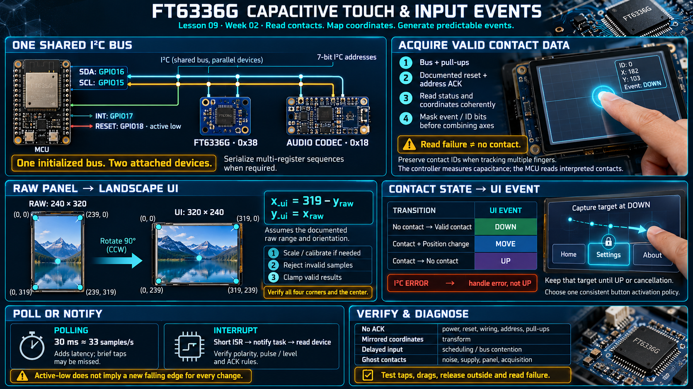

# Lesson 09 — FT6336G Capacitive Touch and Input Events

> English edition · Week 02 · ES3C28P / ESP32-S3

[Lesson index](README.md) · [Original lesson](../09-ft6336-touch.md)

## Learning objectives

Read touch data through a shared I2C bus, transform panel coordinates into UI coordinates, and convert sampled contacts into predictable interaction events.

## Touch controller responsibilities

The FT6336G performs capacitive sensing and exposes interpreted contact information through registers. The MCU reads coordinates and status rather than measuring the panel's electrode capacitance directly. The ESP32-S3's individual capacitive touch inputs serve a different purpose and are not substitutes for a two-dimensional touch-panel controller.

| Signal            | Board assignment from the course notes |
| ----------------- | -------------------------------------- |
| SDA               | GPIO16                                 |
| SCL               | GPIO15                                 |
| Interrupt         | GPIO17                                 |
| Reset, active low | GPIO18                                 |
| I2C address       | `0x38`, expressed as a 7-bit address   |

The audio codec uses the same SDA/SCL pair at address `0x18`. Keep one initialized bus instance and attach both devices to it. Verify the selected driver's thread-safety guarantees; serialize higher-level sequences when several register operations must remain logically indivisible. See the [ESP-IDF I2C driver](https://docs.espressif.com/projects/esp-idf/en/v5.3/esp32s3/api-reference/peripherals/i2c.html).

## Initialization and acquisition

Establish the bus and pull-ups, perform the documented reset sequence, and confirm that the device acknowledges its address. Read status and coordinate registers using the exact controller register map. Coordinate high bytes can also contain event or identifier bits, so mask those fields before combining the axis value.

Prefer a coherent block read where the device supports it. Preserve the distinction between “no contact” and “transaction failed”; interpreting a failed read as a release can generate false UP events.

The notes describe a UI that uses one contact, even though the controller family can report multiple contacts. If extending the UI, preserve contact IDs rather than assuming that array position permanently identifies a finger.

## Polling and interrupt-driven operation

The original implementation reportedly polls every 30 ms. This is approximately 33 samples per second and can be adequate for simple controls. It also adds sampling latency and can miss a sufficiently brief contact.

An interrupt can notify a task to read the device. Keep the ISR short and use an appropriate ISR-safe signaling API. Determine interrupt polarity, pulse/level behavior, and acknowledgment requirements from the controller configuration. An active-low pin does not by itself establish whether every change produces a new falling edge.

## Coordinate transformation

The display and touch panel can use different orientation conventions. The original landscape mapping is:

```text
x_ui = 319 − y_raw
y_ui = x_raw
```

This formula assumes raw coordinates span 240 columns and 320 rows with the expected origin and direction. If their actual range differs, apply scaling or calibration first. Reject invalid samples and clamp valid transformed coordinates to the UI bounds.

Test all four corners and the center. An I2C acknowledgment proves communication, while correct corner mapping proves usable spatial input.

## From contacts to UI events

Maintain previous contact state and generate:

| Transition                             | Event |
| -------------------------------------- | ----- |
| No contact → valid contact             | DOWN  |
| Contact continues with position change | MOVE  |
| Contact → no contact                   | UP    |

Buttons commonly activate on a chosen edge, while sliders follow DOWN and MOVE. Define whether a button commits on press or on release inside its bounds; either policy should be consistent.

Capture the interaction target at DOWN. For example, a gesture beginning in the tab bar should not activate a body button simply because the finger later crosses it. Preserve that target until UP or explicit cancellation.

## Failure analysis

No acknowledgment suggests reset state, power, address, wiring, or pull-up issues. Mirrored coordinates suggest a transform problem. Delayed input during audio activity suggests task scheduling or shared-bus contention. Ghost contacts can involve noise, supply quality, panel conditions, or acquisition settings; polling frequency alone is not a sufficient diagnosis.

## Practical exercise

Implement a coordinate viewer and event log. Verify corners, taps, drags, release outside a control, and an I2C read failure. Confirm that one failed transaction does not silently become a user action.

## Existing course illustration



> This is the illustration supplied with the original lesson. Its embedded labels have not been translated or technically revised; the English text above governs this edition.
