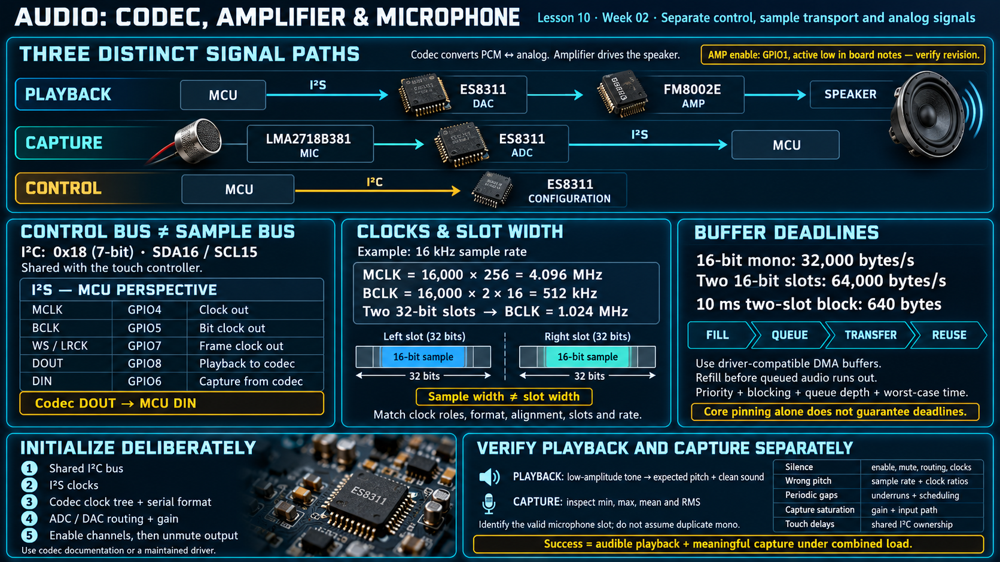

# Lesson 10 — Audio: ES8311 Codec, Amplifier, and Microphone

> English edition · Week 02 · ES3C28P / ESP32-S3

[Lesson index](README.md) · [Original lesson](../10-audio-chain.md)

## Learning objectives

Separate audio control from sample transport, calculate serial-audio clocks and buffer deadlines, and verify playback and capture as independent signal paths.

## Signal-chain responsibilities

The board notes identify an ES8311 codec, an FM8002E speaker amplifier, and an LMA2718B381 analog MEMS microphone. The codec converts between PCM samples and analog audio; the amplifier supplies speaker drive; the microphone produces the analog capture signal.

```text
Playback: MCU → I2S → codec DAC → amplifier → speaker
Capture:  microphone → codec ADC → I2S → MCU
Control:  MCU → I2C → codec configuration registers
```

The notes assign amplifier enable to GPIO1 with active-low behavior. Confirm polarity for the board revision. This lesson does not assume an amplifier topology or rated output power without its exact component documentation.

## Control bus and data bus

I2C configures the codec at 7-bit address `0x18` on SDA16/SCL15, shared with touch. I2S transports audio samples using dedicated clock and data signals.

| I2S signal | GPIO | Direction relative to the MCU            |
| ---------- | ---- | ---------------------------------------- |
| MCLK       | 4    | Clock output in the course configuration |
| BCLK       | 5    | Bit-clock output                         |
| WS/LRCK    | 7    | Frame/slot clock output                  |
| DOUT       | 8    | Playback samples to codec                |
| DIN        | 6    | Capture samples from codec               |

A codec's DOUT connects to the MCU's DIN. Signal names must therefore identify the endpoint perspective. The original notes attribute a confusing vendor pin table to this naming difference.

## Clock and slot configuration

For a 16 kHz sample rate and an MCLK multiplier of 256:

```text
MCLK = 16,000 × 256 = 4.096 MHz
```

For two 16-bit serial slots per frame:

```text
BCLK = 16,000 × 2 × 16 = 512 kHz
```

If 16-bit samples occupy 32-bit slots, BCLK instead becomes 1.024 MHz. Sample width and slot width are different settings. The codec and MCU must agree on clock roles, format, word alignment, slot selection, and rate. See the [I2S driver guide](https://docs.espressif.com/projects/esp-idf/en/v5.3/esp32s3/api-reference/peripherals/i2s.html).

## Initialization sequence

Initialize the shared I2C bus, establish I2S clocks, configure the codec's clock tree and serial format, configure ADC/DAC paths and gain, and enable the required channels. Keep output muted or the amplifier disabled during transitions where the hardware permits it, then enable output deliberately.

The original notes mention codec registers `0x14`, `0x17`, and `0x1B` for microphone-path, ADC-level, and filtering configuration. These are register-map pointers, not a complete initialization recipe. Use the exact codec documentation or a maintained driver rather than copying isolated values.

## Buffers and real-time deadlines

At 16 kHz, 16-bit mono audio requires 32,000 payload bytes per second. Two 16-bit slots require 64,000 bytes per second. A 10 ms two-slot block contains 640 bytes, so the producer must replenish data before the queued audio is consumed.

Use driver-compatible DMA storage and define buffer ownership. A worker task can block on transfer progress while the rest of the application runs. Core pinning is an optional scheduling decision; meeting deadlines depends on priority, blocking behavior, queue depth, and worst-case processing time.

For capture, determine which slot carries valid microphone samples. Do not assume both slots contain identical mono data. If averaging two signed samples, widen the intermediate arithmetic to avoid overflow.

## Playback and capture verification

Begin with a low-amplitude tone and verify expected pitch and clean output. Then capture microphone data and inspect minimum, maximum, mean, and RMS over a defined interval. Clipping, DC offset, and incorrect slot alignment produce different signatures.

| Symptom                   | Checks                                                              |
| ------------------------- | ------------------------------------------------------------------- |
| Silence                   | Amplifier enable, mute, DAC routing, clocks, and speaker connection |
| Wrong pitch               | Sample rate and clock ratios                                        |
| Periodic gaps             | Underrun counters, scheduling, and processing time                  |
| Capture saturation        | Analog gain and input path                                          |
| Touch delays during setup | Shared I2C ownership and transaction duration                       |

The completion criterion is audible playback and meaningful capture data under a combined workload. Creating an I2S channel or receiving an I2C acknowledgment alone does not establish either result.

## Existing course illustration



> This is the illustration supplied with the original lesson. Its embedded labels have not been translated or technically revised; the English text above governs this edition.
