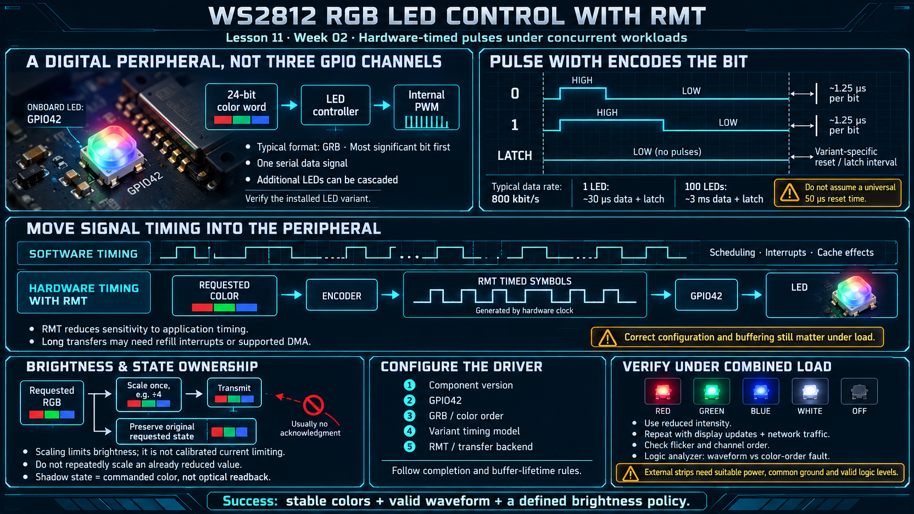

# Lesson 11 — WS2812 RGB LED Control with RMT

> English edition · Week 02 · ES3C28P / ESP32-S3

[Lesson index](README.md) · [Original lesson](../11-ws2812-rmt-led.md)

## Learning objectives

Explain pulse-width encoded LED data, identify the limitations of software timing, and maintain a reliable LED driver under concurrent display and network activity.

## An addressable LED is a digital peripheral

The board notes assign one WS2812-family RGB LED to GPIO42. Unlike a discrete RGB LED with three independently driven channels, an addressable LED receives a serial color word and performs its own internal PWM.

A typical device accepts 24 bits in GRB order, most significant bit first. Data can be cascaded through additional LEDs, but the board's single LED does not establish the electrical requirements of an external strip.

## Pulse timing

A commonly encountered WS2812 waveform has an approximately 1.25 µs bit period, corresponding to 800 kbit/s. A shorter high interval encodes zero; a longer high interval encodes one. A sufficiently long low interval latches the frame.

```text
0: short high interval + remaining low interval
1: longer high interval + remaining low interval
frame end: continuous low for the specified reset/latch interval
```

Exact high times, tolerances, and reset duration vary across WS2812 revisions and compatible devices. A universal 50 µs reset assumption is unsafe for variants requiring a longer interval. Use the installed LED's specification or an appropriate supported driver.

One 24-bit LED requires approximately 30 µs of data time at 800 kbit/s, plus the latch interval. A chain of 100 LEDs requires approximately 3 ms of data time. Chain length increases the duration for which waveform continuity matters.

## Why software timing becomes unreliable

A loop that changes GPIO levels and waits a calibrated number of cycles can be interrupted by scheduling, interrupts, or cache effects. The original notes report LED flicker when display activity overlapped with a software-driven waveform. That observation indicates a timing problem but does not prove that DMA alone caused it.

Disabling interrupts for an entire LED chain can create unacceptable latency for other workloads. A peripheral waveform generator provides a better boundary between application scheduling and signal timing.

## RMT transmission

The pulses come from a peripheral, not from a CPU loop:

```
┌────────┐                 ┌─────────────┐
│ RMT    │ ── waveform ──► │ WS2812      │
│ GPIO42 │                 │ GRB, 24 bit │
└────────┘                 └─────────────┘
```

One frame is the bits, then a reset:

```
┌─────┐                        ┌────────┐
│ RMT │                        │ WS2812 │
└──┬──┘                        └────┬───┘
   │                                │
   │ bit 0, short high ────────────►│
   │ bit 1, long high ─────────────►│
   │ reset, low > 50 us ───────────►│
```

RMT represents a waveform as timed high/low symbols and emits them using a hardware clock. An encoder translates color bits into those symbols. The application submits a transfer and observes the driver's completion rules.

RMT reduces timing sensitivity, but it still has resource and scheduling constraints. Long transmissions may require refill interrupts or supported DMA operation. Correct driver configuration and adequate buffering remain necessary under load. See the [RMT driver documentation](https://docs.espressif.com/projects/esp-idf/en/v5.3/esp32s3/api-reference/peripherals/rmt.html).

For a single onboard LED, a maintained LED-strip component can provide the encoding layer. Record its version, GPIO, color order, timing model, and transfer backend.

## Brightness and state ownership

The original firmware reportedly divides channel values by four before transmission. This limits brightness and reduces demand; it is not a calibrated current limiter. Preserve the application's requested color separately from the transmitted scaled value so that repeated updates do not repeatedly divide an already reduced value.

The LED normally provides no acknowledgment or color readback. A shadow state records the commanded color, not a measured optical result. Make this distinction explicit in diagnostics and user interfaces.

External strips require a suitable power source, common ground, and logic levels that meet the strip's input thresholds. Do not supply a long strip from the board's 3.3 V rail merely because the onboard LED works there.

## Practical verification

Show red, green, blue, white at reduced intensity, and off. Run the same sequence while repeatedly updating the display and exchanging network traffic. Check for flicker and incorrect channel order. A logic analyzer can distinguish waveform corruption from an otherwise valid command with the wrong color order.

The acceptance criterion is a stable visible sequence under the stated combined workload, with a valid transmitted waveform and a defined brightness policy.

## Existing course illustration



> This is the illustration supplied with the original lesson. Its embedded labels have not been translated or technically revised; the English text above governs this edition.
