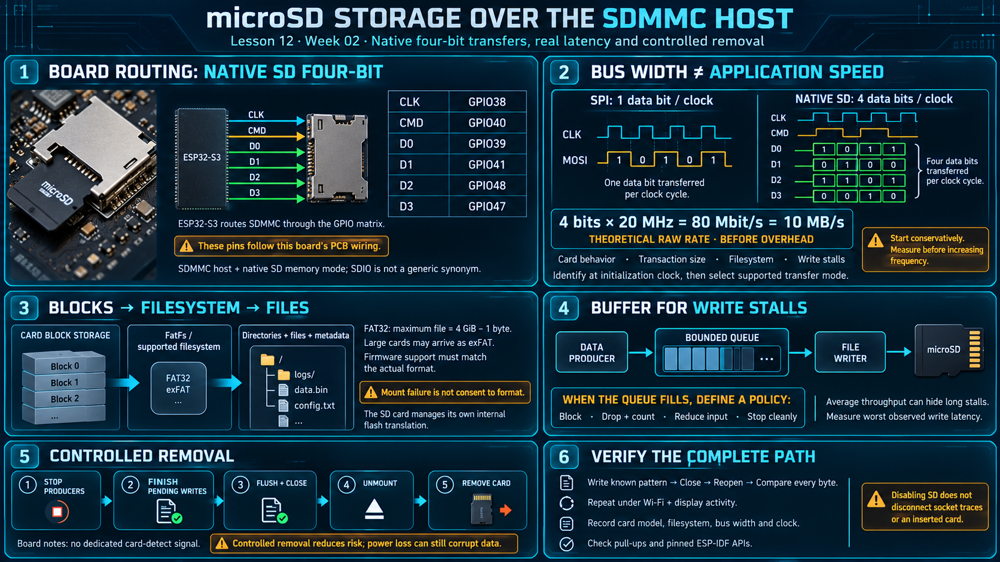

# Lesson 12 — microSD Storage over the SDMMC Host

> English edition · Week 02 · ES3C28P / ESP32-S3

[Lesson index](README.md) · [Original lesson](../12-microsd-sdio.md)

## Learning objectives

Distinguish native SD memory transfers from SPI mode, configure the board's socket routing, and design file writes that tolerate latency and controlled removal.

## Board routing and terminology

The card sits on the SDMMC host in 4-bit mode:

```
┌────────────┐              ┌───────────────┐
│ ESP32-S3   │ ── 4-bit ──► │ microSD       │
│ SDMMC host │              │ CLK CMD D0-D3 │
└────────────┘              └───────────────┘
```

A command on CMD, then the payload on the data bus:

```
┌──────┐                     ┌──────┐
│ host │                     │ card │
└───┬──┘                     └───┬──┘
    │                            │
    │ command on CMD ───────────►│
    │◄────────── response on CMD │
    │◄──────────── data on D0-D3 │
```

The course notes describe a native four-bit SD connection:

| Signal | GPIO |
| ------ | ---- |
| CLK    | 38   |
| CMD    | 40   |
| D0     | 39   |
| D1     | 41   |
| D2     | 48   |
| D3     | 47   |

Use **SDMMC host** for the ESP32-S3 peripheral and **native SD four-bit mode** for this memory-card connection. SDIO more specifically describes SD input/output functionality; using it as a general label for every SD memory interface can obscure the protocol distinction.

On ESP32-S3, the SDMMC signals can be routed through the GPIO matrix. The pins above are required by this board's PCB wiring, not by a universal fixed-pin limitation of the chip. See the [SDMMC host guide](https://docs.espressif.com/projects/esp-idf/en/v5.3/esp32s3/api-reference/peripherals/sdmmc_host.html).

## Bus width and throughput

Native four-bit mode transfers four data bits per clock, while SPI mode transfers one bit per clock. Bus width improves the potential transfer rate, but measured performance also depends on clock, card behavior, transaction size, filesystem overhead, and write stalls.

For illustration, a four-bit bus at 20 MHz has a raw data rate of 80 Mbit/s, or 10 MB/s before overhead. This is a theoretical wire rate, not a promised application write speed.

The host identifies the card at an initialization clock, negotiates supported operation, and then selects the data-transfer mode. Start with a conservative configuration before increasing frequency.

## Configuration example

The following fragment illustrates the board mapping; it is not a complete mount routine:

```c
#include "driver/sdmmc_host.h"

sdmmc_slot_config_t slot = SDMMC_SLOT_CONFIG_DEFAULT();
slot.width = 4;
slot.clk = GPIO_NUM_38;
slot.cmd = GPIO_NUM_40;
slot.d0 = GPIO_NUM_39;
slot.d1 = GPIO_NUM_41;
slot.d2 = GPIO_NUM_48;
slot.d3 = GPIO_NUM_47;
```

Check pull-up requirements and the API available in the pinned ESP-IDF release. Initialization success should be followed by a real write/read comparison.

## Blocks, filesystems, and wear

The card interface provides block storage. The filesystem adds directories, filenames, allocation, and metadata. FAT32 is common on smaller cards; larger cards frequently arrive formatted as exFAT. Firmware support must match the actual format and build configuration.

FAT32's maximum file size is 4 GiB minus one byte. Long recordings should use file rotation or another supported format. Do not silently enable automatic formatting when mount fails: a wiring or unsupported-format problem should not cause existing data to be erased.

The card manages its own internal flash translation. ESP-IDF's wear-leveling layer used for some internal-flash filesystems is not generally inserted between an SD card and FatFs. See [FatFs integration](https://docs.espressif.com/projects/esp-idf/en/v5.3/esp32s3/api-reference/storage/fatfs.html).

## Latency and removal policy

Write throughput averages can hide long card stalls. Buffer acquisition data in bounded queues and define the response to a queue filling: block, drop with a counter, reduce input, or stop recording cleanly.

The notes report no dedicated card-detect signal. Without one, mount or I/O results provide the available evidence of card presence. Before removal, stop producers, finish pending writes, flush and close files, and unmount. This reduces corruption risk but does not make an arbitrary power interruption harmless.

Socket-connected pins are not automatically safe expansion pins when the application disables SD. Physical traces, pull-ups, and an inserted card remain connected.

## Practical verification

Create a temporary file, write a known pattern, close it, reopen it, and verify every byte. Measure average throughput and worst observed write latency under Wi-Fi and display activity. Report the card model, filesystem, bus width, and clock with the results.

## Existing course illustration



> This is the illustration supplied with the original lesson. Its embedded labels have not been translated or technically revised; the English text above governs this edition.
