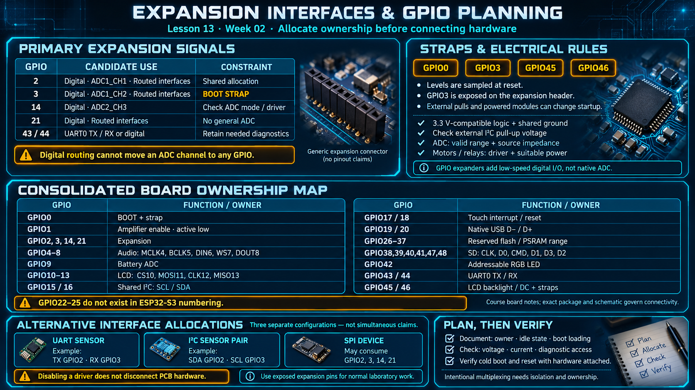

# Lesson 13 — Expansion Interfaces and GPIO Resource Planning

> English edition · Week 02 · ES3C28P / ESP32-S3

[Lesson index](README.md) · [Original lesson](../13-expansion-pins.md)

## Learning objectives

Use a board-level pin map, identify boot and electrical constraints, and allocate expansion interfaces without conflicting with onboard functions.

## Available expansion connections

The original notes identify GPIO2, GPIO3, GPIO14, and GPIO21 as the four primary expansion signals. GPIO43/44 are also exposed through the UART0 header and may be reusable when their diagnostic role is intentionally removed.

| GPIO | Candidate function | Constraint |
|---|---|---|
| 2 | Digital I/O, ADC1_CH1, routed UART/SPI/I2C | Shared with any selected expansion interface |
| 3 | Digital I/O, ADC1_CH2, routed UART/SPI/I2C | Also a strapping pin |
| 14 | Digital I/O, ADC2_CH3, routed digital peripheral | ADC support depends on mode and driver constraints |
| 21 | Digital I/O, routed digital peripheral | No general ADC function |
| 43/44 | UART0 TX/RX or reassigned digital I/O | Preserve access required for logs or recovery |

A function routed through the GPIO matrix is still subject to input/output capability, electrical requirements, and PCB connectivity. ADC channels cannot be assigned to an arbitrary GPIO by changing a digital routing setting.

## Consolidated board map

Pins on this board fall into reserved groups and a free header:

```
┌───────────────┐   ┌─────────────┐   ┌───────────────┐
│ flash + PSRAM │   │ USB D- / D+ │   │ LCD SPI       │
│ GPIO26-37     │   │ GPIO19-20   │   │ GPIO10-13, 46 │
└───────────────┘   └─────────────┘   └───────────────┘

┌───────────────────┐   ┌─────────┐   ┌──────────────────┐
│ free header       │   │ RGB LED │   │ microSD          │
│ GPIO 2, 3, 14, 21 │   │ GPIO42  │   │ GPIO38-41, 47-48 │
└───────────────────┘   └─────────┘   └──────────────────┘
```

| GPIO group | Assignment in the course notes |
|---|---|
| 0 | BOOT button and boot strap |
| 1 | Amplifier enable, active low |
| 2, 3, 14, 21 | Expansion header |
| 4, 5, 6, 7, 8 | Audio MCLK, BCLK, DIN, WS, DOUT |
| 9 | Battery-sense ADC |
| 10, 11, 12, 13 | LCD CS, MOSI, clock, MISO |
| 15, 16 | Shared codec/touch I2C clock and data |
| 17, 18 | Touch interrupt and reset |
| 19, 20 | Native USB D− and D+ |
| 26–37 | Reserved flash/PSRAM subsystem range |
| 38, 39, 40, 41, 47, 48 | SD clock, D0, CMD, D1, D3, D2 |
| 42 | Addressable RGB LED |
| 43, 44 | UART0 TX/RX header |
| 45 | LCD backlight and strap function |
| 46 | LCD DC and strap function |

GPIO22–25 are absent from the ESP32-S3 GPIO numbering. A numerical gap is not an unallocated board resource. The exact package and board schematic remain authoritative for electrical connectivity.

## Strapping and startup

The ESP32-S3 strapping pins include **GPIO0, GPIO3, GPIO45, and GPIO46**. Their levels are sampled during reset to control documented startup behavior. GPIO3 is particularly relevant because it appears on the expansion header.

An attached sensor, level shifter, or pull resistor can alter a strap even before the application configures the pin. Review startup levels and timing, not merely the final runtime direction. Consult the [ESP32-S3 schematic checklist](https://docs.espressif.com/projects/esp-hardware-design-guidelines/en/latest/esp32s3/schematic-checklist.html) for boot constraints.

## Allocate interfaces explicitly

A UART might use GPIO2 as TX and GPIO3 as RX. A second I2C bus might use the same pair. A four-signal SPI interface might consume all four expansion pins. These are alternative allocations unless an intentional multiplexing design manages both electrical isolation and ownership.

Disabling a driver does not disconnect its hardware. Repurposing touch, display, SD, or memory connections can create contention with devices still attached to the PCB. Use exposed expansion pins for normal laboratory work.

## Electrical and power constraints

Use 3.3 V-compatible logic and a shared ground. Check pull-up voltage on externally powered I2C modules. For analog input, select a valid ADC range and account for source impedance. For loads such as motors or relays, provide a suitable driver and power source rather than using GPIO current as load power.

A GPIO expander can add low-speed digital I/O, but it does not add native ADC channels or reproduce every timing-sensitive peripheral function.

## Practical planning exercise

Design connections for a UART sensor, an I2C sensor pair, and an SPI device as three separate configurations. For each, document GPIO ownership, idle state, boot-time loading, logic voltage, current demand, and retained diagnostic access. Verify cold boot and reset with the external hardware connected.

## Existing course illustration



> This is the illustration supplied with the original lesson. Its embedded labels have not been translated or technically revised; the English text above governs this edition.
