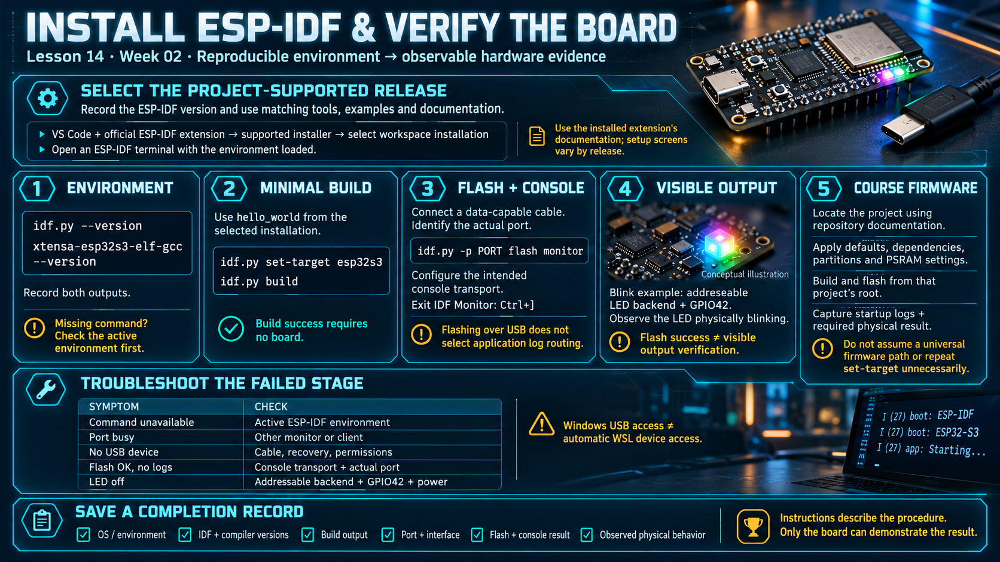

# Lesson 14 — Installing ESP-IDF and Verifying the Board

> English edition · Week 02 · ES3C28P / ESP32-S3

[Lesson index](README.md) · [Original lesson](../14-esp-idf-setup.md)

## Learning objectives

Establish a reproducible development environment, distinguish build success from hardware verification, and document a known-good flashing and console procedure.

## Select a supported version first

Use the ESP-IDF release required by the course project or its dependencies. Do not interpret an older instruction to install “the latest 5.x” as a permanent version policy. Record the selected release and use its matching examples and documentation.

The environment includes ESP-IDF, the ESP32-S3 cross-compiler, Python dependencies, CMake/Ninja, flashing tools, and debug tools. Supported Python and host requirements vary by release.

## Install through the supported workflow

1. Install Visual Studio Code and the official Espressif ESP-IDF extension.
2. Follow the extension's supported installation workflow for the chosen host OS.
3. Install or select the required ESP-IDF release and matching tools.
4. Select that installation for the workspace.
5. Open an ESP-IDF terminal with its environment loaded.

The current extension documentation describes Espressif Installation Manager (EIM) integration. Older extension releases may present Express configuration screens. Follow the installed extension's documentation rather than expecting identical command labels across versions. See [Install ESP-IDF and Tools](https://docs.espressif.com/projects/vscode-esp-idf-extension/en/latest/installation.html).

On Windows and WSL, tool installation and USB access are separate concerns. Establish whether the build and serial client run in Windows or Linux, then verify that the selected environment can access the device. A working Windows COM port does not automatically imply a usable WSL `/dev/ttyACM*` device.

**Windows:** run `idf.py` in **PowerShell** or the extension’s **ESP-IDF Terminal** (PowerShell-based). Do **not** use Git Bash — MSYS/MinGW (`MSYSTEM`) breaks Espressif’s toolchain.

## Verification stage 1: environment

The order that has to succeed before the toolchain counts as ready:

```
┌───────────┐                        ┌────────┐                        ┌───────┐
│ developer │                        │ idf.py │                        │ board │
└─────┬─────┘                        └────┬───┘                        └───┬───┘
      │                                   │                                │
      │ set-target esp32s3 ──────────────►│                                │
      │ build ───────────────────────────►│                                │
      │                                   │ flash ────────────────────────►│
      │◄────────────────────────────────────────────────────── console log │
```

```sh
idf.py --version
xtensa-esp32s3-elf-gcc --version
```

Record their output. If a command is unavailable, inspect the selected environment before reinstalling tools. An ordinary terminal may not have the ESP-IDF paths and Python environment exported.

## Verification stage 2: minimal build

Create a project from the `hello_world` example included in the selected ESP-IDF installation. In the project directory:

```sh
idf.py set-target esp32s3
idf.py build
```

The target must be ESP32-S3. Successful compilation and linking produce an image, but no board is needed for this stage.

## Verification stage 3: flash and console

Connect the board with a data-capable USB cable. Identify the actual serial device using the OS device list or extension port selector. Replace PORT below with that device name:

```sh
idf.py -p PORT flash monitor
```

Typical names are `/dev/cu.usbmodem…`, `/dev/ttyACM…`, or `COM…`. Configure the project's console transport for the intended interface; flashing over native USB does not by itself route application logs to it.

Observe the expected example output and use `Ctrl+]` to exit IDF Monitor. Reset and re-enumeration behavior depends on the selected peripheral and host tool; a restart is not an unconditional consequence of opening a serial port. If automatic download fails, use the BOOT/RESET sequence from Lesson 06.

## Verification stage 4: visible peripheral result

If using the blink example, explicitly select an addressable RGB LED backend supported by that example release and GPIO42. A generic GPIO blink configuration may not drive a WS2812-family LED correctly.

Observe actual blinking. A success message from a flash tool proves programming, while visible blinking proves that this example also controls the selected output.

## Verification stage 5: course firmware

Locate the real firmware project using repository documentation. The original notes mention `firmware/esp32s3`, but that path belongs to their referenced project and must not be assumed to exist in every course checkout.

Apply its intended defaults, dependencies, partition layout, PSRAM configuration, and console routing. Build and flash from that project's root. Record the startup log and the required physical result, such as a status screen. Avoid rerunning `set-target` on an already configured project unless its instructions require it.

## Troubleshooting

| Problem                                | Next check                                             |
| -------------------------------------- | ------------------------------------------------------ |
| Command unavailable                    | Active ESP-IDF environment                             |
| Port busy                              | Other monitors or clients holding the device           |
| No USB device                          | Data cable, connector, recovery mode, host permissions |
| Flash succeeds but no logs             | Console selection and actual port                      |
| Build changes after switching versions | Supported dependencies and regenerated build artifacts |
| LED remains off                        | Addressable LED backend, GPIO42, and power             |

## Completion record

Save the OS/environment, ESP-IDF and compiler versions, successful build output, port/interface choice, flash result, console output, and observed physical behavior. Hardware verification must be performed on the board; these instructions alone do not establish that it has passed.

## Existing course illustration



> This is the illustration supplied with the original lesson. Its embedded labels have not been translated or technically revised; the English text above governs this edition.
