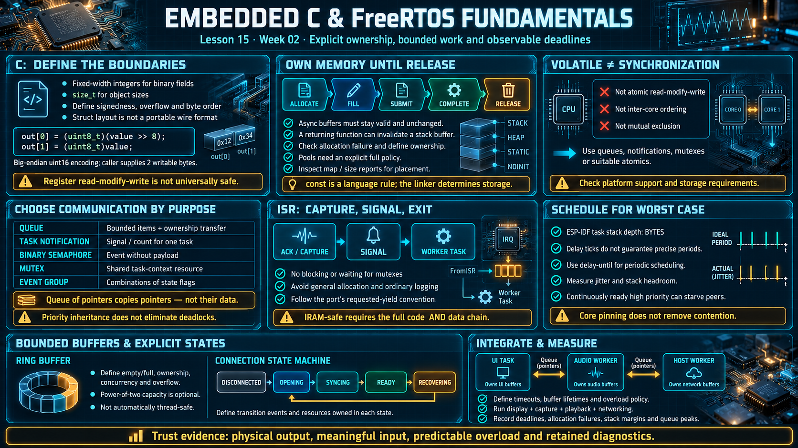

# Lesson 15 — Embedded C and FreeRTOS Engineering Fundamentals

> English edition · Week 02 · ES3C28P / ESP32-S3

[Lesson index](README.md) · [Original lesson](../15-embedded-c-freertos-review.md)

## Learning objectives

Write C with explicit memory and ownership rules, select correct synchronization mechanisms, and structure tasks and interrupts around bounded work and observable deadlines.

## Embedded execution constraints

An embedded application shares finite memory and processing resources with drivers, radio services, and interrupts. An invalid pointer or stack overflow can affect the complete device. Avoid relying on workstation assumptions about process isolation, virtually unlimited memory, or recoverable resource exhaustion.

Use fixed-width integer types for defined binary fields and `size_t` for object sizes. Specify signedness, overflow behavior, and byte order at protocol boundaries. A C structure's in-memory representation is not automatically a portable wire format: padding, alignment, and endianness require deliberate handling.

```c
#include <stdint.h>

static void encode_u16_be(uint8_t out[2], uint16_t value)
{
    out[0] = (uint8_t)(value >> 8);
    out[1] = (uint8_t)value;
}
```

This helper explicitly defines the two output bytes. Its caller must provide at least two writable bytes.

## `volatile` and synchronization are different concepts

`volatile` tells the compiler that accesses have observable significance, as with memory-mapped hardware registers. It does not provide atomic read-modify-write operations, inter-core memory ordering, or mutual exclusion. A shared variable does not become safe merely because it is declared volatile.

For task-to-task communication, prefer queues, notifications, mutexes, or an appropriate atomic operation with defined ordering. For ISR-to-task signaling, use the supported ISR-safe RTOS API. Atomic operations also require platform support and suitable storage; do not assume every type or address is valid for an ISR-safe atomic operation.

## Bit operations and registers

```c
uint32_t flags = 0;
flags |=  (UINT32_C(1) << 3);  /* Set bit 3. */
flags &= ~(UINT32_C(1) << 3);  /* Clear bit 3. */
flags ^=  (UINT32_C(1) << 3);  /* Toggle bit 3. */
```

These operations are suitable for ordinary owned state. Hardware registers may have write-one-to-clear bits, reserved fields, or dedicated set/clear registers. Read-modify-write is not universally safe for hardware. Prefer supported drivers and documented register access patterns.

## Memory lifetime and ownership

Static allocation makes capacity predictable, but mutable static storage still requires ownership rules. Dynamic allocation can be appropriate when failure, lifetime, and fragmentation are handled explicitly. Fixed pools are useful for bounded workloads, but the pool-full behavior must also be defined.

Avoid large local arrays on small task stacks. A buffer submitted to an asynchronous driver must remain valid and unchanged until the driver releases it. Stack-local buffers are especially dangerous if a function returns while hardware still uses them.

Place read-only tables appropriately, usually with `static const`, and inspect the map or size report when placement matters. `const` expresses a language-level restriction; actual storage follows the toolchain and linker configuration.

## Interrupt service routines

Keep ISRs bounded. A typical handler acknowledges or captures the event, signals a worker, and exits. It must not wait for a mutex or call a blocking task API. Avoid general-purpose allocation and ordinary logging in course ISRs.

Use `...FromISR` APIs where provided and follow the port's requested-yield convention. If an interrupt must execute while cache is disabled, its full code and data dependency chain must be safe for that interval. Other interrupts may be deferred. `IRAM_ATTR` on one function is not a complete proof of safety.

## Ring buffers and state machines

A ring buffer manages bounded storage using producer and consumer positions. A power-of-two capacity permits masking with `capacity - 1`; it is an optimization, not a mathematical requirement. Other capacities can use conditional wrap or modulo.

Define empty/full representation, concurrency, ownership, and overflow policy. A plain ring buffer is not automatically thread-safe, even with one producer and one consumer, unless its access and ordering rules are correct.

A state machine makes event handling explicit. For a host connection, possible states include disconnected, opening, synchronizing, ready, and recovering. Specify which events cause transitions and what resources each state owns. This prevents startup delays and error recovery from becoming scattered special cases.

## Task scheduling

A task has a priority, stack, and execution context. ESP-IDF provides SMP scheduling and optional core affinity. In ESP-IDF's task-creation API, stack depth is specified in bytes, unlike the word-based convention used by many upstream FreeRTOS ports. See [IDF FreeRTOS](https://docs.espressif.com/projects/esp-idf/en/v5.3/esp32s3/api-reference/system/freertos_idf.html).

```c
#include "freertos/FreeRTOS.h"
#include "freertos/task.h"

static void worker_task(void *arg)
{
    (void)arg;
    for (;;) {
        /* Perform bounded work or block waiting for an event. */
        vTaskDelay(pdMS_TO_TICKS(10));
    }
}
```

This fragment illustrates yielding with a time conversion; it is not a precise 10 ms periodic scheduler. Tick quantization and scheduling affect timing. Use the supported delay-until API for a periodic schedule, and measure actual jitter when deadlines matter.

A high-priority task that remains continuously ready can starve other work. Core pinning alone does not solve starvation or shared-resource contention. Measure stack headroom during worst-case call paths, not only during idle operation.

## Choose communication by purpose

Two tasks do not share a variable. They hand items through a queue:

```
┌────────┐             ┌───────┐                ┌────────┐
│ task A │ ── send ──► │ queue │ ── receive ──► │ task B │
└────────┘             └───────┘                └────────┘
```

One item, in order:

```
┌────────┐                  ┌───────┐                  ┌────────┐
│ task A │                  │ queue │                  │ task B │
└────┬───┘                  └───┬───┘                  └────┬───┘
     │                          │                           │
     │ send item ──────────────►│                           │
     │                          │ deliver item ────────────►│
```

| Mechanism         | Suitable purpose                                |
| ----------------- | ----------------------------------------------- |
| Queue             | Transfer bounded items with explicit ownership  |
| Task notification | Signal or count events for a specific task      |
| Binary semaphore  | Synchronize an event without carrying a payload |
| Mutex             | Protect a shared task-context resource          |
| Event group       | Coordinate combinations of state flags          |

Queues copy their configured item size. A queue containing a pointer copies the pointer, not the pointed-to data; the sender and receiver must agree on buffer lifetime. Mutex priority inheritance mitigates some priority inversion but does not eliminate deadlocks or long critical sections.

## Board-level integration exercise

Design a system with a UI task, audio worker, and host-protocol worker. Give each hardware interface an owner. Define queues, buffer lifetimes, timeouts, and overload behavior. Run display updates, microphone capture, playback, and networking together while recording missed deadlines, allocation failures, stack margins, and queue high-water levels.

A successful design has observable physical output and meaningful captured input, handles overload predictably, and retains diagnostic evidence. Generated code should be reviewed against these same requirements before it is trusted on hardware.

## Existing course illustration



> This is the illustration supplied with the original lesson. Its embedded labels have not been translated or technically revised; the English text above governs this edition.
