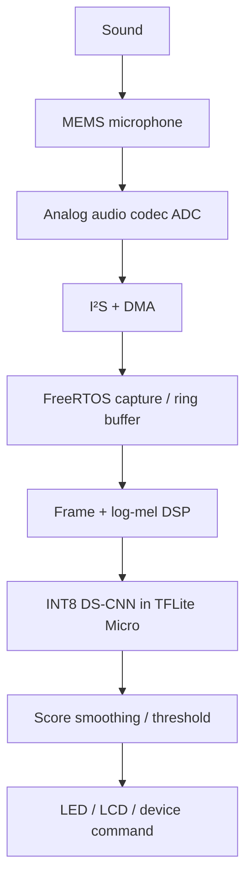

# ND01 — Week 07: Sensors, DSP, and Embedded Edge AI (Theory)

**Track:** Embedded & Hardware. **Scope:** physical sensing to microcontroller inference. This is a detailed conceptual reading unit with no fixed teaching periods.

> Week 07 establishes the engineering foundations. [Week 08](../week08/README.md) contains the practical CLI, model-training and firmware experiments.

## Start with the shared foundations

Read the [Week 07 common chapters](../../../shared/week07/foundations/README.md) about sensors, ADCs, sampling, signal processing, ML, data quality and deployment.

## ND01-specific chapters

1. [Hardware audio acquisition: microphone, codec, I²S, and DMA](theory/01-hardware-audio-acquisition.md)
2. [Audio DSP: framing, FFT, log-mel, and reproducibility](theory/02-audio-dsp-features.md)
3. [TinyML: DS-CNN, INT8 quantization, and resource budgets](theory/03-tinyml-and-memory.md)
4. [Embedded firmware architecture, real-time operation, and secure deployment](theory/04-firmware-architecture.md)

## Learning outcomes

You should be able to:
- Draw the full sensing and digital audio chain used by an ESP32-S3 audio application.
- Explain why peripheral buses, DMA and task scheduling matter for continuous sensor capture.
- Interpret a log-mel input tensor and verify features across a host and firmware.
- Distinguish model Flash size from activation/tensor arena RAM requirements.
- Explain why inference execution time, buffering and wake-up logic must be measured together.
- Identify what changes when inference moves from a PC to an MCU.

## End-to-end system

## Advance to practice

- [ND01 Week 08 lab guide](../week08/labs/README.md)
- [ND01 Week 08 deeper firmware lessons](../week08/lessons/README.md)
- [Week 08 checkpoint](../week08/checkpoint.md)

**Discussion prompt:** What will fail first if microphone capture cannot run while inference is computing—accuracy, latency, or both? Explain the dropped-buffer mechanism.
