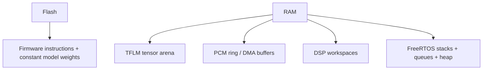

# ND01.3 — TinyML, DS-CNN, Quantization, and Memory Budgets

[ND01 Week 07](../README.md) | [Previous: DSP](02-audio-dsp-features.md) | [Next: Firmware](04-firmware-architecture.md)

## What makes embedded inference different?

A desktop model may assume abundant RAM and dynamically allocated tensors. A microcontroller has tightly constrained memory, compute, power and operator availability. TinyML is the engineering of useful inference within those constraints.

In an ESP32-S3 project, be explicit about:
- Flash partition and model artifact size.
- Internal SRAM (and external PSRAM, if used).
- DMA buffers, RTOS task stacks, queues and heaps.
- Tensor arena requirements, scratch buffers and operator implementations.
- Real-time deadlines and power budget.

## Why a depthwise-separable CNN?

A normal 3×3 convolution mapping 32 input channels to 32 output channels has:

```text
3 × 3 × 32 × 32 = 9,216 weights (without bias)
```

An equivalent-size depthwise separable block uses:
- One 3×3 spatial filter per input channel: `3 × 3 × 32 = 288`.
- One 1×1 pointwise map from 32 to 32 channels: `1 × 1 × 32 × 32 = 1,024`.
- Total: `1,312 weights`.

This can substantially reduce work and model parameters. It does not guarantee equal accuracy; the architecture must be tested for the chosen classification task.

## Float32 versus INT8 models

A 32-bit floating-point weight uses four bytes; an INT8 weight uses one byte. Post-training quantization attempts to map model operations into lower-precision values while preserving useful predictions.

A simplified affine transform is:

```text
quantized = clamp(round(real / scale) + zero_point)
approximately reconstructed = scale * (quantized - zero_point)
```

The runtime must use appropriate scales and zero points. The representative calibration dataset should cover realistic loudness, silence and other operating conditions. If calibration samples are unrepresentative, activation ranges may saturate at inference.

**Do not confuse ADC bit depth with model precision**: recording 16-bit PCM and running an INT8 neural network are completely compatible.

## A memory map, not one number



Illustrative example:
- 1-second mono PCM ring: approximately 31.25 KiB.
- Model file: approximately 19 KiB, which may remain in Flash.
- Tensor arena: for example 64 KiB reserved in RAM.
- Additional memory: FFT working buffers, task stacks and RTOS allocations.

These amounts are *illustrative* and are not measured resource usage for this specific board. The correct RAM budget counts RAM residents and peak overlaps; Flash-resident model weights do not automatically add to RAM occupancy.

## Operator availability

An INT8 model may require convolution, depthwise convolution, reshape, pooling, mean, fully-connected or softmax operators. TFLite Micro needs an interpreter with the **actual exported model's required operators** registered.

If an operator is absent or unsupported in the chosen version, tensor allocation or inference may fail. A valid `.tflite` file is not by itself proof that the model runs on the device.

## Measuring trade-offs

For every candidate model report:

| Measure | Why it matters |
|---|---|
| Float32 held-out accuracy | Baseline quality |
| INT8 held-out accuracy | Quantization regression |
| False triggers on realistic noise | Operating reliability |
| Model file size | Flash/partition budget |
| Tensor arena used | RAM budget |
| Feature extraction + inference time | CPU/deadline budget |
| Dropped audio blocks | Whether real-time input remains valid |

The lowest model size is not automatically the best design: some compression choices can hurt accuracy, and some fast operators require more scratch memory.

## Design exercise

You have an estimated 19 KiB model file, a 64 KiB tensor arena and 32,000 bytes of PCM history. Explain which allocations may belong in Flash, which must be in RAM, and what else needs space. Then describe how to *measure*, rather than guess, the peak memory and latency.

## Questions

1. Why is a TFLite model's file size different from its peak tensor memory?
2. Why should INT8 models be re-tested after conversion?
3. What are the consequences of underallocating the tensor arena?
4. What is the role of an operator resolver?
5. Could you replace a model file dynamically without flashing? Only if firmware is explicitly designed to load, validate and swap model artifacts.

[Next: Firmware](04-firmware-architecture.md)
