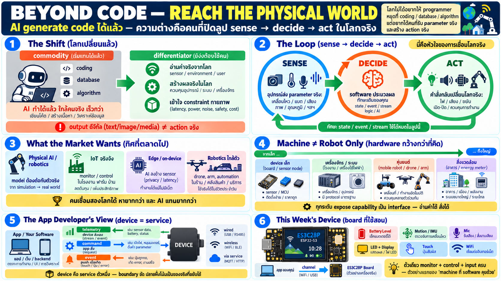

# ทำไมเรา software developer ต้องเข้าถึง hardware — ยุคที่ coding ไม่พอ



## โลกเปลี่ยนแล้ว

ทักษะที่เคยทำให้ programmer มีค่า — coding, database, algorithm —
กำลังกลายเป็น **commodity** เพราะ AI generate code เก่งมากแล้ว
เขียน CRUD, ทำ API, เขียน test — งานพวกนี้คุณภาพ AI ทำได้ใกล้
เคียงคนจริง และเร็วกว่ามาก

สิ่งที่ AI ยังแทนไม่ได้ง่าย ๆ คืองานที่ต้อง **สัมผัสโลกกายภาพ**:

- อ่านค่าจริงจากสิ่งแวดล้อม — อุณหภูมิ, การเคลื่อนไหว, เสียง,
  แบตเตอรี่, ตำแหน่ง — ไม่ใช่ข้อมูลที่เจนมา
- สร้างผลจริงในโลกกายภาพ — หุ่นยนต์ขยับ, ไฟติด, เสียงดัง,
  motor หมุน — ไม่ใช่แค่ pixel บนจอ
- เข้าใจว่าระบบจริงมี constraint เชิงกายภาพ — latency, power,
  noise, failure mode — สิ่งที่ simulator ไม่เคยสอนครบ

นี่คือเส้นแบ่งใหม่ของอาชีพ: **คนที่ทำได้แค่ output ดิจิทัล
(text/image/media)** กับ **คนที่ปิดลูปได้ครบ — sense → decide
→ act**

## Sense → Decide → Act — ลูปที่ต่างจากการสร้าง content

ลูปของงานที่แตะฮาร์ดแวร์:

```
┌───────┐      ┌───────────┐      ┌─────────┐
│ sense │ ───► │ decide    │ ───► │ act     │
│ read  │      │ your code │      │ command │
└───────┘      └───────────┘      └─────────┘
```

งาน software ทั่วไปคือการ generate ข้อมูล: หน้าเว็บ, report,
รูป, ข้อความ — output สุดท้ายคือ "สิ่งที่คนอ่าน/ดู"

งานที่แตะ hardware ต่างออกไปตรงที่มันเป็น **ลูปปิดกับโลกจริง**:

```
sense   → อ่าน parameter จริงจากอุปกรณ์ (เคลื่อนไหวไหม ไฟเหลือเท่าไร)
decide  → software ประมวลผล (logic, model, AI — ความถนัดเดิมของคุณ)
act     → ส่งคำสั่งกลับไปเปลี่ยนโลกจริง (ไฟเปลี่ยนสี, เสียงดัง,
          หุ่นยนต์หยุด)
```

ทักษะ software ที่คุณมีอยู่ — state, event, stream, error handling
— **ใช้ได้หมด** ในลูปนี้ สิ่งที่ต้องเพิ่มคือความเข้าใจว่า "ปลายอีก
ฝั่งของ wire คืออุปกรณ์จริง ไม่ใช่ API server"

## ทำไมตลาดอยากได้คนแบบนี้

แนวโน้มที่ชัดในตอนนี้:

- **Physical AI / robotics** — model ที่ดีแล้วต้องต่อกับตัวจริง:
  sensor fusion, motor control, safety — ใครต่อ software เข้ากับ
  เครื่องได้มีค่ากว่าคนเขียน model อย่างเดียว
- **IoT ที่จริงจัง** — ไม่ใช่ dashboard ลองเล่น แต่ระบบที่ monitor/
  control device จริง: โรงงาน, farm, บ้าน, รถ — ต้องการคนที่เข้าใจ
  ทั้งสองฝั่งของ wire
- **Edge + on-device** — AI ย้ายลง device (privacy, latency,
  offline) → งาน "เอา app ลงไปรันข้างๆ sensor" เพิ่มขึ้นเรื่อย ๆ
- **Robotics ที่ใกล้ตัว** — หุ่นยนต์ขนาดเล็ก, drone, automation
  ในบ้าน/ร้าน — ทุกตัวต้องมี software layer บน

คนที่ทำได้ทั้ง web และ hardware access = หายากกว่าคนเขียน
แต่ละอย่าง — และ AI แทนยากกว่าเพราะต้องเชื่อมสองโลกให้เข้ากัน

## Machine ไม่ใช่แค่หุ่นยนต์

"Hardware" ที่ software engineer เข้าถึงได้จริงวันนี้กว้างมาก:

| ระดับ | ตัวอย่าง |
|---|---|
| **Device เล็ก** | board พัฒนา, sensor node, wearable, smart plug |
| **เครื่องจักร/ระบบ** | เครื่องจักรโรงงาน, หม้อต้มอัจฉริยะ, จักรยานไฟฟ้า |
| **หุ่นยนต์** | mobile robot, arm, drone, AMR ในโกดัง |
| **สิ่งแวดล้อม** | sensor อาคาร, irrigation, energy meter |

ทุกระดับมีจุดเดียวกัน: **มัน expose ความสามารถเป็น interface**
— อ่านค่าได้ สั่งได้ — และนั่นคืองานของ software ฝั่งนี้

## เข้าถึง hardware จากมุม app developer หน้าตาเป็นยังไง

ข่าวดี: คุณไม่ต้องเขียน firmware หรือแตะ register — อุปกรณ์ทุกตัว
มี **capability surface** ให้ใช้:

- **telemetry** — ข้อมูลที่ device ส่งมาเอง (อุณหภูมิ, การเคลื่อนไหว,
  ระดับแบต, เสียงรอบข้าง) — เป็น stream/event ไม่ใช่ query
- **command** — สิ่งที่สั่ง device ให้ทำ (เปลี่ยนสีไฟ, เล่นเสียง,
  เปิด mic) — เป็น request ไปทางเดียวหรือมี ack
- **event** — สิ่งที่เกิดบน device (กดปุ่ม, touch, เกิด error) —
  push ขึ้นมาเมื่อเกิด

และ **channel** ที่เชื่อมสองฝั่งมีหลายแบบ — สาย (serial), ไร้สาย
(BLE/WiFi), ผ่าน service กลาง — แต่ละแบบมี trade-off ที่เป็น
เรื่องของบทถัด ๆ ไป

**Mental model เดียวที่ต้องได้จากบทนี้**: device ไม่ใช่ "hardware
ที่ต้อง program" — มันคือ **service ตัวหนึ่งที่มี boundary ชัด**,
คุณคุยกับมันผ่าน interface ที่เขากำหนด เหมือนคุยกับ API ทุกตัวที่
เคยใช้ — แค่ปลายอีกฝั่งเป็นของจริงที่เคลื่อนไหวได้

## ตัวอย่าง capability ของ board ตัวที่จะใช้สอน

board ที่ใช้ใน course นี้ (ES3C28P) มี surface ที่เห็นได้ชัด:

| Capability | จากมุม app |
|---|---|
| battery level | telemetry — รู้สถานะไฟของ device |
| motion sensor (IMU) | telemetry — เคลื่อนไหว/เอียงยังไง |
| microphone + audio level | telemetry — รับเสียงรอบข้าง |
| RGB LED + display | command — แสดงสถานะ/feedback บนตัวเครื่อง |
| touch screen | event — รับ input จากผู้ใช้ตรง ๆ บนเครื่อง |
| WiFi | ช่องทางเชื่อม — remote access |

พอรวมกัน: board เล็กตัวนี้กลายเป็น **device ที่ติดตาม สั่งงาน และ
รับ input ได้ครบ** — เหมาะเป็นตัวอย่างแรกของ "machine ที่ software
คุยด้วย" ได้อย่างสมบูรณ์

## เป้าหมายของ week นี้

จบ week นี้ผู้เรียนควร:

1. เข้าใจว่า computer ↔ microcontroller แบ่งหน้าที่กันยังไง —
   ทำไมไม่ทำทุกอย่างฝั่งเดียว
2. รู้ว่า browser เข้าถึง hardware ได้ผ่าน API มาตรฐาน — ไม่ต้อง
   native app เสมอ
3. เข้าใจ telemetry/command/event model — ภาษากลางของทุก device
4. ออกแบบ app ที่คุยกับ device ได้เป็น (anatomy — ไม่ใช่ code)
5. ตอบได้ว่าเมื่อไหร่ browser-direct พอ เมื่อไหร่ต้องผ่าน service
   กลาง

## Checklist — เข้าใจแกนไหม

| คำถาม | ควรตอบได้ |
|---|---|
| ทำไม coding อย่างเดียวไม่พอแล้ว | output ดิจิทัล AI ทำได้ — ลูป sense→decide→act ยังต้องการคน |
| software ฝั่ง app ทำอะไรกับ device | อ่าน telemetry + ส่ง command + รับ event — ผ่าน interface ที่ device กำหนด |
| device ต่างจาก API server ยังไง | ผลของมันอยู่ในโลกกายภาพ — sensor วัดจริง actuator ขยับจริง |
| ต้องเขียน firmware ไหม | ไม่ — ใช้ capability surface ที่ device expose ให้ |
| ช่องทางเชื่อมมีกี่แบบ | สาย / ไร้สาย / ผ่าน service — เลือกตามงาน |
