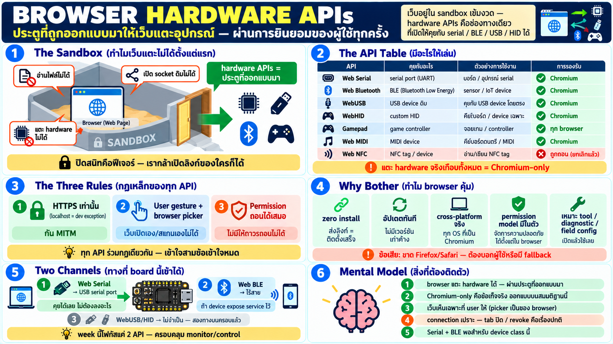

# Browser hardware APIs — เว็บเพจที่แตะ hardware ได้



## จุดเริ่มต้น: browser คือ sandbox

เว็บเพจธรรมดาอยู่ใน sandbox ที่เข้มงวดมาก — อ่าน file เครื่องไม่ได้,
เปิด socket ดิบไม่ได้, แตะ hardware ไม่ได้เลย นี่คือ feature ไม่ใช่
ข้อเสีย: มันคือเหตุที่กล้าเปิด link ของใครก็ได้โดยไม่ต้องไว้ใจ

แต่ sandbox แบบ "ปิดสนิท" ทำให้เว็บแพ้ native app มาตลอด — เว็บทำ
ได้แค่จอ+เสียง+เครือข่าย ในขณะที่ native เข้าถึง serial port,
Bluetooth, file จริง ฯลฯ

คำตอบของ browser คือ **hardware APIs** — ประตูที่ถูกออกแบบมาให้
เว็บเพจแตะอุปกรณ์ได้ **แต่ต้องผ่านการยินยอมของผู้ใช้ทุกครั้ง**

## มี API อะไรให้เล่นบ้าง

| API | ให้เว็บคุยกับ | สถานะจริง |
|---|---|---|
| **Web Serial** | serial port (USB/RS-232 ทุกชนิด) | Chromium เท่านั้น |
| **Web Bluetooth** | BLE device รอบตัว | Chromium เท่านั้น |
| **WebUSB** | USB device ที่ไม่ใช่ class มาตรฐาน | Chromium เท่านั้น |
| **WebHID** | HID device (custom HID, ปุ่มพิเศษ) | Chromium เท่านั้น |
| Web MIDI | instrument ดนตรี | Chromium เท่านั้น |
| Web NFC | tag NFC | ถูกถอนออกแล้ว — เคยทดลอง |
| Gamepad API | game controller | ทุก browser |
| Web Audio | mic/speaker + audio processing | ทุก browser (ไม่ cover ใน week นี้) |

pattern ชัดมาก: **API ที่แตะ hardware จริงเกือบทั้งหมดอยู่ใน
Chromium เท่านั้น** — Chrome, Edge, Opera, Arc ฯลฯ
Firefox และ Safari ไม่ implement (และแสดงท่าทีจะไม่ทำ)

## กฎเหล็ก 3 ข้อที่ทุก API ร่วมกัน

นี่คือสิ่งที่ออกแบบร่วมกันทุกตัว — เข้าใจสามข้อนี้เข้าใจทั้งหมวด:

### 1. ต้อง HTTPS (หรือ localhost)

- API เหล่านี้เปิดให้เฉพาะ **secure context** — `https://` เท่านั้น
- ข้อยกเว้นเดียว: `localhost` / `127.0.0.1` — เพื่อ dev
- เหตุผล: เว็บที่แตะ hardware ต้องพิสูจน์ตัวตน (ไม่ใช่เว็บปลอม
  กลางทาง) — MITM บน HTTP จะยิงคำสั่งลง device ของผู้ใช้ได้

### 2. ต้อง user gesture + picker ของ browser

เพจขอได้ แต่ผู้ใช้เป็นคนเลือก:

```
┌──────┐                                 ┌─────────┐                                 ┌──────┐
│ page │                                 │ browser │                                 │ user │
└───┬──┘                                 └────┬────┘                                 └───┬──┘
    │                                         │                                          │
    │ requestPort / requestDevice ───────────►│                                          │
    │                                         │ show the picker ────────────────────────►│
    │                                         │◄─────────────────────── grant one device │
    │◄───────────────────────── open a stream │                                          │
```

- เรียก `requestPort()` / `requestDevice()` ได้เฉพาะตอน user
  เพิ่งกด/แตะ — เว็บเปิด device เงียบ ๆ ไม่ได้
- browser แสดง **device picker ของตัวเอง** — user เลือกเองว่าจะให้
  เว็บเห็นเครื่องไหน — เว็บ enumerate เครื่องทั้งหมดลับ ๆ ไม่ได้
- นี่คือความต่างสำคัญจาก native: native app เห็น device list หมด
  web เห็นเฉพาะที่ user เลือกให้

### 3. Permission ถอนได้เสมอ

- user ถอนสิทธิ์ได้ทุกเมื่อผ่าน site settings — ไม่มีการ "ให้ถาวร
  ถอนไม่ได้"
- tab ที่ถูกซ่อนอาจถูกตัดการเชื่อม — app ต้องทน "หายไปแล้วกลับมา"
  เสมอ

## ทำไม browser คุ้มค่าที่จะเป็น platform hardware app

ถ้าข้อจำกัดเยอะขนาดนี้ ทำไมต้องสนใจ:

- **zero install** — เว็บคือ deployment ที่ friction ต่ำสุดที่มี
  อยู่: ส่ง link = ติดตั้งเสร็จ
- **อัปเดตทันที** — ไม่มี version เก่าค้างในป่า
- **cross-platform จริง** — เขียนรอบเดียวรันบน Windows/macOS/
  Linux/ChromeOS/Android ที่เป็น Chromium
- **รักษาความปลอดภัยได้ฟรี** — permission model มีมาในตัว ไม่ต้อง
  สร้างเอง
- เหมาะมากกับงานแนวนี้: **tool/diagnostic/dashboard/field config**
  — งานที่อยากให้คนหน้างานเปิดแล้วใช้เลย ไม่อยากขอให้ลงโปรแกรม

ข้อเสียที่ต้องรับ: ขาด Firefox/Safari → เว็บที่ใช้ API เหล่านี้คือ
"เว็บสำหรับ Chromium" — ต้องบอกผู้ใช้ตรง ๆ หรือมี fallback

## Board ของเราเข้าได้ทางไหน

สำหรับ device ตัวที่ใช้สอน ช่องทางที่สมเหตุสมผล:

- **Web Serial** — board มี USB port ที่ browser เห็นเป็น serial
  device → เว็บเพจคุยกับมันได้เลย ไม่ต้องลงอะไรเพิ่ม
- **Web Bluetooth** — board มี BLE ใน hardware → ถ้าฝั่ง device
  expose service ไว้ เว็บเชื่อมไร้สายได้
- **WebUSB/HID** — ไม่จำเป็น เพราะช่องทางสองแบบบนครอบคลุมแล้ว

นี่คือเหตุที่ week นี้โฟกัสแค่ 2 API: **Serial (สาย) + BLE
(ไร้สาย)** — ครอบคลุม use case หลักของการเข้าถึง device จากเว็บ

## แนวคิดที่ต้องติดตัว

1. **Browser เข้าถึง hardware ได้** — แต่ผ่านประตูที่ออกแบบมา
   (HTTPS + gesture + picker + revoke)
2. **Chromium-only คือข้อเท็จจริง** — ไม่ใช่ข้อเสียชั่วคราว ต้อง
   ออกแบบบนสมมติฐานนี้
3. **เว็บเห็นเฉพาะที่ user ให้** — picker เป็นของ browser ไม่ใช่
   ของเรา; เว็บไม่เคย "สแกนหาเครื่อง" เอง
4. **connection เปราะ** — tab ปิด/ซ่อน/revoke คือเรื่องปกติ app
   ต้องเตรียม reconnect
5. **สอง channel พอ** — Serial + BLE ครอบคลุม monitor/control
   ส่วนใหญ่ของ device class นี้

## Checklist

| คำถาม | ควรตอบได้ |
|---|---|
| ทำไมเว็บต้อง HTTPS ถึงแตะ hardware | secure context — กัน MITM ยิงคำสั่งลง device |
| ทำไมต้อง user กดก่อนเปิด port | กันเว็บเปิด device เงียบ ๆ — gesture = consent |
| เว็บเห็น device ทุกตัวไหม | ไม่ — เห็นเฉพาะที่ user เลือกใน picker |
| browser ไหนใช้ได้ | Chromium เท่านั้นสำหรับ Serial/BLE/USB/HID |
| ถ้า user revoke permission | app ต้องรับมือ disconnect — ถอนได้เสมอ |
| board ของเราใช้ทางไหน | Web Serial (สาย) + Web BLE (ไร้สาย) |
