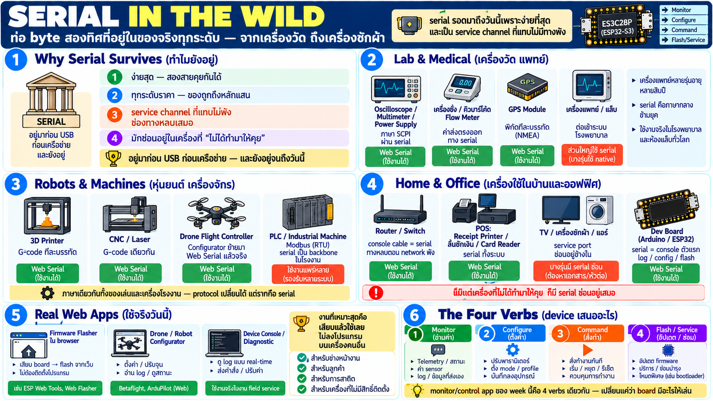

# Web Serial in the wild — อุปกรณ์จริงที่คุย serial

ก่อนไปไร้สาย ลองดูว่า "ท่อ byte สองทิศ" ที่เรียนมาใช้กับของจริง
ระดับไหน — คำตอบคือกว้างกว่าที่คิดมาก

## ทำไม serial รอดมาถึงวันนี้

- ง่ายที่สุดที่เชื่อมสองเครื่องได้ — สองสายก็คุยกันได้
- อยู่ในทุกระดับราคา — ของถูกถึงเครื่องมือวัดหลักแสน
- เป็น **service channel ที่แทบไม่มีทางพัง** — เมื่อเครื่องมีปัญหา
  ช่องทางที่เหลือมักเป็น serial เสมอ
- อุปกรณ์ที่ "ไม่ได้ทำมาให้คุย" ก็มักมี serial console ซ่อนไว้
  สำหรับโรงงาน/ช่างซ่อม

## แผนที่ของจริง — ใครใช้ serial บ้าง

### เครื่องมือวัด (lab/industry instruments)

- **oscilloscope, multimeter, power supply, signal generator** —
  เครื่องมือวัดมาตรฐานโลกคุยด้วยภาษาชื่อ SCPI ผ่าน serial เป็นหลัก
  — ขอค่าได้ ตั้งค่าได้ ดึง waveform ได้ ทุกอย่างผ่าน text command
  บนสายนี้
- **เครื่องชั่งอุตสาหกรรม, barcode/RFID reader, flow meter** —
  sensor ระดับโรงงานจำนวนมากส่งค่าออก serial ตรง ๆ
- **GPS module** — ส่งพิกัดมาเป็น sentence ทีละบรรทัด (NMEA) —
  ตัวอย่าง classic ของ "telemetry ที่ไหลเอง"

### เครื่องมือแพทย์และ lab

- patient monitor, เครื่องวิเคราะห์ lab, เครื่องวัดระดับต่าง ๆ —
  จำนวนมากมี serial port สำหรับส่งข้อมูลเข้า hospital system หรือ
  service
- จุดสำคัญ: เครื่องมือแพทย์อายุการใช้งานยาวหลายสิบปี — serial เป็น
  ภาษากลางที่ยังใช้ได้ข้ามยุค

### หุ่นยนต์และเครื่องจักร

- **3D printer** — ตัวอย่างที่ดีที่สุด: คุยด้วย G-code ผ่าน serial —
  ทุกบรรทัดคือคำสั่งการเคลื่อนที่/อุณหภูมิ
- **CNC / laser cutter** — G-code เดียวกัน เครื่องใหญ่ระดับโรงงาน
  ก็ใช้ภาษาเดียวกัน
- **drone flight controller** — configurator ของจริงเช่น Betaflight
  เคยเป็น Chrome app แล้วย้ายมา Web Serial เต็มตัว — tune โดรนจาก
  browser ได้เลย
- **PLC / controller อุตสาหกรรม** — Modbus บน serial ยังเป็น
  backbone ของโรงงานจำนวนมาก

### เครื่องใช้ในบ้านและสำนักงาน

- **router / switch / firewall** — console cable เสียบหน้าเครื่องคือ
  serial — ช่องทางหลบเมื่อ network พัง (เครื่องมือช่างระบบตัวจริง)
- **เครื่องพิมพ์ใบเสร็จ (POS printer), ลิ้นชักเก็บเงิน, card
  reader** — POS ทั้งระบบถูกสร้างบน serial
- **smart TV / เครื่องซักผ้า / เครื่องปรับอากาศ** — มี service port
  serial อยู่ข้างใน ช่างใช้ดู log/flash firmware

### เครื่องมือนักพัฒนาเอง

- **Arduino / ESP32 / Raspberry Pi console** — serial monitor คือ
  "console ตัวแรก" ของทุก board
- ** flashing tool** — burn firmware ใหม่ลงชิปผ่าน serial มาตลอด

## เว็บเพจที่ใช้ Web Serial จริงแล้ววันนี้

ไม่ใช่ของเล่น — มี product จริงใช้ production:

- **firmware flasher ใน browser** — เครื่องมือตระกูล ESP web tools
  ให้ user เสียบ board แล้ว flash firmware จากเว็บเพจตรง ๆ ไม่ต้อง
  ลงอะไร — ตัวอย่างที่แสดงพลังของ zero-install ได้ชัดที่สุด
- **drone/robot configurator** — เครื่องมือ tune หลายตัวย้ายจาก
  desktop app หรือ Chrome app มาเป็นเว็บที่ใช้ Web Serial — user
  ไม่ต้องเช็ค OS ไม่ต้องติดตั้ง
- **device console/diagnostic** — vendor หลายรายทำ web-based
  console ให้ช่างเทคนิคเสียบแล้วดู log หรือ config ทันที

pattern ที่เห็นชัด: งานที่เหมาะกับ Web Serial มากสุดคืองานที่
**"เสียบแล้วใช้เลย"** — flasher, configurator, diagnostic — เพราะ
ค่าใช้คือการไม่ต้องลงโปรแกรมอะไรเลยบนเครื่องคนอื่น

## 4 verbs ที่ device เสนอผ่าน serial

ดูอุปกรณ์หลากชนิดแล้วพบว่าแยกเป็น 4 หน้าที่:

| Verb | ความหมาย | ตัวอย่าง |
|---|---|---|
| **monitor** | อ่านค่าที่ไหลออกมาเอง | multimeter ส่งค่า, GPS ส่งพิกัด, sensor log |
| **configure** | ตั้งค่า/ปรับ behavior | เปลี่ยน PID drone, ตั้งค่าเครื่องวัด, wifi creds |
| **command** | สั่งให้ทำทันที | พิมพ์ใบเสร็จ, หุ่นยนต์หยุด, เปิด/ปิด output |
| **flash/service** | เปลี่ยน firmware/ซ่อม | flash ใหม่, อ่าน fault log, factory mode |

**ทุก monitor/control app ที่จะสร้างใน week นี้ก็คือ 4 verbs
เดียวกันนี้** — เปลี่ยนแค่ว่า device ของเรามีอะไรให้เล่นบ้าง

## เชื่อมกลับ board ของเรา

board ตัวที่ใช้สอนก็เข้า pattern เดียวกันหมด:

- telemetry ไหลออกมาเอง → **monitor** (battery, motion, เสียง)
- สั่งเปลี่ยน LED/เสียง/mic → **command**
- ตั้งค่า behavior → **configure**
- (service ฝั่ง firmware ไม่ใช่ของกลุ่มนี้)

คนที่เคยแตะเครื่องมือวัด/POS/drone ผ่าน serial — สิ่งเดียวกันทั้งหมด
— เพียงครั้งนี้ "client" คือ browser

## Checklist

| คำถาม | ควรตอบได้ |
|---|---|
| serial ยังใช้จริงไหม | ทุกระดับ — เครื่องวัด แพทย์ หุ่นยนต์ เครื่องบ้าน router |
| ภาษาที่เครื่องมือวัดคุย | SCPI (text command บน serial) — ตัวอย่าง protocol จริง |
| 3D printer คุยยังไง | G-code ทีละบรรทัดผ่าน serial |
| เว็บใช้ Web Serial จริงไหม | ใช้แล้ว — flasher/configurator/console เป็น product จริง |
| งานที่เหมาะกับ web serial | "เสียบแล้วใช้เลย" — ไม่ลงโปรแกรมฝั่ง user |
| device เสนออะไรผ่าน serial | monitor / configure / command / service — 4 verbs |
