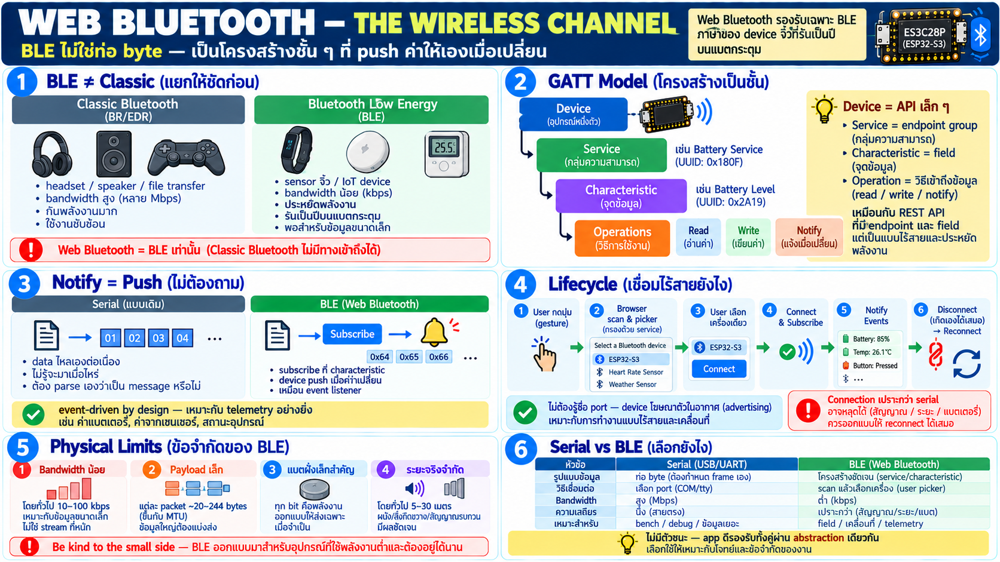

# Web Bluetooth — ช่องทางแบบไร้สายในเชิงหลักการ



## BLE ≠ Bluetooth ที่เคยรู้จัก

ก่อนอื่นแยกสองอย่างที่คนสับสน:

- **Bluetooth classic** — audio headset, file transfer — เป็น
  protocol เก่าที่กินไฟและซับซ้อน
- **BLE (Bluetooth Low Energy)** — ออกแบบมาให้ sensor ตัวเล็กรัน
  ได้เป็นปีบนแบตกระดุม — trade-off: bandwidth น้อยกว่ามาก แต่
  ประหยัดและเรียบง่าย

**Web Bluetooth รองรับเฉพาะ BLE** — classic ไม่มีทาง — เพราะ BLE
คือภาษาที่ device จิ๋วคุยกัน และเพราะ model มันเหมาะกับ sandbox
ของเว็บ

device ตัวที่ใช้สอนมี BLE อยู่ใน hardware อยู่แล้ว — บทนี้สมมติว่า
ฝั่ง firmware เตรียมไว้ให้ (เหมือนที่ของจริงจะทำ)

## GATT — โครงสร้างข้อมูลของ BLE

ต่างจาก serial ที่เป็น "ท่อ byte ล้วน" — BLE ไม่ให้ท่อดิบ:
ให้ **โครงสร้างเป็นชั้น ๆ** แทน:

```
device
 └─ service        ← กลุ่มความสามารถหนึ่งชุด (เช่น battery service)
     └─ characteristic   ← จุดข้อมูลจริง (เช่น "ระดับแบต %")
         └─ operations: อ่าน / เขียน / ติดตามค่า (notify)
```

- **service** = เมนูความสามารถ — device หนึ่งมีหลาย service
  (battery service, device info, service ที่เรากำหนดเอง)
- **characteristic** = จุดข้อมูลเดี่ยวใน service — มี property
  บอกว่าทำอะไรได้: read / write / notify
- **descriptor/operations** — characteristic แต่ละตัวมีวิธีใช้
  ต่างกัน: บางตัวอ่านได้อย่างเดียว บางตัวเขียนเพื่อสั่ง บางตัว
  push ค่าเอง (notify)

mental model ที่ตรงที่สุดสำหรับ app dev: **device คือ API เล็ก ๆ**
— service คือ endpoint group, characteristic คือ field/endpoint,
notify คือ subscription

## Notify — push ที่ไม่ต้องถาม

จุดแข็งที่ต่างจาก serial:

- serial: data ไหลมาเองต่อเนื่อง (คุณไม่รู้จะมาเมื่อไหร่)
- BLE: app **subscribe ที่ characteristic** → device push ค่าใหม่
  เมื่อเปลี่ยน — เหมือน event listener
- ไม่ต้อง poll ไม่ต้องถาม — ค่ามาเมื่อมีเรื่อง
- เหมาะกับ telemetry อย่างยิ่ง: battery เปลี่ยน แจ้ง / sensor อัปเดต
  แจ้ง

นี่คือเหตุที่ BLE เป็น "event-driven by design" ในขณะที่ serial
ต้องสร้าง framing เองข้างบนท่อดิบ

## Lifecycle — เชื่อมไร้สายยังไง

```
user กดปุ่ม (gesture)
  → browser แสดง device picker (scan บรรยากาศ แสดงเครื่องที่ตรง filter)
  → user เลือกเครื่อง
  → connect → เจอ service ต่าง ๆ → subscribe characteristic ที่ต้องการ
  → notify เข้ามาเป็น stream ของ events
  → disconnect อาจเกิดเอง (ระยะ/ไฟต่ำ) — app ต้องทนและต่อใหม่ได้
```

ต่างจาก serial ตรงที่:

- **ไม่ต้องรู้ชื่อ port** — เลือกด้วย filter (ชื่อ/ประเภท service)
  เครื่องโฆษณาตัวเองอยู่ในอากาศ
- **ไม่มี "claim เดียว"** แบบ serial — แต่ก็มีข้อจำกัดของมัน
  (device ต่อ connection จำนวนจำกัดในเวลาเดียว)
- **connection เปราะกว่า** — สัญญาณวิทยุ, ระยะทาง, battery save —
  disconnect เป็นเรื่องปกติมาก ต้องออกแบบ reconnect เป็นหลัก

## ข้อจำกัดเชิงกายภาพที่ต้องเข้าใจ

- **bandwidth น้อย** — BLE ไม่ใช่ท่อใหญ่ เหมาะค่าเล็ก ๆ ถี่ ๆ
  ไม่เหมาะ stream หนัก (file, เสียงเต็ม, วิดีโอ)
- **จำกัดขนาดต่อครั้ง** — ข้อมูลที่ส่งแต่ละก้อนมีขนาดเล็ก (packet
  ต้องแบ่ง) — ออกแบบ payload เล็ก ๆ
- **แบตฝั่งเล็กสำคัญ** — ทุกการ connect/notify กินไฟ device —
  "be kind to the small side" ต่อเนื่องจากบทต่อไป
- **ระยะทางจริง** — ไม่ใช่ "ทุกที่ในบ้าน" — ผนัง/การรบกวนมีผลจริง

## Board ของเราผ่าน BLE — ภาพสมมติ

สมมติฝั่ง firmware เปิด service ให้ — จากมุม app:

- เลือกเครื่องผ่าน picker → connect → เจอ service ของ board
- telemetry เดิม (battery, motion, เสียงรอบข้าง) ผ่าน notify —
  เหมือน serial แต่ structure ชัดกว่า (แยก characteristic ไม่ต้อง
  parse stream)
- command เดิมผ่าน write characteristic — สั่ง LED/เสียงเหมือน
  serial แค่คนละท่อ
- **app เดียวกัน สลับ Serial↔BLE ได้** ถ้าออกแบบ abstraction ดี —
  นี่คือ concept ของบทถัดไป (transport abstraction)

## Serial vs BLE — เลือกยังไง

| | Serial (สาย) | BLE (ไร้สาย) |
|---|---|---|
| รูปแบบ | ท่อ byte — ต้อง frame เอง | structured — characteristic ชัดเจน |
| เชื่อม | user เลือก port | user เลือก device จาก scan |
| bandwidth | สูงกว่า | ต่ำกว่า — payload เล็ก |
| ความเสถียร | นิ่ง (สายตรง) | เปราะ — สัญญาณ/ระยะ |
| เหมาะ | dev/bench, data หนัก, อยู่นิ่ง | field, พกพา, เคลื่อนไหว |
| ไฟ | device ไม่กังวล | ทุก bit คือพลังงานของแบต |

ไม่มีตัวไหนชนะ — เป็นสองทางเลือกสำหรับ context ต่างกัน app ที่ดี
รองรับทั้งคู่ผ่าน abstraction เดียวกัน

## Checklist

| คำถาม | ควรตอบได้ |
|---|---|
| Web Bluetooth รองรับ classic ไหม | ไม่ — BLE เท่านั้น |
| BLE structure เป็นยังไง | device → service → characteristic → read/write/notify |
| telemetry ผ่าน BLE ยังไง | subscribe characteristic → notify push เมื่อเปลี่ยน |
| ต่างจาก serial ตรงไหน | ไม่ใช่ท่อดิบ — structured data points; ไม่ต้อง frame เอง |
| เมื่อไหร่เลือก BLE | ไร้สาย เคลื่อนไหว payload เล็ก — และยอมรับ disconnect ได้ |
| เมื่อไหร่เลือก serial | ข้อมูลหนัก อยู่นิ่ง ต้องการเสถียร |
