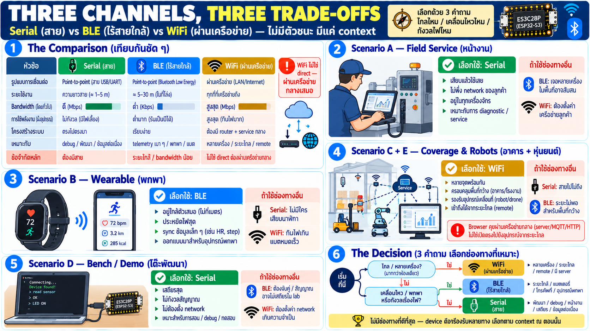

# เลือกช่องทาง — Serial vs BLE vs WiFi ในสถานการณ์จริง



ตอนนี้เห็นสองทางแล้ว (สายกับไร้สายระยะสั้น) — บทนี้เพิ่มทางที่สาม
และสำคัญที่สุดในภาพใหญ่: **WiFi / เครือข่าย** พร้อมตัวอย่างเปรียบ
เทียบว่าสถานการณ์ไหนใช้อะไร

## สามช่องทาง สามลักษณะ

| | **Serial (สาย)** | **BLE (ไร้สายระยะสั้น)** | **WiFi (ผ่านเครือข่าย)** |
|---|---|---|---|
| รูปแบบ | point-to-point ท่อตรง | point-to-point ไร้สาย | ผ่านเครือข่าย — ไม่ตรง |
| ระยะ | ความยาวสาย (~เมตร) | ~สิบเมตร (ผนังมีผล) | ทุกที่ที่เครือข่ายถึง |
| bandwidth | สูงพอใช้ | ต่ำ — payload เล็ก | สูงสุด |
| ไฟฝั่ง device | ไม่กังวล | ประหยัดสุด | กินไฟสุด (radio เต็ม) |
| ต้องมีอะไร | สายเส้นเดียว | อยู่ใกล้กัน | infrastructure — router/AP |
| เข้าถึงจากไกล | ไม่ได้ | ไม่ได้ | **ได้ — นี่คือจุดต่างสำคัญ** |
| หลายเครื่องพร้อมกัน | ทีละเครื่อง | ทีละเครื่อง | **หลายเครื่องพร้อมกันผ่านกลาง** |
| stream หนัก (เสียงดิบ) | ได้ | **ไม่ได้** | ได้ |

ข้อควรรู้เฉพาะเสียง: Web Bluetooth เปิดให้แค่ GATT
(read/write/notify) — ไม่มีช่องเสียงจริง (profile เสียงของ BLE
อยู่ใน spec แต่ browser ไม่ expose ให้เว็บ) — **เสียงดิบผ่าน Web
BLE ไม่ได้** ที่ทำได้คือค่าที่ device ประมวลผลแล้ว เช่น audio
level หรือ event "เสียงดังเกิน threshold" — ถ้าต้องการ stream
เสียงจริง ทางคือ serial หรือ WiFi ผ่าน service กลาง

ข้อสังเกตสำคัญ: **WiFi path ไม่ใช่เว็บต่อตรงกับ device** — browser
คุยกับ device ผ่านเครือข่าย/service กลาง ไม่ใช่เปิดช่องตรงเหมือน
serial/BLE (browser ไม่เปิด connection ดิบเข้าอุปกรณ์บน LAN ได้
อย่างอิสระ) — นี่คือเหตุที่มันเป็นเรื่องของบท "service กลาง" ท้าย
week

## ตัวอย่างเชิงเปรียบเทียบ — สถานการณ์เดียวกัน สามทางเลือก

### สถานการณ์ A: ช่างหน้างาน service เครื่องจักร

- **Serial** ✅ — เสียบสายเข้า service port เปิดเว็บ diagnostic
  เห็น log/ตั้งค่าทันที ไม่ต้องพึ่ง network ของลูกค้าเลย — นี่คือ
  เหตุที่ serial ยังอยู่ในทุกเครื่อง
- BLE — ได้ถ้าเครื่องเปิด broadcast แต่ปัญหาคือเจอเครื่องไหนในโรงงาน
  ที่มีเครื่องเยอะ และสัญญาณรบกวนเยอะ
- WiFi — ถ้าเครื่องต่อ LAN อยู่แล้วใช้ได้ แต่ต้องมี credential/
  เครือข่ายของสถานที่ — ไม่ใช่ "เสียบแล้วใช้"

### สถานการณ์ B: wearable/เครื่องมือพกพา sync กับมือถือ

- Serial — ไม่ได้ ไม่มีใครเสียบสายเข้านาฬิกา
- **BLE** ✅ — อยู่ใกล้ตัวเสมอ ประหยัดไฟสุด sync ค่าเล็ก ๆ เป็นระยะ
  — นี่คือเหตุที่ BLE ถูกออกแบบมา
- WiFi — กินไฟเกินไปสำหรับเครื่องติดตัวที่ต้องอยู่ทั้งวัน

### สถานการณ์ C: monitor sensor ทั่วทั้งอาคาร จาก office

- Serial — ไม่ได้ เดินสายไปไม่ถึง 100 จุด
- BLE — ไม่ได้ ระยะไม่ถึงและต้องอยู่ใกล้
- **WiFi** ✅ — ทุกจุดอยู่บนเครือข่ายเดียวกัน dashboard เห็นทุกตัว
  พร้อมกัน ผ่าน service กลาง — และเข้าถึงได้จากที่ไหนก็ได้ที่
  เครือข่ายถึง

### สถานการณ์ D: demo/bench/พัฒนา

- **Serial** ✅ — เสถียรสุด ไม่ต้องกังวลสัญญาณ ไม่ต้องตั้งค่า
  network — เหมาะสอน/พัฒนา/debug
- ทั้ง BLE และ WiFi มีขั้นตอนเชื่อม/สัญญาณที่ต้องดูแลเพิ่ม

### สถานการณ์ E: device เคลื่อนที่ในโกดัง/สนาม (robot จริง)

- Serial — ไม่ได้ สายลากไม่ได้
- BLE — ระยะไม่พอ หลุดบ่อย
- **WiFi** ✅ — robot เคลื่อนไหวใน coverage เครือข่ายเดียว ส่ง
  telemetry ต่อเนื่องเข้าระบบกลาง

## แผนที่การตัดสินใจ

```
                  ┌──────────────────────────────────┐
                  │ remote, or many devices at once? │
                  └─────────────────┬────────────────┘
                                    │
              ┌─────────────────────┴──────────────────────┐
              ▼                                            ▼
┌──────────────────────────┐                    ┌────────────────────┐
│ yes                      │                    │ no                 │
│ Wi-Fi, through a service │                    │ one nearby device? │
└──────────────────────────┘                    └──────────┬─────────┘
                                                           │
                                             ┌─────────────┴─────────────┐
                                             ▼                           ▼
                                ┌─────────────────────────┐    ┌───────────────────┐
                                │ it moves, or it is worn │    │ it can sit still  │
                                │ energy matters          │    │ and be plugged in │
                                │ BLE                     │    │ Serial            │
                                └─────────────────────────┘    └───────────────────┘
```

สามคำถามตัดสินได้เกือบทั้งหมด: **ไกลไหม / เคลื่อนไหวไหม /
กังวลไฟไหม**

## ข้อเท็จจริงเชิงออกแบบที่เห็นจากการเทียบ

- **ไม่มีช่องทางที่ดีสุด** — แต่ละอันถูกออกแบบมาเพื่อ context
  ต่างกัน: serial = bench/service, BLE = personal/เคลื่อนไหว,
  WiFi = coverage + remote
- **ทางเลือกคือ product decision** — ผู้ใช้ปลายทางไม่ได้เลือก
  protocol เอง พวกเขาเลือก "ใช้งานยังไง" — ช่องทางคือผลของ context
- **ต้นทุนไม่เท่ากัน** — serial ถูกและง่ายสุด; BLE ประหยัดไฟ;
  WiFi ให้ระยะและจำนวนเครื่องแต่ต้องมี network + กินไฟสุด
- **device ดีรองรับหลายทาง** — board ที่ใช้สอนมีทั้ง serial (USB)
  และ WiFi และ BLE — การเลือกใช้ขึ้นกับสถานการณ์ ณ ตอนนั้น

## เชื่อมกับบทก่อนและบทถัดไป

- สองบทก่อนลงลึก 2 ทางแรกแล้ว — บทนี้เติมทางที่ 3 และเฟรมการเลือก
- ถัดไป (cooperation design): ไม่ว่าช่องทางไหน รูปแบบการคุยคือ
  telemetry/command/event เหมือนกัน — เพราะมันอยู่เหนือ transport
- และ "WiFi ผ่าน service" คือพรีวิวของบทสุดท้าย week — เมื่อ
  point-to-point ไม่พอ

## Checklist

| คำถาม | ควรตอบได้ |
|---|---|
| ต้อง remote/หลายเครื่อง → ทางไหน | WiFi ผ่านเครือข่าย/service — serial/BLE ทำไม่ได้ |
| เคลื่อนที่+ประหยัดไฟ → ทางไหน | BLE |
| เสถียรสุด/หน้างาน/bench → ทางไหน | Serial |
| WiFi path ต่างจากอีกสองยังไง | ไม่ใช่ point-to-point — ผ่านเครือข่าย/service กลาง |
| 3 คำถามตัดสิน | ไกลไหม / เคลื่อนไหวไหม / กังวลไฟไหม |
| device ที่ดีควรมีกี่ทาง | หลายทาง — เลือกตามสถานการณ์ |
