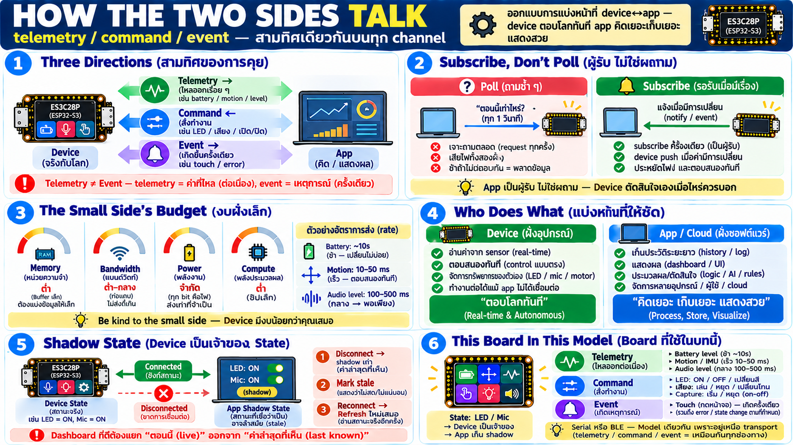

# Capability → cooperation design — ออกแบบการทำงานร่วมของสองเครื่อง



รู้ช่องทางแล้ว — คำถามต่อไปคือ **แบ่งงานกันยังไง** ระหว่าง device
กับ app บทนี้คือหลักการออกแบบการคุยของสองฝั่ง

## สามทิศของการสนทนา device

ทุก device interface — ไม่ว่าช่องทางไหน — ลดเหลือ 3 อย่าง:

| ทิศ | ชื่อ | ตัวอย่าง |
|---|---|---|
| device → app | **telemetry** | ค่าที่ไหลออกมาเอง: battery, motion, level เสียง — stream ต่อเนื่องหรือเมื่อเปลี่ยน |
| app → device | **command** | สั่งให้ทำ: เปลี่ยนสี LED, เล่นเสียง, เปิด/ปิด feature |
| device → app (เมื่อเกิด) | **event** | สิ่งที่เกิดบนเครื่อง: แตะจอ, error, state เปลี่ยน — ไม่ใช่ตอบ command แต่เป็นเหตุการณ์ |

จุดที่มือใหม่พลาด: **telemetry ≠ event** — telemetry คือค่าที่ไหล
มาเรื่อย ๆ (periodic stream); event คือเหตุการณ์จุดเดียวที่เกิด
ครั้งเดียว (touch ครั้งนั้น) — คนละลักษณะ คนละวิธีรับ

## Event-driven, ไม่ใช่ poll

ขยายความที่เกิดใน serial กับ BLE ให้เป็นหลักการร่วม:

- **poll** = app ถาม device ทุก ๆ รอบ "มีอะไรใหม่ไหม" — เสียง่าย
  แต่แย่: ถามตอนไม่มีอะไรเปลี่ยน = เสียงานเสียไฟทั้งคู่; ถามช้า =
  พลาด event
- **subscribe/push** = device บอกเมื่อมีเรื่อง — app ไม่ทำงานเลย
  จนกว่าข้อมูลจริงมาถึง

**model ที่ถูก: app เป็น "ผู้รับ" ไม่ใช่ "ผู้ถาม"** — device
ตัดสินใจเองว่าเมื่อไหร่ควรบอก (periodic telemetry + on-change
events) — งาน app คือ subscribe ถูก stream แล้ว react

```
poll:      app ──ถาม──► device ──ตอบ──► app   (ทุกรอบ ทุกครั้ง)
subscribe: device ──push เมื่อมี──► app        (เฉพาะที่มีเรื่อง)
```

## งบของฝั่งเล็ก — be kind to the small side

กฎทองของ cooperation design: **device มีงบน้อยกว่าคุณเสมอ**

| งบฝั่งเล็ก | หมายถึง | ผลต่อการออกแบบ |
|---|---|---|
| memory | buffer รับ-ส่งเล็กมาก | payload ต้องเล็ก อย่าส่งหนัก |
| bandwidth | ท่อเล็ก | อย่าเรียก telemetry ถี่เกินที่ channel รับ |
| power | แบต/พลังงานจำกัด | ทุก bit ที่ไหล = ไฟ — ขอเท่าที่จำเป็น |
| compute | chip เล็ก | อย่าให้มันคิดหนัก — คิดฝั่งใหญ่ |

รูปแบบที่ดี:

- **subscribe เฉพาะที่ต้องการ** — อย่าเปิดทุก stream "เผื่ออยากดู"
- **rate ให้เหมาะ** — battery ทุก 10 วินาทีพอ ไม่ต้อง 10ms;
  motion ถี่กว่าเพราะมันเปลี่ยนเร็ว
- **command ส่งเมื่อจำเป็น** — ไม่ใช่ spam setpoint เดิมซ้ำ
- **batch อย่างมีสติ** — รวมหลายอย่างในรอบเดียวเมื่อทำได้
  แทนส่งกระจาย

## แบ่งหน้าที่ — อะไรอยู่ฝั่งไหน

นี่คือคำถามสถาปัตยกรรมจริง:

| งาน | ฝั่งที่เหมาะ | เพราะ |
|---|---|---|
| อ่าน sensor แบบ real-time | **device** | อยู่ใกล้กายภาพ — ช้าไม่ได้ |
| เปลี่ยนพฤติกรรมทันที (act) | **device** | ตอบสนองต้องเร็ว เสถียร |
| เก็บ history ยาว | **app/cloud** | storage ใหญ่ฝั่งใหญ่ |
| visualize/วิเคราะห์ | **app** | จอ+GPU+memory อยู่นี่ |
| logic ซับซ้อน/AI | **app/cloud** | compute หนักฝั่งใหญ่ |
| ทำงานต่อเมื่อ app ตาย | **device** | device ต้องอยู่ได้คนเดียว |

**กฎเดียว**: device ทำ "ตอบโลกทันที" — app ทำ "คิดเยอะเก็บเยอะ
แสดงสวย" — อย่าเอา logic หนักฝั่งเล็ก อย่าเอา real-time ฝั่งใหญ่

## State ใครเป็นเจ้าของ — shadow state

ปัญหาเชิงออกแบบที่เกิดแน่: **เมื่อ app disconnect device ยังทำงาน
อยู่** — ไฟยังติดอยู่ motor ยังหมุน mic อาจยังเปิด

- **device เป็นเจ้าของ state ของตัวเองเสมอ** — มันคือของจริง app
  เป็นเพียงมุมมอง
- app เก็บ **shadow** — ภาพที่เชื่อว่า device เป็น — sync เมื่อ
  telemetry/event บอก หรือเมื่อ reconnect ต้อง refresh
- disconnect → shadow เก่า: app ต้องรู้ว่าสิ่งที่แสดงอาจไม่ใช่
  สภาพจริงอีกต่อไป — mark stale / แสดง "unknown" ไม่ใช่แสดงค่า
  ค้างเป็น current

นี่คือเหตุที่ dashboard ที่ดีมีความหมายของ "ตอนนี้" vs "ค่าล่าสุด
ที่เห็น" ต่างกัน

## Board ตัวนี้ในแบบฉบับ cooperation

จาก capability ที่แสดงไว้:

- **telemetry streams**: battery (ช้า), motion (เร็ว), audio level
  (กลาง) — rate ต่างกันเพราะความเปลี่ยนแปลงต่างกัน
- **commands**: เปลี่ยน LED, เล่นเสียง, เปิด/ปิด capture —
  fire แล้วจบ ไม่ stream ย้อน
- **events**: touch บนจอ — เกิดเป็นจุด ไม่ใช่ stream
- **state**: LED สีอะไร, mic เปิดไหม — device เป็นเจ้าของ; app
  track ผ่าน shadow

เมื่อเชื่อมผ่าน Serial หรือ BLE — **model เดียวกันทั้งหมด** เพราะ
ทั้งสามอยู่เหนือ transport — เหตุที่ app เดียวสลับทางได้ถ้าออกแบบ
แยก transport ออกจาก logic

## Checklist

| คำถาม | ควรตอบได้ |
|---|---|
| telemetry ต่างจาก event ยังไง | telemetry ไหลเรื่อย ๆ / event เกิดจุดเดียว |
| poll หรือ subscribe | subscribe — app เป็นผู้รับ ไม่ใช่ผู้ถาม |
| ทำไมอย่าเรียก telemetry ถี่ | ทุก bit กินงบฝั่งเล็ก — rate ให้เหมาะกับความเปลี่ยน |
| logic หนักอยู่ฝั่งไหน | app/cloud — device ทำ real-time เท่านั้น |
| device ยังทำงานตอน app ตายไหม | ยัง — device เป็นเจ้าของ state ตัวเอง app เก็บ shadow |
| app เพิ่ง reconnect ควรทำอะไร | refresh state ใหม่ — shadow เก่าอาจ stale |
