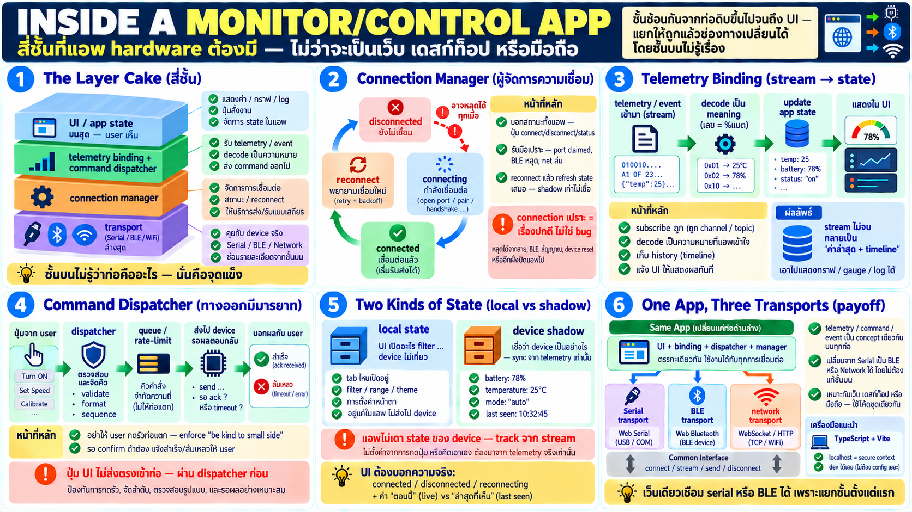

# Anatomy ของ monitor/control app — app ที่คุยกับ device



ถึงตอนนี้เรารู้ช่องทาง (serial/BLE/WiFi) และรูปแบบการคุย
(telemetry/command/event) — บทนี้ถามว่า **app ที่ใช้งานจริงหน้าตา
เป็นอย่างไรข้างใน** — ไม่ลง code แต่ให้เห็น anatomy ที่ถูกต้อง

## สี่ส่วนที่ app device ต้องมี

ไม่ว่าจะเป็นเว็บ/desktop/มือถือ — app ที่คุยกับ hardware จริงมี
ส่วนประกอบชุดเดียวกันเสมอ:

```
┌─────────────────────────────────────────┐
│            UI and application state     │  what the user sees and operates
├─────────────────────────────────────────┤
│   telemetry binding    command dispatch │  turn bytes into meaning, and back
├─────────────────────────────────────────┤
│           connection manager            │  connect, drop, reconnect
├─────────────────────────────────────────┤
│      transport (Serial / BLE / Wi-Fi)   │  the actual channel
└─────────────────────────────────────────┘
```

ทีละชั้น:

### 1. Transport — ช่องทางดิบ

- ส่วนที่รู้ว่าคุยผ่าน serial / BLE / network — เป็น **ส่วนเดียว
  ที่รู้ว่าท่อคืออะไร**
- เปลี่ยน serial → BLE → เครือข่าย แค่ชั้นนี้ — ชั้นบนไม่รู้เรื่อง
- งานของมัน: เชื่อมต่อ, ให้ stream ของข้อมูลเข้า, รับข้อมูลที่จะ
  ส่งออก — แค่นั้น

### 2. Connection manager — ผู้จัดการความเชื่อมต่อ

ส่วนที่สำคัญที่สุดและมือใหม่มักละเลย:

- จัดการ lifecycle เต็มรูป: disconnected → connecting → connected →
  disconnect (เมื่อไหร่ก็ได้) → reconnect
- ตอบคำถาม "ตอนนี้เราอยู่ไหน" ให้ทั้ง app — status bar, ปุ่ม
  connect/disconnect, auto-reconnect policy
- รับมือความเปราะ: port ถูก claim, BLE หลุด, network ล่ม — ทุกอย่าง
  ต้องเป็นเรื่องปกติที่จัดการ ไม่ใช่ error ที่ทำให้ app ตาย
- **reconnect เมื่อกลับมา: refresh state เสมอ** — shadow เก่าไม่
  เชื่อได้

### 3. Telemetry binding — แปลง stream เป็น state

- telemetry/event เข้ามา → อัปเดต app state ที่แสดงอยู่
- งาน: subscribe ที่ถูกต้อง, decode เป็น meaning (เลขนี้คือ %แบต
  ไม่ใช่แค่ byte), เก็บ history ถ้าต้องการ, แจ้ง UI เมื่อเปลี่ยน
- ที่นี่คือที่ที่ stream ไม่จบกลายเป็น "ค่าล่าสุด + timeline" —
  chart, gauge, log

### 4. Command dispatcher — ทางออกที่มีมารยาท

- การกดปุ่มของ user ไม่ได้ส่งตรงเข้าท่อ — ผ่าน dispatcher ก่อน
- งาน: queue/รวมคำสั่ง (อย่า spam), รอ ack ถ้าจำเป็น, timeout ถ้า
  ไม่ตอบ, แจ้ง user ว่าสำเร็จ/ล้มเหลว
- นี่คือจุดที่ enforce "be kind to the small side" — อย่าให้ user
  กดรัวแล้วท่อแตก

## App state — กาวที่เชื่อมทุกอย่าง

app มี state สองชนิดที่ต้องแยกให้ชัด:

- **local state** — ของตัว app เอง: หน้าไหนเปิดอยู่, ตั้งค่า UI,
  filter — device ไม่เกี่ยว
- **device shadow** — ภาพที่เชื่อว่า device เป็น: LED สีอะไร, mic
  เปิดไหม — **sync จาก telemetry/event เท่านั้น ไม่เดาเอง**

และ UI ควรบอกความจริงของ state:

- `connected` vs `disconnected` vs `reconnecting` — แสดงชัดเสมอ
- ค่าที่แสดงต้องแยก "ตอนนี้" (live telemetry) กับ "ล่าสุดที่เห็น"
  (stale หลัง disconnect)

## Transport abstraction — ทำไม app เดียวใช้ได้หลายทาง

นี่คือ payoff ของการแยกชั้น:

```
UI ──► telemetry binding / dispatcher ──► connection manager
                                              │
                    ┌─────────────────────────┼─────────────────┐
                    ▼                         ▼                 ▼
              Serial transport          BLE transport     network transport
              (Web Serial)              (Web Bluetooth)   (through a service)
```

- เพราะ telemetry/command/event เป็น concept เดียวกันบนทุกช่องทาง
  ชั้นบนไม่จำเป็นต้องรู้ว่าท่อคืออะไร
- ออกแบบ interface เดียวกัน: `connect()`, `telemetry stream`,
  `send command`, `on disconnect` — transport แต่ละตัว implement
  เหมือนกัน
- ผล: เดโม "เว็บเดียวเชื่อม serial หรือ BLE" เป็นไปได้เพราะแยกชั้น
  ตั้งแต่แรก — ไม่ใช่ปรับทีหลัง

(รูปแบบ pseudo-API ข้างบนเป็นแนวคิดเชิงออกแบบ ไม่ใช่ API จริง)

## Tooling context — TypeScript + Vite

สำหรับการใช้งานจริงของ week นี้:

- **TypeScript** — เหมาะกับงานนี้มากเพราะ: type บอกทิศทางข้อมูลชัด
  (telemetry คือ type นี้ command คือ type นั้น), event handler
  ชัดเจน, และอยู่ใน browser โดยตรง
- **Vite** — dev server + build ที่เร็ว เหมาะกับ zero-install web
  app — รันบน localhost ได้เลย (ซึ่งเป็น secure context ที่ Web
  Serial/BLE ยอมรับ — ไม่ต้องตั้ง HTTPS ตอน dev)
- ไม่เน้น UI framework — anatomy เดียวกันนี้ใช้ได้กับ vanilla TS
  หรือ framework ใด ๆ

## Pattern ที่ผู้เรียนควรถือไว้

- **แยกชั้นเสมอ** — transport / connection / binding / state —
  อย่ารวม "เปิด serial" กับ "แสดงผล" ในก้อนเดียว
- **connection เป็นสิ่งแรกที่ต้องถูกต้อง** — app ที่หลุดแล้วทำตัวไม่
  ถูก น่ารำคาญกว่า app ที่ไม่มี feature เยอะ
- **state ของ device มาจากมันเสมอ** — app ไม่เดา มัน track
- **ช่องทางเป็นรายละเอียด** — logic ไม่ผูกกับสาย/ไร้สาย
- **ผู้ใช้ต้องเห็นความจริง** — สถานะเชื่อม, ความใหม่ของข้อมูล

## Checklist

| คำถาม | ควรตอบได้ |
|---|---|
| ส่วนประกอบหลักของ app | transport / connection manager / telemetry binding / command dispatcher + UI+state |
| transport abstraction คืออะไร | interface เดียวกันเหนือ serial/BLE/network — ชั้นบนไม่รู้ว่าท่ออะไร |
| shadow state คืออะไร | ภาพที่ app เชื่อว่า device เป็น — sync จาก telemetry ไม่เดาเอง |
| reconnect ต้องทำอะไร | refresh state ใหม่ — shadow เก่าไม่เชื่อได้ |
| dispatcher มีไว้ทำไม | queue/ack/timeout/อย่าให้ user spam ท่อ |
| Vite/localhost ดีตรงไหน | localhost = secure context — dev ได้เลยไม่ต้อง HTTPS |
