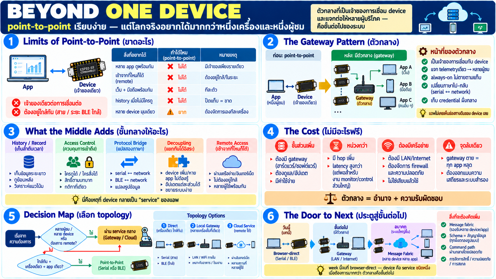

# เมื่อ device เดียวไม่พอ — สู่บริการกลาง



ทุกบทที่ผ่านมาคือ **point-to-point** — app หนึ่งคุยกับ device หนึ่ง
อยู่ใกล้ ๆ — มันเรียบง่ายและพอสำหรับงานจำนวนมาก แต่โลกจริงมัก
ต้องการมากกว่านั้น

## ขีดจำกัดของ point-to-point

| อยากได้ | point-to-point ทำได้ไหม |
|---|---|
| app หลายตัวดู device เดียวกันพร้อมกัน | ไม่ได้ — port/connection มีเจ้าของเดียว |
| เข้าถึงจากที่ไหนก็ได้ | ไม่ได้ — ต้องอยู่ใกล้ device |
| เว็บ + มือถือ + desktop พร้อมกัน | ไม่ได้ — ทีละตัว |
| เก็บ history ตอนไม่มีใครดูอยู่ | ไม่ได้ — ปิดแท็บ = ขาดข้อมูล |
| device หลายตัวในมุมมองเดียว | ยาก — ต้องเชื่อมทีละตัว |
| ยังทำงานเมื่อผู้ใช้ offline | ไม่ได้ — app ปิด = หยุด |

แกนของข้อจำกัดทั้งหมดคือสองอย่าง: **"เจ้าของเดียวต่อการเชื่อม"**
และ **"ต้องอยู่ใกล้กัน"**

## Gateway/service กลาง — แนวคิด

วิธีแก้คือแทรก **ตัวกลางที่เป็นเจ้าของการเชื่อม device และแจกต่อ
ให้หลายผู้บริโภค**:

```
point-to-point:          app ────── device

ผ่านตัวกลาง:             device ──► gateway ──► app A
                        (ต่อกลาง)      │        app B
                                       └──────► service อื่น ๆ
```

gateway (หรือ "service กลาง") คือโปรแกรมที่:

- **เป็นเจ้าของการเชื่อม device** — เสียบ serial / เชื่อม BLE /
  รับ WiFi connection จาก device แทน — app ไม่ผูกกับท่อดิบอีก
- **fan-out** — telemetry หนึ่งสายจาก device แจกให้ผู้ชมหลายตัว
- **always-on** — ทำงานต่อเนื่อง ไม่ตายตามแท็บเว็บ — history
  เก็บได้ตลอด
- **เปลี่ยนภาษา** — app คุยกับมันด้วยวิธีที่เหมาะกับเครือข่าย
  (ไม่ใช่ serial) — gateway แปลงไป-กลับให้
- **เป็นเจ้าของ credential** — WiFi/secret ของ device อยู่ฝั่ง
  กลาง — app ไม่ต้องรู้

app ทุกตัวคุยกับ gateway — **ไม่เคยเห็นช่องทางดิบของ device** —
นี่คือเหตุที่ week นี้สอนแนวคิด: ผู้ใช้ปลายทางไม่ต้องรู้ว่า wire
เป็นยังไง ข้างใน gateway จัดการหมด

## แผนที่ topology ที่ใช้จริง

```
งานเล็ก/เดี่ยว:      app ──serial──► device                    (week นี้)

งานใกล้หลายผู้ชม:    device ──► gateway (เครื่องเดียวกับ app) ──► หลาย viewer

งานจริง/remote:      device(s) ──► gateway/service กลาง ──► app/web/mobile
                    (WiFi หรือสาย)      (เครือข่าย/cloud)      จากทุกที่
```

level ไหนก็ใช้ concept เดียวกัน — device เสนอ capability → ใครก็
ตามบริโภคผ่านชั้นกลางที่เหมาะสม

## สิ่งที่ชั้นกลางให้เพิ่ม (นอกเหนือจาก fan-out)

- **history/record** — เก็บ telemetry เป็นลำดับเวลา ตอบย้อนได้
  (dashboard ไม่ต้องดูสดอยู่ตลอด)
- **access control** — ใครดูได้/ใครสั่งได้ — กติกาอยู่กลางที่เดียว
- **protocol bridge** — device ฝั่งหนึ่งคุยแบบหนึ่ง app อีกฝั่งคุย
  อีกแบบ — กลางแปล
- **decoupling** — device เพิ่ม/หาย app ไม่ต้องรู้จักมัน รู้จักแค่
  ชั้นกลาง — เพิ่มลดขนาดได้
- **remote access** — เครือข่ายแทนสาย/ระยะใกล้

## ข้อเสียที่ต้องรับเมื่อมีตัวกลาง

อย่างเป็นธรรม — ไม่มีอะไรฟรี:

- **ชิ้นส่วนเพิ่มขึ้น** — ต้องดูแล gateway เอง (รันอยู่ตลอด อัปเดต
  ขาดได้)
- **หน่วงกว่า** — ไม่ใช่ตรงสู่ตรง มี hop เพิ่ม — latency เพิ่มขึ้น
  เล็กน้อย (แต่เพียงพอสำหรับ monitor/control แทบทุกงาน)
- **ต้องมีเครือข่าย** — หาก remote ต้องมี infra — ไม่ใช่ "เสียบแล้ว
  ใช้" แบบ point-to-point
- **จุดล้มเดียว** — gateway ตาย = ทุก app หลุด — ออกแบบให้รับมือ

## เมื่อไหร่เลือกแบบไหน — ตัดสินแบบเดิม

กลับไปที่สามคำถามของบทเลือกช่องทาง + เพิ่มคำถาม "กี่ผู้ชม":

```
อยู่ใกล้ + เครื่องเดียว + app เดียว     → point-to-point (Serial/BLE)
หลายผู้ชม / remote / หลาย device        → ผ่าน service กลาง
ยังทำงานแม้ไม่มีใครดู                   → ต้อง always-on = กลาง
```

## นี่คือประตูสู่ขั้นต่อไป

week นี้ครอบคลุม browser-direct จบแล้ว — แต่เมื่อระบบโต:

- **message fabric / pub-sub กลาง** — หลาย device หลาย app
  เชื่อมผ่านระบบกลางที่ decouple กันเต็มตัว — device publish,
  app subscribe — ไม่มีใครรู้จักกันโดยตรง
- **schema เป็นสัญญา** — ข้อมูลที่ไหลผ่านกลางต้องมีนิยามที่ทุกฝั่ง
  ตกลงร่วม — ไม่ใช่ byte ดิบ
- **command path ผ่านกลาง** — สั่งจาก web ไกล ๆ ไปถึง actuator
  ผ่านชั้นกลางโดยปลอดภัย

นั่นคือเนื้อหาที่ตามมา — แต่จุดยืนของ week นี้สมบูรณ์แบบในแบบของ
มัน: **เข้าใจว่า device เป็น service ชนิดหนึ่ง และ browser เข้าถึง
มันได้โดยตรง — เมื่อต้องการมากกว่า ตัวกลางคือขั้นต่อไป**

## Checklist

| คำถาม | ควรตอบได้ |
|---|---|
| point-to-point ขาดอะไร | หลายผู้ชมพร้อมกัน, remote, always-on |
| gateway คืออะไร | ตัวกลางเจ้าของการเชื่อม device แจกต่อหลาย app |
| ชั้นกลางให้อะไรเพิ่ม | fan-out, history, access control, แปลภาษา, decouple |
| ข้อเสียของการมีตัวกลาง | ชิ้นส่วนเพิ่ม, latency hop, ต้องมี network, จุดล้มเดียว |
| เมื่อไหร่ point-to-point พอ | ใกล้ + เครื่องเดียว + app เดียว + ไม่ต้อง always-on |
| ขั้นต่อไปคืออะไร | fabric กลาง — device publish, app subscribe, decouple |
