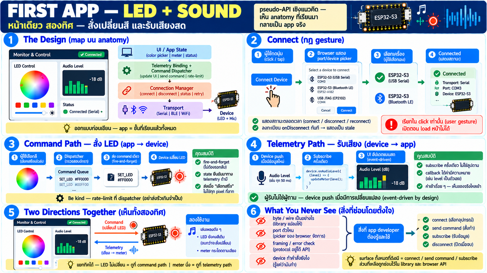

# App แรก — ควบคุม LED และอ่านระดับเสียง



ถึงเวลาเห็น code — เป้าหมายของบทนี้คือ app หน้าเดียวที่ทำสองอย่าง
ร่วมกัน: **ส่งคำสั่งเปลี่ยนสี LED** (command) และ **แสดงระดับเสียง
รอบข้างสด ๆ** (telemetry)

> code ทั้งหมดในบทนี้เป็น **ตัวอย่างเชิงแนวคิด** — pseudo-API ที่
> แสดงรูปแบบการออกแบบเท่านั้น ไม่ใช่ SDK จริง — เมื่อ library จริง
> พร้อม รูปแบบการใช้จะหน้าตาคล้ายนี้

## ออกแบบก่อนเขียน — map เข้ากับ anatomy

จากบทก่อนหน้า app มีชั้นชัดเจน — demo นี้ใช้ทุกชั้น:

```
UI:        [color picker]  [sound meter]  [status + connect btn]
            │                │                    │
dispatcher  │  led cmd →     │                    │
binding     │           audio level →            │
            └──── connection manager ────────────┘
                          │
                    transport: Web Serial
                          │
                        device
```

- **command path**: user เลือกสี → dispatcher → ส่งคำสั่งเดียว →
  board เปลี่ยน LED
- **telemetry path**: subscribe "audio level" → device push ค่า →
  binding อัปเดต meter
- **connection**: ปุ่มเดียวเปิด/ปิด — status แสดงตลอด

## โครง app — TypeScript + Vite

Vite dev server รันบน `localhost` ซึ่งนับเป็น secure context —
Web Serial ใช้ได้เลยไม่ต้อง HTTPS ตอน dev

โครงสร้างเชิงแนวคิด:

```ts
// pseudo-API — แนวคิดเชิงออกแบบ ไม่ใช่ SDK จริง
const device = await deviceLib.connectSerial()   // เปิด picker → เชื่อม
```

## ส่วนที่ 1: เชื่อมต่อ (กฎ gesture เสมอ)

```ts
// pseudo-API
connectBtn.onclick = async () => {
  status.text = "connecting…"
  device = await deviceLib.connectSerial()   // user ต้องเลือก port ใน picker
  status.text = "connected"
  device.onDisconnect(() => {
    status.text = "disconnected — ค่าที่แสดงอาจไม่ใช่ของจริงแล้ว"
  })
}
```

จุดที่ต้องสังเกต (ไม่ใช่ syntax):

- เรียกใน **onclick** เท่านั้น — user gesture บังคับ เปิดตอน page
  load ไม่ได้
- เชื่อมเสร็จแล้วค่อย subscribe/send — ตาม lifecycle บท serial
- `onDisconnect` ลงทะเบียนทันที — เพราะหลุดคือเรื่องปกติ ต้องแสดง
  stale ให้ user เห็น

## ส่วนที่ 2: ส่งคำสั่ง LED — command path

```ts
// pseudo-API
colorPicker.oninput = async (color) => {
  await device.command.send("led.setColor", color)   // สั่งครั้งเดียว
}
```

แนวคิดเบื้องหลังสั้น ๆ:

- user เปลี่ยนสี → คำสั่งหนึ่งไปที่ device → device เปลี่ยน LED เอง
- **fire แล้วจบ** — command ไม่ stream กลับ (state ยืนยันมาทาง
  telemetry/event ถ้ามี)
- dispatcher ควร rate-limit — picker ไหลค่าถี่มาก ไม่ควรส่งทุก
  frame ของการลาก (หลัก "be kind to the small side"):

```ts
// pseudo-API — ส่งเฉพาะเมื่อ user "เลือกเสร็จ" ไม่ใช่ทุก pixel ที่ลาก
colorPicker.onchange = (color) => device.command.send("led.setColor", color)
```

## ส่วนที่ 3: อ่านเสียง — telemetry path

```ts
// pseudo-API
device.telemetry.subscribe("audio.level", (level) => {
  meter.value = level          // 0–100
  meterText.text = `${level}%`
})
```

จุดเชิงแนวคิด:

- **subscribe ครั้งเดียว** — ไม่ใช่ลูปถาม; device push เมื่อค่า
  อัปเดต — เหมือน event listener บน DOM
- callback รับ "ค่าที่มีความหมายแล้ว" (ตัวเลข level) — ไม่ใช่
  byte ดิบ; การแปลงอยู่ในชั้น binding/library
- ค่าเข้าเรื่อย ๆ → meter เคลื่อน — ผู้ใช้เห็น "ของจริง" ไหลเข้า

## รวมกัน — เห็น cooperation จริง

ตอนนี้หน้าเดียวมีทั้งสองทิศ:

```
user ลากสี ──command──► device เปลี่ยน LED       (app→device)
device ฟังเสียง ──telemetry──► meter ขยับ        (device→app)
```

- กดเปิดเพลงดัง ๆ → LED เดิมที่ตั้งไว้ + meter กระโดด — เห็น
  input และ output ของโลกกายภาพพร้อมกัน
- ถ้า LED ไม่เปลี่ยน → command path มีปัญหา; ถ้า meter นิ่ง →
  telemetry path — **แยก debug ได้เพราะทิศแยกกัน**

## สิ่งที่บทนี้ "ไม่ได้แสดง" โดยตั้งใจ

เพื่อให้เห็นว่า app dev ไม่ต้องรู้:

- **byte เป็นอย่างไรบนสาย** — library แปลงค่าที่มีความหมาย ↔ wire
- **port ตัวไหน** — user เลือกใน picker เอง library จำให้
- **framing/ตรวจความเสียหาย** — protocol ที่เชื่อถือได้อยู่ใต้ API
- **device implement คำสั่งยังไง** — รู้แค่ "ส่งไปแล้วมันทำ"

คุณเห็นเฉพาะ **interface สามชิ้น**: connect / send command /
subscribe — นั่นคือ surface ทั้งหมดที่ app ต้องการ

## สิ่งที่ต่อยอดได้ทันที

- เพิ่ม battery gauge — subscribe telemetry อีกตัว (pattern เดียวกัน)
- ปุ่ม "เล่นเสียง" — command อีกชนิด
- แสดง touch event — subscribe event (จุด) ไม่ใช่ stream
- สลับเป็น BLE — เปลี่ยน connect function เดียว ที่เหลือเหมือนเดิม
  (transport abstraction)
- เก็บ history ของ level → chart แบบง่าย — binding เก็บค่าเก่า

## Checklist

| คำถาม | ควรตอบได้ |
|---|---|
| ทำไม connect ต้องอยู่ใน click handler | user gesture บังคับของ Web API |
| command vs telemetry ต่างยังไง | สั่ง fire-and-forget / subscribe รับ stream |
| ทำไมไม่ส่งสีทุก frame ของการลาก | ท่อ+ฝั่งเล็ก — ส่งเมื่อเลือกเสร็จ |
| byte/wire อยู่ที่ไหน | ซ่อนใน library — app เห็นแค่ connect/send/subscribe |
| debug แยกยังไง | command ทิศหนึ่ง telemetry อีกทิศ — ล้มคนละฝั่ง |
| เพิ่ม capability ใหม่ทำยังไง | เพิ่ม subscribe/command เดิม pattern เดียวกัน |
