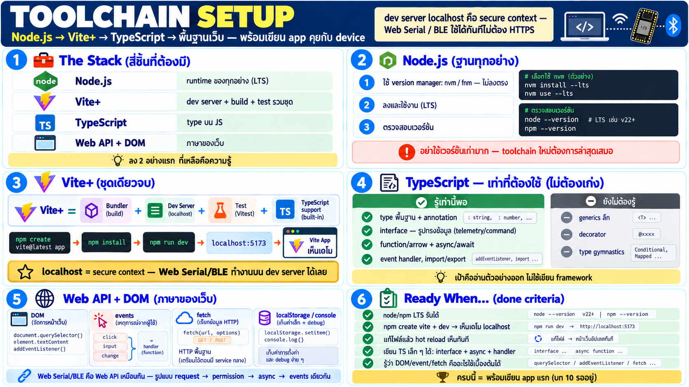

# เตรียมเครื่องมือ — Node.js, Vite+, TypeScript และพื้นฐานเว็บ



บทสุดท้ายของ week: ติดตั้ง toolchain ให้ครบ และรู้ว่าต้องเติม
พื้นฐานอะไรบ้างก่อนเขียน app ที่คุยกับ device จริง

## ชิ้นที่จะลงและเหตุผล

| ชิ้น | ทำอะไร | ทำไมต้องมี |
|---|---|---|
| **Node.js** | runtime ของ JS ฝั่งเครื่อง + npm | toolchain ทั้งหมดรันบนมัน |
| **Vite+** | dev server + build + test bundle | สร้าง/รัน/build web app |
| **TypeScript** | type บน JS | อ่าน/เขียน app ที่มี type ชัด — เหมาะกับ telemetry/command |
| **Web API + DOM** | พื้นฐานเว็บ | ภาษาที่ browser ให้ใช้ — ทุกอย่างสร้างบนนี้ |

## ขั้นตอนที่ 1: ติดตั้ง Node.js

แนะนำ version manager มากกว่าลงตรง — เผื่อหลาย project ต้องการ
version ไม่เหมือนกัน:

- **macOS/Linux**: `nvm` หรือ `fnm` — `nvm install --lts` แล้ว
  `nvm use --lts`
- **Windows**: `fnm` หรือติดตั้งจาก nodejs.org โดยตรง (เลือก LTS)

ตรวจว่าพร้อม:

```bash
node --version     # ควรเห็น version LTS (เช่น v22.x ขึ้นไป)
npm --version      # มากับ node
```

> อย่าใช้ node version เก่ามาก — toolchain ใหม่ต้องการ version ล่าสุด
> อยู่เสมอ

## ขั้นตอนที่ 2: เข้าใจ Vite+

Vite+ (viteplus.dev) คือชุดเครื่องมือรวมจากทีม VoidZero — เดิมต้อง
ลงหลายตัวแยกกัน (bundler + dev server + test runner + linter) ตอน
นี้รวมเป็นชุดเดียว:

- **Vite** — dev server เร็วมาก + build เป็น static ที่ deploy ได้
- รวมเครื่องมือเสริม (test, lint) ในระบบเดียวกัน
- TypeScript รองรับในตัว — ไม่ต้องตั้งค่า compile เอง

สร้าง project ตัวอย่าง (ตามเอกสาร Vite+ ปัจจุบัน):

```bash
npm create vite@latest my-device-app
cd my-device-app
npm install
npm run dev
```

เปิด URL ที่แสดง (เช่น `http://localhost:5173`) — เห็นหน้า demo =
พร้อม

**จุดเชื่อมกับเนื้อหา week นี้**: `localhost` นับเป็น secure
context — **Web Serial / Web Bluetooth ใช้ได้เลยบน dev server ไม่
ต้องตั้ง HTTPS** — จุดนี้เองที่ทำให้ Vite dev เหมาะกับงานนี้

## ขั้นตอนที่ 3: พื้นฐาน TypeScript ที่ต้องรู้

ไม่ต้องเป็นผู้เชี่ยวชาญ — เท่าที่ app ฝั่งนี้ต้องใช้:

- **type พื้นฐาน** — `string`, `number`, `boolean`, array,
  object literal + type annotation (`let x: number`)
- **interface** — นิยามรูปทรงข้อมูล (เช่น `interface Telemetry
  { battery: number; level: number }`)
- **function + arrow function** — callback ล้วน ๆ
- **async/await + Promise** — ทุกอย่างที่คุยกับโลกภายนอกเป็น async
- **event handler** — `element.onclick = ...` / `addEventListener`
- **module** — `import`/`export` ระหว่าง file

สิ่งที่ "ยังไม่ต้องรู้" ตอนนี้: generics ลึก, decorator,
advanced type gymnastics — ไม่ได้ใช้ใน app ระดับนี้

## ขั้นตอนที่ 4: พื้นฐาน Web API + DOM

แอพที่คุยกับ device ยังคงเป็นเว็บ — พื้นฐานเหล่านี้คือภาษาของมัน:

- **DOM** — `document`, `querySelector`, `createElement`,
  `textContent`, `addEventListener` — สร้าง/อัปเดตหน้าจอ
- **events** — click, input, change — user action → handler
- **fetch** — HTTP request พื้นฐาน (สำหรับช่วงที่คุยกับ service
  กลางในอนาคต)
- **storage** — `localStorage` เก็บค่าเล็ก ๆ เช่นการตั้งค่า
- **console** — `console.log` คือ debugger แรกที่มีอยู่แล้ว

และจากสองบทก่อน — **Web Serial + Web Bluetooth** คือ Web API เช่น
กัน แค่เป็นหมวด hardware — รูปแบบการใช้เหมือนกัน: request →
permission → async operation → events

## แผนเติมพื้นฐานที่แนะนำ

สำหรับผู้เรียนที่ยังไม่คุ้นเว็บ — เส้นทางสั้นที่ครอบคลุม:

1. **TypeScript เบื้องต้น** — เอกสาร "TypeScript for JavaScript
   Programmers" บนเว็บหลัก — ครึ่งวันรู้พอใช้
2. **DOM + events** — แบบฝึกเล็ก ๆ: ปุ่มกดแล้วเปลี่ยนข้อความ/
   input แล้วแสดงค่า — ครึ่งวัน
3. **async/await** — ลอง fetch ข้อมูลสาธารณะแล้วแสดง —
   เข้าใจ "งานที่ไม่จบทันที"
4. **Vite dev** — แก้ตัวอย่าง hello-world แล้วเห็น hot reload —
   เข้าใจ flow dev

เป้าหมายคือพอที่จะอ่านตัวอย่าง app ในบทถัด ๆ ไปออก — ไม่ใช่เขียน
framework เอง

## Done criteria — พร้อมเมื่อ

- [ ] `node --version` และ `npm --version` รันได้ version LTS
- [ ] สร้าง project Vite ใหม่ → `npm run dev` → เห็นหน้า demo บน
      localhost
- [ ] แก้ file ใน src แล้วเห็น hot reload ทันที
- [ ] เขียน TypeScript เล็ก ๆ ได้: interface + async function +
      event handler
- [ ] รู้ว่า DOM/event/fetch คืออะไรและใช้เบื้องต้นเป็น
- [ ] รู้ว่า `localhost` คือ secure context — พร้อมลอง Web Serial/
      BLE จริงได้เลย

## Checklist สรุป week

| คำถาม | ควรตอบได้ |
|---|---|
| ติดตั้ง toolchain อะไร | Node.js (LTS) → Vite+ (dev/build) |
| localhost ดียังไง | secure context — Web Serial/BLE ใช้ได้ทันที |
| TS ที่ต้องรู้ | type/interface/async-await/event handler — พอ |
| Web API พื้นฐาน | DOM/events/fetch/console — พื้นที่ทุกอย่างสร้างบน |
| พร้อมเขียน app เมื่อไหร่ | เมื่อทำ done criteria ครบ — บท app แรกรออยู่ |
