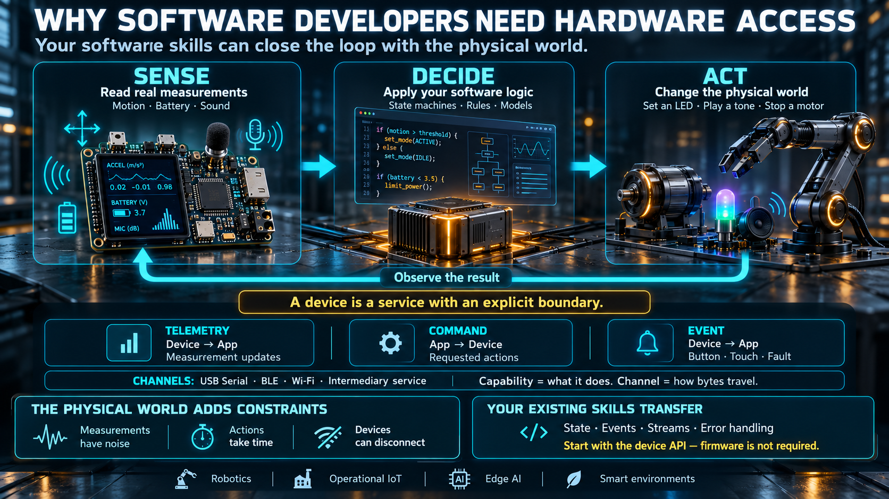

# Why Software Developers Need Hardware Access



Writing application code is no longer a scarce skill. Generating a CRUD service, an HTTP API, or a test suite is work that current coding models do well, and they do it faster than a person typing the same structure by hand. The skills that stay hard are the ones that close a loop with the physical world: reading a real measurement, deciding what it means, and changing something that is not a pixel.

This lesson sets that boundary. It does not ask you to write firmware. It asks you to treat a device as a service with a defined surface, and to see where your existing software skills sit inside that loop.

## The boundary moved

The work a programmer used to be hired for — implementing features, shaping a database, applying a known algorithm — is becoming a commodity. A model can draft it. A reviewer still has to judge it, but the draft itself is no longer the expensive part.

What a model does not replace is contact with a physical system:

- **A real measurement.** Temperature, motion, sound level, battery state, position. These values are sampled from a sensor. They are not generated text.
- **A real effect.** A robot joint moves, an LED changes color, a speaker emits a tone, a motor turns. The output is a change in the world, not a rendered frame.
- **A physical constraint.** Latency, power budget, electrical noise, packet loss, and failure modes that a simulator only approximates. A device can brown out, drift, or disconnect. The software has to expect that.

The professional split is between people who produce digital output — text, images, media — and people who can close the loop **sense → decide → act**.

## Sense, decide, act

The loop a hardware-facing program actually runs:

```
┌───────┐      ┌───────────┐      ┌─────────┐
│ sense │ ───► │ decide    │ ───► │ act     │
│ read  │      │ your code │      │ command │
└───────┘      └───────────┘      └─────────┘
```

Ordinary application work generates information for a person to read: a page, a report, an image, a message. The last step is display.

Hardware-facing work is a closed loop with a machine:

```
sense   → read a real parameter from the device
          (is it moving? how much battery remains?)
decide  → run the logic you already know
          (state machines, models, rules, an inference step)
act     → send a command that changes the physical world
          (set an LED, play a tone, stop a motor)
```

The software skills you already have transfer directly: state, events, streams, and error handling. What you add is a different peer on the other end of the wire. That peer is a device, not an API server. It has a clock of its own, a power budget of its own, and a body that keeps doing something after your tab closes.

Three properties follow from that, and they show up in every later lesson:

- **The measurement is lossy.** A sensor samples. It quantizes. It drifts. "The temperature is 26.4" means "the sensor reported 26.4 under its current calibration," not a ground truth the software invented.
- **The action has inertia.** A command is not applied in zero time. A motor has to accelerate. An LED driver has to latch a color. A radio has to deliver a packet.
- **The peer can disappear.** A server timeout is an error you retry. A device disconnect can also mean the actuator is still in the last state you commanded. The software must say so.

## Why this combination is hired

Several product categories now require the same person to understand both sides of the wire:

- **Physical AI and robotics.** A model that scores well offline still has to be wired to sensor fusion, motor control, and a safety stop. The integration is the product. A person who can only train the model, or only draw the dashboard, leaves the loop open.
- **Operational IoT.** A demo dashboard is not the job. Factories, farms, buildings, and vehicles need software that monitors and commands real equipment, including the case where the link fails.
- **Edge and on-device inference.** Privacy, latency, and offline operation push models onto the device that sits next to the sensor. The application is no longer "a cloud API plus a chart." It is a process running beside the measurement.
- **Nearby robotics.** Small mobile robots, arms, drones, and in-store automation each need a software layer on top of motors and sensors. The layer is small. The failure modes are not.

Someone who can ship a web application and also speak to a device is harder to replace with a code generator, because the work is the join between two systems that fail differently.

## A machine is not only a robot

"Hardware," for an application developer, is any machine that exposes a surface you can read and command:

| Class                    | Examples                                                    |
| ------------------------ | ----------------------------------------------------------- |
| **Small device**         | Development board, sensor node, wearable, smart plug        |
| **Machine or appliance** | Factory equipment, a connected boiler, an e-bike controller |
| **Robot**                | Mobile robot, arm, drone, warehouse AMR                     |
| **Environment**          | Building sensors, irrigation valves, energy meters          |

The class changes the packaging and the safety stakes. It does not change the software shape. Each of these machines exposes capabilities: values you can read, actions you can request, and events it will report. That surface is the job.

## What access looks like from the application

You do not start by writing firmware or touching a peripheral register. The device already has a **capability surface**. From the application, that surface has three directions:

- **Telemetry.** Values the device reports on its own: temperature, motion, battery level, ambient sound level. This is a stream or a series of updates, not a database query you issue whenever you like.
- **Command.** An instruction the application sends: set LED color, play a tone, enable the microphone. It may be fire-and-forget, or it may wait for an acknowledgement. It is not a stream in the return direction.
- **Event.** Something that happened on the device: a button press, a touch, a fault. The device pushes it when it occurs. It is not the device answering a command.

The **channel** that carries those three is a separate choice. A cable (serial), a short-range radio (Bluetooth Low Energy), a local network (Wi-Fi), or a service in the middle. Each channel has a cost in range, power, bandwidth, and how many clients can listen. Later lessons compare them. This lesson only needs the split: the capability is what the device can do; the channel is how the bytes travel.

The mental model to keep: a device is not "hardware you must program." It is **a service with an explicit boundary**. You speak the interface it publishes, the same way you speak any other API. The other end happens to move.

## The board used in this course

The teaching board, ES3C28P, makes that surface concrete:

| Capability                 | From the application                                                                |
| -------------------------- | ----------------------------------------------------------------------------------- |
| Battery level              | Telemetry — the device's own power state                                            |
| Motion sensor (IMU)        | Telemetry — how the board is moving or tilted                                       |
| Microphone and audio level | Telemetry — a processed level of nearby sound, not a raw recording in every channel |
| RGB LED and display        | Command — status and feedback on the device itself                                  |
| Touch screen               | Event — input that happens on the device, not in the page                           |
| Wi-Fi                      | A channel — remote access, once a network path exists                               |
| USB serial and BLE         | Channels — a cable path and a short-range radio path                                |

Taken together, the board is a complete first machine: it can be observed, commanded, and used as an input device. It is small enough to sit on a bench and complete enough to exercise every idea in the week.

## What this week is for

By the end of the week you should be able to:

1. Explain how a computer and a microcontroller split the work, and why one side should not do all of it.
2. Name the standard browser APIs that reach hardware, and the permission rules they share.
3. Use telemetry, command, and event as the common vocabulary of any device, independent of the cable or radio.
4. Sketch the anatomy of an application that talks to a device — layers, not a code listing.
5. Decide when a browser can talk to one nearby device directly, and when the system needs a service in the middle.

## Checklist

| Question                                      | You should be able to answer                                                                                                          |
| --------------------------------------------- | ------------------------------------------------------------------------------------------------------------------------------------- |
| Why is coding alone no longer enough?         | Digital output is cheap to generate. Closing sense → decide → act still needs a person who understands the physical peer.             |
| What does the application do with a device?   | Read telemetry, send commands, and receive events, through the interface the device exposes.                                          |
| How is a device different from an API server? | Its effects are physical. A sensor measures something real. An actuator moves something real. It keeps state after the client leaves. |
| Do you have to write firmware?                | No. You use the capability surface the device already exposes.                                                                        |
| How many kinds of channel are there?          | Cable, short-range radio, and a network or intermediary service. You pick by the situation, not by habit.                             |
