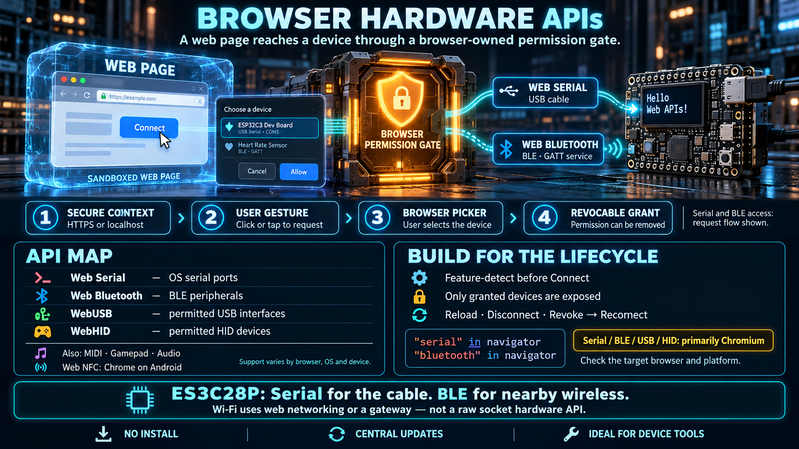

# Browser Hardware APIs



A normal web page runs in a strict sandbox. It cannot read arbitrary files, open a raw socket, or touch a serial port, a USB device, or a radio. That sandbox is the reason a person can follow an unknown link. It is also the reason the web spent years losing to native applications on any job that needed a machine.

Browser hardware APIs are the designed exception. A page may reach a device, but only through a gate the browser owns: a secure context, a user gesture, a picker the page cannot skip, and a permission the user can revoke. This lesson is the map of those gates. The next lessons go into serial and Bluetooth specifically.

## The sandbox is the starting point

The web's security model assumes the page is untrusted. Origin isolation, no raw sockets, and no silent hardware access are what make that assumption survivable. A native application, once installed, can enumerate serial ports, scan for radios, and open devices because the operating system treats the install as consent. A page does not get that trust from being loaded.

The hardware APIs do not remove the sandbox. They add a narrow, user-mediated door. If you design as though the page "has the device," the API will refuse you. If you design as though the user is lending the page one device for a while, the API matches the product.

## Which APIs exist

| API               | What the page can reach                                                | Practical support                                 |
| ----------------- | ---------------------------------------------------------------------- | ------------------------------------------------- |
| **Web Serial**    | Serial ports (USB CDC and other serial devices the OS exposes)         | Chromium-based browsers                           |
| **Web Bluetooth** | Nearby Bluetooth Low Energy devices                                    | Chromium-based browsers                           |
| **WebUSB**        | USB devices that are not already claimed by a standard class driver    | Chromium-based browsers                           |
| **WebHID**        | Human Interface Devices, including custom HID and specialized controls | Chromium-based browsers                           |
| **Web MIDI**      | MIDI instruments and controllers                                       | Chromium-based browsers                           |
| Web NFC           | NFC tags                                                               | Removed after an experiment. Not a viable option. |
| Gamepad API       | Game controllers                                                       | Broad support across browsers                     |
| Web Audio         | Microphone, speaker, and audio processing                              | Broad support. Not the subject of this week.      |

The pattern is stable enough to design on: **the APIs that touch a general-purpose device are a Chromium feature set.** Chrome, Edge, Opera, Arc, and other Chromium browsers implement them. Firefox and Safari do not, and they have not committed to doing so. A product that depends on Web Serial or Web Bluetooth is a Chromium product. Say that to the user, or provide a fallback that does not pretend the API exists.

Feature-detect before you offer the button:

```ts
const canUseSerial = "serial" in navigator;
const canUseBluetooth = "bluetooth" in navigator;
```

A missing API is a product state ("open this page in Chrome or Edge"), not an exception to catch after the user has already clicked.

## Three rules every hardware API shares

Learn these three and the rest of the family is predictable.

### 1. Secure context only

These APIs are exposed only in a [secure context](https://developer.mozilla.org/en-US/docs/Web/Security/Secure_Contexts): `https://`, or the development exception `http://localhost` and `http://127.0.0.1`.

The reason is impersonation. On plain HTTP, a network attacker can modify the page in transit and then issue commands to a device the user just authorized. Hardware access without a secure origin would turn a coffee-shop network into a path onto the user's machine. Localhost is exempt so development does not require a certificate. A LAN IP such as `http://192.168.1.20` is **not** a secure context. Serving the dev build to a phone over the local network will not unlock these APIs unless you terminate TLS.

### 2. User gesture, then the browser's picker

`navigator.serial.requestPort()` and `navigator.bluetooth.requestDevice()` require a recent user activation. A click or a tap counts. A timer, a page load, or a promise that resolves later does not.

The browser then shows **its own picker**. The user chooses which device the page may see. The page cannot enumerate every serial port, and it cannot silently scan every BLE advertisement and build its own chooser from the full set. Filters on the Bluetooth call narrow what the picker shows. They do not give the page the scan results.

This is the important difference from native software. A native tool can list every port and every advertisement. A page receives only the device the user selected, plus devices that same origin was previously granted and that the browser is willing to return (for serial, `navigator.serial.getPorts()` returns previously granted ports, not the system list).

### 3. Permission is reversible, and the session is fragile

The user can revoke the grant in site settings at any time. There is no "allow forever, cannot undo" contract you can rely on.

The session is also tied to the page. Closing the tab drops the connection. Hiding the tab can stall timers and, on some platforms, affect radio connections. A reload kills the streams you were holding. A good hardware page treats disconnect, revoke, and reload as normal lifecycle events. It shows a disconnected state, drops stale readings, and offers a way back — which, for a first-time grant, means another gesture and often another picker.

## Why the browser is still the right platform

The constraints are real. The deployment properties are also real, and for a class of tools they dominate:

- **No install.** Sending a link is the entire distribution step. A technician opens the page and the tool is current.
- **One deployed version.** You do not debug a build from eighteen months ago that is still on a laptop in the field.
- **One codebase across desktop operating systems.** The same page runs on Windows, macOS, Linux, ChromeOS, and Chromium on Android, within the limits of each platform's device support.
- **A permission model you do not have to invent.** The browser already asks, remembers, and revokes. You still design the disconnected state. You do not design the security prompt.
- **A fit for tools, not for always-on products.** Diagnostics, firmware helpers, bench dashboards, and field configuration are exactly the jobs where "open the link and plug in" beats "install our agent."

The cost you accept: no Firefox and no Safari for Serial, Bluetooth, USB, and HID. Document the browser requirement on the page itself, before the user clicks Connect.

## Which doors this board uses

For the ES3C28P, two APIs cover the direct paths:

- **Web Serial.** The USB port enumerates as a serial device. A page can open it with no extra driver install on the platforms where the OS already exposes that port.
- **Web Bluetooth.** The board has BLE in hardware. If the firmware publishes a GATT service, the page can connect without a cable.
- **WebUSB and WebHID.** Unnecessary for this course. Serial and BLE already cover the monitor-and-control cases we care about. USB and HID matter when a device is not a serial port and is not a BLE peripheral — a custom USB class, or a HID controller the OS does not already map.

That is why the week focuses on two APIs: **serial for the cable, BLE for the short-range radio.** Wi-Fi is the third channel, but it is not a third browser hardware API. A page does not open a raw socket to a board on the LAN. The Wi-Fi path goes through a service, which is a later lesson.

## Ideas to carry forward

1. **The browser can reach hardware** through a gate: secure context, user gesture, browser-owned picker, revocable permission.
2. **Chromium-only is a design constraint**, not a temporary gap. Ship the requirement in the UI.
3. **The page sees only what the user granted.** The picker belongs to the browser. The page does not scan the room or the port list on its own.
4. **The connection is fragile.** Tab close, reload, hide, and revoke are normal. Reconnect is a feature, not an edge case.
5. **Two direct channels are enough** for this device class: Serial and BLE. Reach beyond one nearby device, and you leave the browser hardware APIs for a service in the middle.

## Checklist

| Question                                       | You should be able to answer                                                                                                                |
| ---------------------------------------------- | ------------------------------------------------------------------------------------------------------------------------------------------- |
| Why does hardware access require HTTPS?        | It requires a secure context, so a network attacker cannot rewrite the page and drive the device. `localhost` is the development exception. |
| Why must the user click before the port opens? | Transient user activation is the consent signal. A page must not open a device on load.                                                     |
| Does the page see every device?                | No. It sees the device the user picked, and later only the grants the browser still honors.                                                 |
| Which browsers work?                           | Chromium-based browsers for Serial, BLE, USB, and HID.                                                                                      |
| What if the user revokes permission?           | The connection drops. The application must show that, discard stale state, and be ready to ask again.                                       |
| Which APIs does this board use?                | Web Serial on the cable, Web Bluetooth over BLE. Wi-Fi is a network path, not a direct hardware API.                                        |
