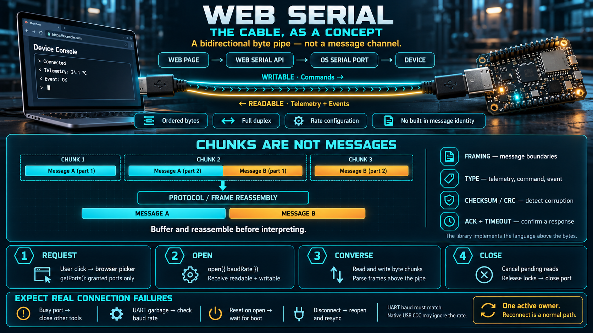

# Web Serial — The Cable, as a Concept



A serial port is the oldest practical way for two machines to exchange bytes, and it is still the simplest. This lesson stays on the concept: what the pipe is, what the browser adds around it, and why a protocol has to exist above the bytes. The wire format used by the teaching board lives in a library. You need the model, not the frame layout.

## A serial port is a bidirectional byte pipe

Ignore voltages and connectors for a moment. Conceptually, a serial port is a pipe with four properties:

- **Bytes, in order.** Data is a sequence of octets. The pipe itself has no messages, no packets, and no types.
- **Full duplex.** Each direction has its own path. Either side can send while the other is sending.
- **An agreed rate.** Both ends must use the same baud rate. A mismatch does not produce a clean error. It produces garbage, because the receiver samples the line at the wrong time.
- **No identity.** The pipe does not tell you what is on the other end. Meaning comes from a language both sides agreed to, above the bytes.

That is why serial outlived the connectors it started on. USB serial adapters, microcontroller USB CDC ports, and RS-232 console ports all present the same abstraction to software: open a port, agree a rate, read and write bytes.

Two details matter in practice even at this altitude. First, opening the port can assert control lines such as DTR. Some boards treat that as a reset, so the device may reboot at the moment you connect. Second, the operating system grants the open exclusively. If a serial monitor, a flasher, or another tab already holds the port, your page will fail to open it. There is one owner.

## Web Serial lets a page hold that pipe

Web Serial is the browser API that lets a page open a serial port on the user's machine — the job that used to require a native terminal or the microcontroller vendor's monitor.

```
┌──────────┐      ┌─────────┐      ┌─────────┐      ┌────────┐
│ web page │ ───► │ browser │ ───► │ OS port │ ───► │ device │
└──────────┘      └─────────┘      └─────────┘      └────────┘
```

The page never receives a file descriptor. The browser opens the port, enforces the permission, and hands the page a pair of streams. The page can ask. It cannot seize.

## The lifecycle

From the grant to the release:

```
┌──────┐                    ┌─────────┐                    ┌────────┐
│ page │                    │ browser │                    │ device │
└───┬──┘                    └────┬────┘                    └────┬───┘
    │                            │                              │
    │ requestPort ──────────────►│                              │
    │◄───────────── granted port │                              │
    │ open(baudRate) ───────────►│                              │
    │                            │ claim the port ─────────────►│
    │                            │◄──────────────── byte stream │
    │◄─────────────────── chunks │                              │
    │ close ────────────────────►│                              │
    │                            │ release ────────────────────►│
```

### 1. Request — the user always chooses

- The call is legal only from a user gesture. That is the rule from the previous lesson, applied here as `navigator.serial.requestPort()`.
- The browser shows **its** port picker. The user sees the ports the operating system currently exposes and grants one of them.
- The page cannot list every port. `getPorts()` returns only ports this origin already holds a grant for.
- A grant can be remembered. The next visit may reopen a previously granted port without showing the picker again, until the user revokes it in site settings. Remembered access is a convenience, not a promise that the device is still plugged in.

### 2. Open — agree the rate, receive two streams

- `port.open({ baudRate })` is the handshake with the pipe. Both sides must match. Common rates are 9600, 115200, and higher; the number is a property of the firmware, not a default you guess.
- On success the port exposes `readable` and `writable`: a `ReadableStream` and a `WritableStream`. The two directions stay separate.
- The open is exclusive. A second page, a second tab, or a native monitor cannot open the same port until this owner releases it.

### 3. Converse — chunks, not messages

This is the part that causes the bugs.

- The readable stream yields **chunks of bytes**. A chunk is an arbitrary slice of the byte flow.
- One chunk may end in the middle of a message. The next chunk may contain the rest of that message plus the start of another. The stream does not know where a message starts or ends.
- Recovering "one complete message" is the job of a layer above the pipe. That layer is the protocol. If you write application logic against raw chunks, it will work on the bench when messages happen to arrive whole, and fail when the OS or the device coalesces or splits them.

The same is true in the write direction. You enqueue bytes. The transport does not promise that one `write()` equals one message on the wire unless your protocol makes that true.

### 4. Close — release the pipe on purpose

- A reader obtained from `readable.getReader()` holds a lock. A writer holds a lock. **Close fails while a lock is held.** Release the reader and writer, then close the port.
- Close releases the operating-system claim. Another tool can open the port afterward.
- Closing the tab also drops the connection, without a polite handshake. Design every session so that reconnect is a normal path: gesture if a new grant is required, reopen, resynchronize state.

## A protocol is the language on top of the pipe

Because the pipe is only bytes, both sides need a shared language. That language answers four questions:

| Question the protocol answers | What it is for |
|---|---|
| Where does one message end and the next begin? | **Framing.** A delimiter, a length prefix, or a start-of-frame marker. Without it, you cannot reassemble chunks. |
| What kind of message is this? | **Type.** Telemetry, command, event, acknowledgement. The same pipe carries all of them. |
| Were the bytes damaged? | **Error detection.** A checksum or CRC. A serial line can flip a bit. You need a way to reject the frame instead of acting on it. |
| Did the command land? | **Acknowledgement.** A request/response habit, with a timeout when the reply never comes. |

On this board the device speaks a framed binary protocol built to tolerate noise and loss. The layout of that frame is the library's job. Your job is the distinction: **the pipe is raw bytes; the language is an agreement above the pipe.** When the library later offers `command.send` and `telemetry.subscribe`, it is that agreement, already implemented.

## Failure modes you will actually see

| Symptom | What it usually means |
|---|---|
| The port will not open | Another program or tab already owns it. Serial is single-owner. |
| The port opens and then nothing makes sense | Baud rate does not match the firmware. You are sampling a real signal at the wrong rate. |
| The device resets when you connect | Opening the port asserted a control line the board treats as reset. Wait until it finishes booting before you expect traffic. |
| Data arrives, then stops | The tab was hidden, reloaded, or discarded. The streams died with the document. |
| `close()` throws or hangs | A reader or writer lock is still held. Release it first. |
| The picker does not appear the second time | A remembered grant is in effect. Check site settings if you need to choose a different port. |
| A reading is cut in half | The stream has no message boundary. Reassemble frames before you interpret them. |

Every row is the same fact in a different costume: **the connection is fragile, and it has exactly one owner.** An application that works on the bench is one that was designed around that fact. An application that only works on the bench assumed the pipe was a reliable message socket.

## Where this sits in the week's loop

The serial channel is how the page's decide/act steps reach the device's sense/act steps:

- Telemetry arrives on the readable stream. The application displays it, stores it, or feeds a decision.
- Commands leave on the writable stream. The device changes its behavior.
- The loop is only closed when both sides use the same language. That is what the library will do. Understanding why it has to exist is what stops you from treating the stream as a sequence of JavaScript strings.

## Checklist

| Question | You should be able to answer |
|---|---|
| What is a serial port? | A bidirectional pipe of bytes. It has no messages of its own. |
| Can the page choose any port it wants? | No. The user grants one port through the browser picker. Later, only remembered grants are visible. |
| Why do you need a protocol? | Chunks have no boundaries. Framing, type, error detection, and acknowledgement are an agreement above the pipe. |
| How many owners can a port have? | One. A second open fails until the first owner releases it. |
| What does the first connection require? | A user gesture, the picker, then `open` at the baud rate the firmware expects. |
| What has to happen before close? | Release the reader and writer locks, then close the port. |
