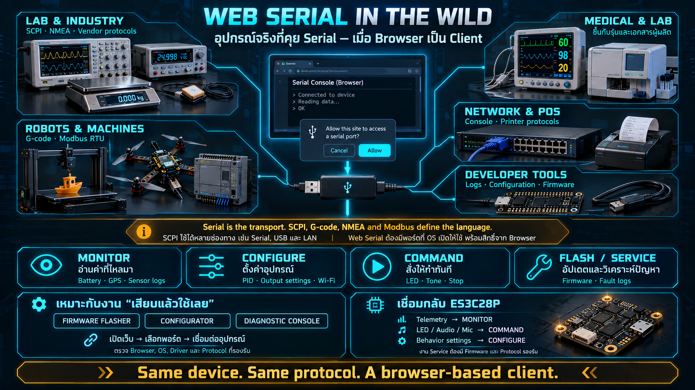

# Web Serial in the Wild



The previous lesson described a bidirectional byte pipe. This one answers a practical question: who still depends on that pipe? The answer is wider than microcontroller demos. Serial remains the service channel of instruments, medical devices, machines, and network equipment, which is why a browser API for it is a product tool and not a novelty.

## Why the pipe survived

- **It is the smallest thing that works.** Two devices can exchange data with a short, well-understood electrical and software contract. There is no association handshake, no IP address, and no access point.
- **It exists at every price.** A development board and a laboratory instrument that costs as much as a car can both present a serial port.
- **It is the channel that remains when the product is broken.** When the network stack, the radio, or the application firmware has failed, the port that still answers is usually serial. Factories and repair benches plan for that.
- **Devices that were never "connected products" still have a console.** The port is there for manufacturing, calibration, and service, even when the customer-facing interface is a screen or a button.

That last point is why Web Serial shows up in field tools. The technician is not integrating a platform. They are plugging into a port the machine already has, and they would rather not install a vendor utility to do it.

## Who actually speaks serial

### Laboratory and industrial instruments

- **Oscilloscopes, multimeters, power supplies, and signal generators** speak SCPI, a text command language carried over serial (and often over Ethernet or USB as well). You can identify the instrument, set a range, request a measurement, and pull a waveform. A command such as `*IDN?` asks for identity. `MEAS:VOLT:DC?` asks a meter for a voltage. The pipe is bytes; SCPI is the language.
- **Industrial scales, barcode and RFID readers, and flow meters** often emit readings as serial output and nothing else. The "API" is a line of text whenever the sensor has a new sample.
- **GPS modules** emit NMEA sentences, one line at a time: a latitude, a longitude, a time, a fix quality. `$GPGGA,...` is the classic example of telemetry that flows on its own. Nobody polls the sky. The module talks, and the host parses lines.

### Medical and laboratory equipment

Patient monitors, analyzers, and benchtop meters frequently expose a serial port so a hospital system or a service laptop can record readings. The equipment stays in service for decades. Serial is the dialect that still works across those decades, which is why integration projects keep meeting it. The application lesson is the same even when you never touch the regulated device itself: a long-lived machine publishes a stable byte language, and the software around it changes faster than the machine does.

### Robots and machine tools

- **3D printers** are the clearest everyday example. They consume G-code over serial. A line such as `G1 X10 Y20 F1200` is a motion command; a temperature line sets a heater. The host streams commands; the printer executes them and reports temperatures back.
- **CNC machines and laser cutters** use the same family of languages. The machine is larger. The pipe is not.
- **Drone flight controllers.** Configurators began as installable apps, including old Chrome Apps, and a generation of them now talk to the controller with Web Serial. The pilot plugs in, opens a page, and tunes the craft without matching an installer to an operating system.
- **PLCs and industrial controllers.** Modbus RTU on RS-232 or RS-485 is still a backbone in plants: a master reads registers and writes coils. The framing is binary and strict. The transport is still serial.

### Home and office machines

- **Routers, switches, and firewalls.** The console cable on the front of the equipment is a serial port. It is the path that still works when the network you are trying to fix is the thing that is down.
- **Receipt printers, cash drawers, and payment terminals.** Point-of-sale systems were built on serial long before they grew IP interfaces. A print job is a command stream. A drawer kick is a command.
- **Televisions, washers, and air conditioners.** A service port inside the chassis lets a technician read a fault log or load firmware. The customer never sees it. The repair manual assumes it.

### The developer's own bench

- **Arduino, ESP32, and a Raspberry Pi console.** The serial monitor is the first console every board has. Logs, a REPL, and crash output show up there before any radio is configured.
- **Flashing.** Loading new firmware onto a microcontroller has gone through a serial bootloader for years. The port is both the console and the recovery path.

## Pages that already use Web Serial in production

This is not a demo category. Shipping tools already depend on it:

- **In-browser firmware flashers.** The ESP Web Tools family lets a person plug in a board and flash firmware from a page, with no local toolchain. It is the cleanest demonstration of zero-install deployment: the tool is the URL, and the device is the USB port.
- **Drone and robot configurators.** Tuning tools have moved from desktop installers and retired Chrome Apps to pages that open the controller with Web Serial. The user does not check an operating-system matrix and does not keep an old installer around.
- **Vendor consoles and diagnostics.** Hardware companies ship a web console so a technician can plug in, read a log, and change a configuration immediately. The page replaces the native utility that used to ship on a USB stick.

The product pattern is consistent. Web Serial earns its place on jobs that are **"plug in and use it"**: flashers, configurators, consoles. The value is that the other person's computer does not need your software installed. It needs a Chromium browser and a cable.

## Four verbs a device offers over serial

A device on a serial pipe offers four kinds of work:

```
┌───────────────┐   ┌──────────────────┐   ┌───────────┐   ┌────────────────┐
│ monitor       │   │ configure        │   │ command   │   │ service        │
│ read a stream │   │ change a setting │   │ do it now │   │ flash / repair │
└───────────────┘   └──────────────────┘   └───────────┘   └────────────────┘
```

Across that range of machines, the traffic collapses into four verbs:

| Verb          | Meaning                                 | Examples                                                            |
| ------------- | --------------------------------------- | ------------------------------------------------------------------- |
| **Monitor**   | Read values the device emits on its own | A multimeter streaming readings, a GPS emitting fixes, a sensor log |
| **Configure** | Change a stored behavior                | A drone PID term, an instrument range, Wi-Fi credentials            |
| **Command**   | Make it do something now                | Print a receipt, stop a robot, enable an output                     |
| **Service**   | Replace firmware or repair              | Flash an image, read a fault log, enter a factory mode              |

Every monitor-and-control application in this week is the same four verbs, pointed at a smaller surface. You will monitor, configure, and command. Service — flashing and factory mode — stays on the firmware side of the course boundary. Recognizing the verbs is what lets you walk up to an unfamiliar serial device and ask the right question first: is this thing streaming, accepting settings, taking immediate orders, or waiting for a recovery tool?

## Back to the teaching board

The ES3C28P sits in the same pattern:

- Telemetry that flows on its own is **monitor**: battery, motion, sound level.
- Setting the LED, playing a tone, or enabling the microphone is **command**.
- Changing a stored behavior is **configure**.
- Firmware update and factory recovery are **service**, and they are outside this week's application work.

If you have used a meter, a point-of-sale device, or a flight controller over serial, you have already been the client in this conversation. The change in this course is that the client is a page.

## Checklist

| Question                              | You should be able to answer                                                                                 |
| ------------------------------------- | ------------------------------------------------------------------------------------------------------------ |
| Is serial still used?                 | Yes, at every scale: instruments, medical devices, robots, appliances, network gear, and development boards. |
| What language do instruments speak?   | SCPI, a text command language on serial. It is a real protocol, not a teaching fiction.                      |
| How does a 3D printer communicate?    | G-code, one line at a time, over serial.                                                                     |
| Do production pages use Web Serial?   | Yes. Flashers, configurators, and consoles ship as web tools.                                                |
| Which jobs fit Web Serial?            | Plug in and use it. The other computer should not need an install.                                           |
| What does a device offer over serial? | Four verbs: monitor, configure, command, and service.                                                        |
