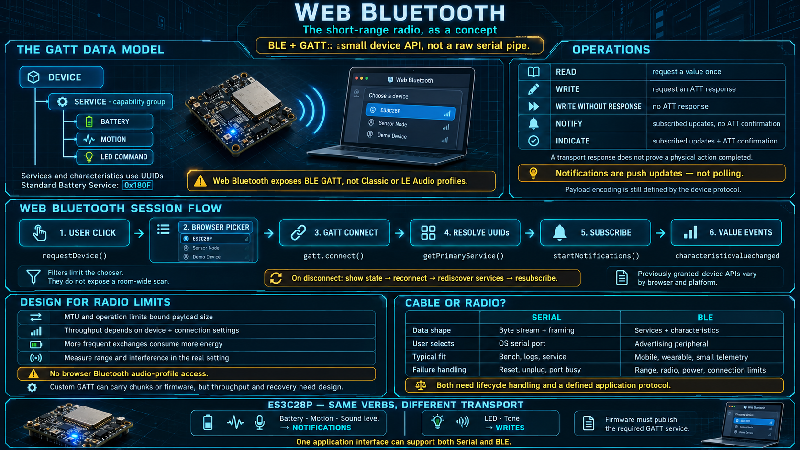

# Web Bluetooth — The Short-Range Radio, as a Concept



Web Bluetooth is not "Bluetooth, but in a page." It is a browser API for one specific radio protocol, Bluetooth Low Energy, and for one specific data model on top of it, GATT. This lesson builds that model. It assumes the teaching board's firmware will publish a BLE service the way a real product would. You are not writing that firmware here.

## BLE is not the Bluetooth you use for audio

Two protocols share the brand:

- **Bluetooth Classic** carries audio headsets, legacy serial profiles, and file transfer. It is older, heavier, and built for a sustained link with a comparatively large power budget.
- **Bluetooth Low Energy (BLE)** was designed so a small sensor can run for months or years on a coin cell. The trade is bandwidth. You get a low duty cycle and small payloads, not a pipe you can fill with audio or a file.

**Web Bluetooth speaks only BLE.** Classic profiles are not available to pages. That limitation matches the web's sandbox: BLE devices already present themselves as a small, discoverable API of named data points, which a browser can expose one permission at a time. A Classic audio link or a serial-port-profile cable does not fit that shape.

The ES3C28P has BLE in the hardware. Whether a page can use it depends on the firmware publishing a GATT server. This lesson treats that as given.

## GATT is the data model

Serial gave you a raw byte pipe and left framing to you. BLE does not hand you the pipe. It hands you a tree:

```
device
 └─ service              a group of related capabilities
     └─ characteristic   one data point inside that group
         operations: read, write, notify, indicate
```

- A **service** is a capability group. A device may expose a Battery Service, a Device Information Service, and one or more custom services that belong to the product. Each service has a UUID. Standard services use 16-bit UUIDs assigned by the Bluetooth SIG (`0x180F` is Battery). Custom services use 128-bit UUIDs that the product defines.
- A **characteristic** is a single data point inside a service: battery percent, a motion sample, an LED command. It also has a UUID. Its **properties** declare what a client may do.
- The operations you will actually use:
  - **Read** — the client asks for the current value once.
  - **Write** — the client sets a value and can wait for a response from the stack.
  - **Write without response** — the client sends a value and does not wait. Faster, and easier to overrun.
  - **Notify** — the client subscribes, and the device pushes a new value when it changes. This is the telemetry path.
  - **Indicate** — the same push, plus an acknowledgement that the value was received. Use it when a lost update matters more than the radio time.

Descriptors exist under a characteristic (the Client Characteristic Configuration Descriptor is what arms notifications). You rarely handle them by hand. `startNotifications()` does that for you.

The application mental model: **the device is a small API.** A service is a group of endpoints. A characteristic is one field. A notification is a subscription. You are not framing a byte stream. You are reading and writing named values, within the limits of the radio.

## Notify is a push, not a poll

This is the structural difference from serial:

- On serial, bytes arrive whenever the other side writes them. You learn that a message exists only by scanning the stream for a frame boundary you defined.
- On BLE, the application **subscribes to a characteristic**. The device pushes a new value when that value changes, or on a cadence the firmware chose. The page receives an event, the same way it receives a DOM event.
- You do not poll, and you do not ask "anything new?" on a timer. The value arrives because there was something to say.
- That shape fits telemetry. Battery changed: one notify. The motion sample updated: one notify. A threshold was crossed: one notify.

BLE is event-driven in the protocol. Serial becomes event-driven only after you build framing on top of the pipe. The application can still present both as subscriptions. The work to get there is different, and it belongs under the transport, not in the UI.

## How a wireless session actually starts

```
user presses a button (gesture)
  → requestDevice({ filters }) opens the browser picker
  → the browser shows peripherals whose advertisements match the filter
  → the user selects one
  → gatt.connect()
  → getPrimaryService / getCharacteristic for the UUIDs you need
  → startNotifications() on each characteristic you intend to follow
  → characteristicvaluechanged events arrive
  → the link drops on its own (range, interference, power saving)
  → the application reconnects, or it tells the user the link is gone
```

Compared with serial:

- **You do not name a port.** You filter on a service UUID or a name prefix. The peripheral is advertising that identity into the air. The picker is still the browser's. The filter only limits what the user is offered.
- **There is no single operating-system claim of the serial kind.** A peripheral still has a small connection budget. Many sensors accept one central at a time. "It did not show up" can mean it is already connected to a phone.
- **The link is more fragile than a cable.** Radio, distance, body shadowing, and the peripheral's own sleep policy all drop the connection. Disconnect is the common case. Reconnect is part of the design, including rediscovery when the grant alone is not enough to find the device again.

`watchAdvertisements` and `getDevices` can restore a previously granted peripheral without a fresh picker, subject to the same permission rules as any other hardware API. They do not let you scan the room in the background.

## Physical limits you have to design for

- **Throughput is small.** BLE is appropriate for short, frequent values. It is the wrong channel for a firmware image, a raw audio stream, or video. If the payload wants to be a file, use the cable or a network path.
- **Each transfer is size-limited.** The ATT MTU bounds how many bytes fit in one operation. Larger values are chunked by your protocol, or they fail. Design the payload as a small struct, not as a document.
- **The peripheral pays for every exchange.** Each connection interval, notification, and write costs energy on the coin cell or the small battery. A page that subscribes to everything, at the fastest interval, is a page that drains the device. Later lessons call this respect for the constrained side.
- **Range is a room, not a building.** Walls, Wi-Fi congestion on 2.4 GHz, and a body between the radio and the laptop all reduce a "ten meter" headline number to something smaller. Plan the product for the distance you measured, not the distance on the box.

Web Bluetooth exposes GATT only. Audio profiles exist in the Bluetooth specifications and are not available to the page. You cannot open a microphone stream or a speaker stream over Web Bluetooth. What you can receive is a value the device already computed: an audio level, or an event that the level crossed a threshold. If the product needs the raw sound, the channel is serial or a network service, not this API.

## The teaching board over BLE

Assume the firmware has published its service. From the page:

- The user picks the board in the browser chooser, the page connects, and it resolves the board's service.
- The same telemetry you would have read over serial — battery, motion, sound level — arrives as notifications. Each value has its own characteristic, so you are not scanning a byte stream for frame boundaries.
- The same commands go out as writes: set the LED, play a tone. Different pipe, same verbs.
- **One application can offer both Serial and BLE** if the transports sit behind one interface. That split is the subject of the application-anatomy lesson. Do not bake "we are on BLE" into the UI logic.

## Choosing between the cable and the radio

|                       | Serial (cable)                                  | BLE (radio)                                               |
| --------------------- | ----------------------------------------------- | --------------------------------------------------------- |
| Shape                 | A byte pipe. You frame it, or a library does.   | A tree of characteristics. The structure is the protocol. |
| How the user connects | Picks a port                                    | Picks a peripheral from advertisements                    |
| Bandwidth             | Higher. Suitable for logs and heavier payloads. | Lower. Small payloads only.                               |
| Stability             | A cable. It stays up until it is unplugged.     | A radio. Range and interference drop it.                  |
| Best context          | Bench, service, anything that can sit still     | Wearable, handheld, a device that must move               |
| Energy                | The link itself is not the battery cost         | Every notification spends the peripheral's battery        |

Neither one wins. They are two transports for two contexts. An application that treats them as interchangeable behind one interface can offer both without two products.

## Checklist

| Question                            | You should be able to answer                                                                          |
| ----------------------------------- | ----------------------------------------------------------------------------------------------------- |
| Does Web Bluetooth support Classic? | No. BLE only.                                                                                         |
| What is the BLE data model?         | Device, then service, then characteristic, with read, write, notify, and indicate.                    |
| How does telemetry arrive?          | Subscribe to a characteristic. The device pushes a notification when the value changes.               |
| How is that different from serial?  | You do not parse a raw pipe. You address named data points. Framing is the protocol's job, not yours. |
| When do you choose BLE?             | The device moves or is worn, the payload is small, and the product can tolerate disconnects.          |
| When do you choose serial?          | The payload is heavier, the device sits still, or you need the link to stay up.                       |
