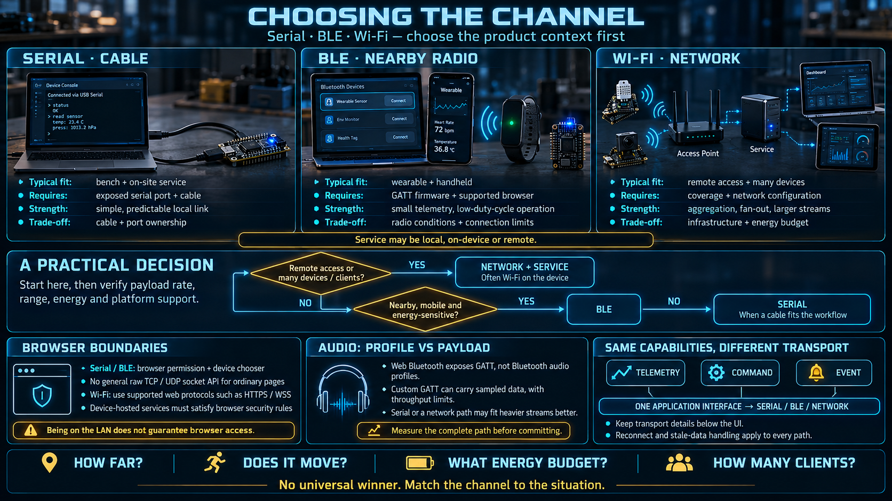

# Choosing the Channel — Serial, BLE, and Wi-Fi



You now have two direct channels: a cable, and a short-range radio. This lesson adds the third, which is the one that changes the shape of the system: **Wi-Fi, through a network**. The three are not substitutes. Each one was built for a different constraint, and the product context picks the channel before anyone picks a protocol.

## Three channels, three shapes

|                            | **Serial (cable)**                              | **BLE (short-range radio)**                 | **Wi-Fi (network)**                                    |
| -------------------------- | ----------------------------------------------- | ------------------------------------------- | ------------------------------------------------------ |
| Shape                      | Point to point, a direct pipe                   | Point to point, wireless                    | Through a network. Not a direct browser pipe.          |
| Range                      | The length of the cable, on the order of meters | On the order of ten meters, and walls count | Wherever the network reaches                           |
| Bandwidth                  | Enough for logs and moderate streams            | Low. Small payloads.                        | The highest of the three                               |
| Energy on the device       | Not the concern                                 | The most economical radio                   | The most expensive radio                               |
| What must already exist    | One cable                                       | The two devices near each other             | Infrastructure: an access point, and usually a service |
| Reach from far away        | No                                              | No                                          | **Yes. This is the difference that matters.**          |
| Many devices, one view     | One port, one owner                             | Typically one link at a time                | **Many devices, through a shared service**             |
| A heavy stream (raw audio) | Yes                                             | **No**                                      | Yes, if the path can carry it                          |

One constraint is specific enough to state on its own. Web Bluetooth exposes GATT — read, write, notify, indicate — and does not expose a BLE audio profile. **A page cannot carry raw audio over Web Bluetooth.** It can receive a value the device already reduced, such as a sound level or a "level crossed a threshold" event. Raw audio needs the cable, or Wi-Fi through a service that can carry a real stream.

The architectural constraint is the other half. **The Wi-Fi path is not the page opening a channel to the device.** A browser will not give a page a raw TCP or UDP socket onto a host on the LAN. Private-network and mixed-content rules exist specifically to stop a public origin from poking at addresses like `192.168.1.50` just because the user's laptop can route there. So "the board is on Wi-Fi" does not mean `fetch("http://the-board/")` is a supported design. It means the board talks to a network service, and the page talks to that service over HTTP or WebSocket. That service is the subject of the lesson on going beyond one device.

## The same job, three contexts

### A. A technician servicing a machine on site

- **Serial is the right default.** Plug into the service port, open the diagnostic page, read the log, change a setting. You do not need the customer's network, their credentials, or their access-point policy. This is why the port is still on the machine.
- BLE is possible when the machine advertises, and it is a poor fit in a plant full of identical machines and 2.4 GHz noise. "Which advertisement is the unit I am standing in front of?" becomes the product problem.
- Wi-Fi works when the machine is already on the LAN and you are allowed onto that LAN. It is not plug-and-use. It is join-the-network-and-use.

### B. A wearable or a handheld instrument syncing to a phone or a laptop

- Serial is not the product. Nobody plugs a cable into a watch for a routine sync.
- **BLE is the channel this situation was designed for.** The two devices are already on the same person. The payloads are small. The radio budget is the whole point.
- Wi-Fi spends too much energy for a device that has to last the day. Use it when the device is charging, or when it has to push a large payload and the battery can afford the spike.

### C. Watching sensors across a building, from an office

- Serial cannot reach a hundred points. You will not pull a console cable to each of them.
- BLE cannot either. The range is one room, and each link wants a nearby central.
- **Wi-Fi is the fit.** Every node is on one network. A service collects them. One dashboard shows all of them, from anywhere that network — or a VPN, or a cloud front — can be reached.

### D. A demo, a teaching bench, or active development

- **Serial is the fit.** It does not depend on radio quality, pairing state, or a DHCP lease. When the software misbehaves, the channel is the thing you can stop suspecting first.
- BLE and Wi-Fi add a connection procedure and a physical failure mode. Add them when the product needs them, not while you are still learning whether the command path works.

### E. A machine that moves through a warehouse or a field

- A cable does not survive motion.
- BLE does not survive the distance, and it will drop every time the machine turns a corner.
- **Wi-Fi is the fit**, provided the coverage is actually there. The machine publishes telemetry into a service as it moves. The page never holds the radio link.

## A decision you can apply without a matrix

```
Do you need remote reach, or many devices in one view?
   ├─ yes → Wi-Fi, through a service on the network
   └─ no  → Is it a single nearby device?
        ├─ it moves, or it is worn, and energy matters → BLE
        └─ it can sit still and be plugged in,
           and you want the link to stay up          → Serial
```

Three questions decide almost every case: **How far? Does it move? Who pays for the radio?**

A fourth question appears as soon as more than one person must watch: **How many clients?** Point-to-point answers "one." A service answers "many." That question is why the Wi-Fi row is not just a longer cable.

## What the comparison is actually saying

- **There is no best channel.** Serial is the bench and service tool. BLE is the personal, mobile, low-energy tool. Wi-Fi is coverage, remote reach, and fan-out. Picking one "for the platform" is how products grow a channel they cannot power or cannot reach.
- **The user does not choose a protocol.** They choose a situation: on the bench, in a pocket, across a site. The channel is the consequence of that situation. If the settings screen asks the user to pick "GATT versus CDC," the product has leaked its transport.
- **The costs are not interchangeable.** Serial is cheap and simple, and it ties you to one cable. BLE spends the least energy and moves the least data. Wi-Fi buys range and device count, and it demands a network plus the largest radio budget.
- **A capable device exposes more than one.** The teaching board has USB serial, BLE, and Wi-Fi. Supporting all three is not indecision. It is how the same capability surface — telemetry, command, event — survives a change of context. The application selects a transport. It does not grow a second product.

## How this connects

The previous two lessons went down into the cable and the radio. This lesson adds the network and the rule for choosing. The next lesson stays above all three: whatever the channel, the conversation is still telemetry, command, and event, because those words name the work and not the pipe. The Wi-Fi row is also the preview of the last architectural step in the week. When one page and one nearby device are no longer enough, the path goes through a service.

## Checklist

| Question                                        | You should be able to answer                                                                                                |
| ----------------------------------------------- | --------------------------------------------------------------------------------------------------------------------------- |
| Remote reach, or many devices at once?          | Wi-Fi through a network service. Serial and BLE cannot do that job.                                                         |
| Mobile, and the battery matters?                | BLE.                                                                                                                        |
| Most stable, on site or on the bench?           | Serial.                                                                                                                     |
| How is the Wi-Fi path different?                | It is not point to point from the page. The page speaks to a service. The browser will not open a raw socket to the device. |
| Which three questions decide?                   | How far, does it move, and who pays for the radio.                                                                          |
| How many channels should a serious device have? | More than one. Choose per situation. The capability surface stays the same.                                                 |
